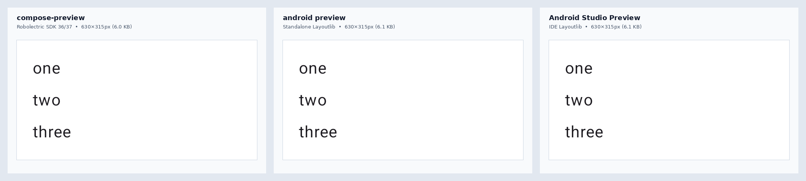
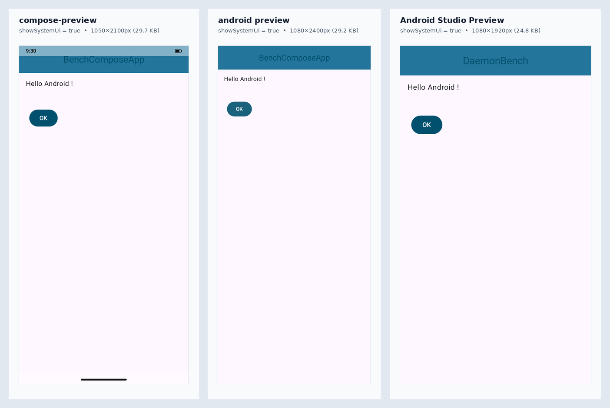

# Compose Preview Benchmarks

End-to-end performance, memory, visual fidelity, structural inspection, and reliability measurements across the three Compose `@Preview` toolchains available to developers and coding agents:

1. **`compose-preview` (`compose-ai-tools` `2.90.1-SNAPSHOT` / [#6521](https://github.com/yschimke/compose-ai-tools/pull/6521) + [`compose-preview-daemon`](https://github.com/yschimke/compose-preview-daemon) `3.27.7`)** — measured both through the one-shot Gradle-backed CLI (`compose-preview list` / `show` / `a11y` / `render --format svg`) and through its persistent JSON-RPC **Render Daemon + Stage-2 Kotlin Build Tools API (BTA)** hot-swap inner loop.
2. **Google Android CLI — `android preview` (`1.1.16717390`)** — standalone Layoutlib CLI (`com.android.screenshot.cli`), measured in both default one-shot mode and `--daemon` mode (`--component-tree`, `--no-image`).
3. **Android Studio Preview — `android studio render-compose-preview` (`Rabbit 3 | 2026.2.3 RC 1`, build `AI-262.10968.63.2623.16898116`)** — gRPC CLI driving a live Android Studio Preview IDE instance running under Xvfb (`1920×1080×24`).

> [!IMPORTANT]
> **Headline takeaway:** For a single cold/clean one-shot CLI render with no persistent daemon, `android preview` is **1.39× faster** than `compose-preview show` (`22.27 s` vs `30.86 s` for 6 previews) because standalone Layoutlib avoids unit-test compilation and Robolectric sandbox boot. In every warm and iterative workflow, **`compose-preview` wins decisively**: warm cached CLI checks are **3.3× faster** than non-daemon `android preview`, and in persistent daemon mode (`3.27.7`), `compose-preview` renders a single preview in **`317–365 ms`** (**8.5×–9.8× faster** than `android preview --daemon` at `3,107 ms`, and **6.1×–7.0× faster** than warm Android Studio at `2,227 ms`), turns a **1-line Kotlin edit into a verified fresh pixel in `965 ms` median (`752 ms` min)** (**4.2× faster** than `android preview --daemon` at `4,054 ms`, and **13.8× faster** than `android studio render-compose-preview` at `13,336 ms`), and fetches semantics in **`2.7 ms`** (**720×–1,040× faster** than both alternatives) at **2.8×–8.7× lower RAM** than Android Studio.

---

## 1. Benchmark environment & workload

| Dimension | Specification |
| --- | --- |
| **Host environment** | Linux Debian 12 VM (`2 vCPUs`, `7.95 GiB RAM`), OpenJDK `21.0.10` (`JAVA_HOME`), Kotlin toolchain `17` |
| **`compose-preview`** | `compose-ai-tools` `f06dc91` ([#6521](https://github.com/yschimke/compose-ai-tools/pull/6521)) · CLI `2.90.1-SNAPSHOT` · `compose-preview-android-daemon` `3.27.7` · Robolectric SDK `36`/`37` |
| **`android preview`** | Google Android CLI `1.1.16717390` |
| **`android studio`** | Android Studio Preview `Rabbit 3 \| 2026.2.3 RC 1` (`AI-262.10968.63.2623.16898116`), bundled JBR 21, `-Xmx2304m`, `-Dcaches.indexerThreadsCount=2`, Xvfb `:99` |
| **Target app** | Zero-config Android app generated via `android create empty-activity` (`AGP 9.0.1`, `Gradle 9.1.0`, `Kotlin 2.3.20`, `compileSdk = 37`, Compose BOM `2026.03.01`, Navigation3 + Material 3) |
| **6 `@Preview` workload** | The 5 canonical `@Preview` composables from [`BenchPreviews.kt`](../samples/android-daemon-bench/src/main/kotlin/com/example/daemonbench/BenchPreviews.kt) (`RedSquarePreview`, `BlueLabelPreview`, `GreenButtonPreview`, `StackPreview`, `RowPreview`) + the generated template's full-screen Material 3 `@Preview(showSystemUi = true)` (`MainScreenPreview`: `Scaffold` + `CenterAlignedTopAppBar` + `Button`) |
| **Measurement protocol** | Cold runs stop all Gradle/preview/Studio JVMs and clean `build/` first (`n = 1`); warm runs prime caches and report **median `[min – max]` over `n = 3` repetitions**. Edit-loop runs mutate a literal token on disk and verify the fresh token in rendered semantics before stopping the clock. Memory sums `/proc/<pid>/status` `VmRSS` across all resident tool JVMs. |

---

## 2. End-to-end latency comparison

```mermaid
xychart-beta
    title "Warm Inner-Loop Latency (ms, lower is better)"
    x-axis ["No-Edit (1)", "No-Edit (All 6)", "1-Line Edit (1)", "1-Line Edit (All 6)", "Semantics / Tree"]
    y-axis "Wall-clock Latency (ms)" 0 --> 14500
    bar [365, 2000, 965, 2269, 3]
    bar [3107, 6186, 4054, 6990, 2807]
    bar [2227, 13658, 13336, 13658, 1945]
```

*Bars left-to-right per group: **`compose-preview` Render Daemon (`3.27.7`)**, **`android preview --daemon` (`1.1.16717390`)**, **`android studio render-compose-preview` (`2026.2.3 RC 1`)**. `android studio` has no multi-preview edit batching command, so bar 4 shows its warm 6-preview sequential render floor without compile.*

### Master latency table (wall-clock ms)

| Scenario | `compose-preview` CLI (One-Shot) | `compose-preview` Daemon + BTA (`3.27.7`) | `android preview` (Non-Daemon) | `android preview --daemon` | `android studio render-compose-preview` | Fastest |
| --- | ---: | ---: | ---: | ---: | ---: | --- |
| **Cold boot / clean discovery (`list`)** | `16,380 ms` | `4,119 ms` *(daemon init + discover)* | `9,780 ms` | — | *No `list` command* | **`compose-preview` Daemon (`4.12 s`)** |
| **Warm discovery (`list`)** | `3,635 ms` | `< 5 ms` *(in-memory)* | `2,138 ms` | — | *No `list` command* | **`compose-preview` Daemon** (`android preview` 1.7× faster CLI) |
| **Truly cold start → first render(s)** | `30,864 ms` *(all 6)* | `8,005 ms` *(init + 1st)* | `22,273 ms` *(all 6)* | `9,782 ms` *(1st boot + 1)* | `281,052 ms` *(cold index + 1st)* `88,954 ms` *(warm caches + 1st)* | **`android preview`** *(cold 6-preview CLI: 1.39× faster)* |
| **Clean `build/` + warm Gradle (1 preview)** | `13,938 ms` | — | `9,692 ms` | — | — | **`android preview` (`1.44×`)** |
| **Clean `build/` + warm Gradle (all 6)** | `16,216 ms` | — | `14,584 ms` | — | — | **`android preview` (`1.11×`)** |
| **Warm no-edit render (1 preview)** | `3,790 ms` *(UP-TO-DATE)* | **`365.1 ms`** *(full)* **`316.7 ms`** *(fast)* | `8,939 ms` | `3,107 ms` | `2,227 ms` *(warm)* `2,385 ms` *(post-cold)* | **`compose-preview` Daemon (`6.1×–9.8×` faster)** |
| **Warm no-edit render (all 6 previews)** | `3,739 ms` *(UP-TO-DATE)* | **`2,000 ms`** *(`333 ms`/ea)* | `12,352 ms` | `6,186 ms` | `13,658 ms` *(6 seq calls)* **DEADLOCK** *(6 parallel)* | **`compose-preview` Daemon (`3.1×–6.8×` faster)** |
| **Warm 1-line edit → fresh pixel (1 preview)** | `16,180 ms` | **`964.6 ms`** *(`751.9 ms` min)* | `11,326 ms` | `4,054 ms` | `13,336 ms` *(2–3 polls req'd)* | **`compose-preview` Daemon (`4.2×–13.8×` faster)** |
| **Warm 1-line edit → fresh pixel (all 6)** | `18,242 ms` | **`2,269 ms`** *(`283 ms` BTA + `1,959 ms` render)* | `13,671 ms` | `6,990 ms` | *Single-composable CLI only* | **`compose-preview` Daemon (`3.1×` faster)** |
| **Cross-file M3 edit → fresh pixel (`MainScreen.kt`)** | — | **`1,238 ms`** *(`338 ms` BTA)* | — | — | — | **Verified on daemon `3.27.7`** |
| **Semantics / component tree only (1 preview)** | — | **`2.7 ms`** *(`data/fetch`)* | — | `2,807 ms` *(`--no-image`)* | `1,945 ms` *(`--print-semantics`)* | **`compose-preview` Daemon (`720×–1,040×` faster)** |
| **ATF accessibility audit (`a11y`, all 6)** | `31,235 ms` | *(via `data/fetch`)* | *Unsupported* | *Unsupported* | *Unsupported via CLI* | **`compose-preview` only** |
| **Figma vector SVG export (`StackPreview`)** | `29,675 ms` | *(via `data/fetch`)* | *Unsupported* | *Unsupported* | *Unsupported* | **`compose-preview` only** |

---

## 3. Stage-2 in-process Kotlin BTA inner loop (`compose-preview-daemon` `3.27.7`)

[#6521](https://github.com/yschimke/compose-ai-tools/pull/6521) updated `compose-preview-daemon` to `3.27.7` (ordering the module's own compiled output ahead of external JARs so in-daemon Kotlin BTA compilation resolves same-module declarations alongside Android and Material 3 dependencies) and added the [`:samples:android-daemon-bench:benchWarmEditLoop`](../samples/android-daemon-bench/README.md) CI gate.

### Live zero-config app Stage-2 breakdown

Measured over LSP-framed JSON-RPC against `compose-preview-android-daemon-3.27.7` on the 6-preview Material 3 app (after `compileWarmUp`: `11,546 ms` across 15 passes):

| Stage-2 edit scenario | BTA `compileSources` median | Sandbox `renderNow` median | Total save-to-pixel median `[runs]` | Semantics token verified |
| --- | ---: | ---: | ---: | :---: |
| **1-line edit (`BenchPreviews.kt` → `StackPreview`)** | `478 ms` | `491 ms` *(270 ms min)* | **`964.6 ms`** `[751.9, 1690.2, 964.6]` | Yes |
| **1-line edit (`BenchPreviews.kt` → all 6 previews)** | **`283 ms`** `[283, 309, 269]` | `1,959 ms` | **`2,269.2 ms`** `[2444.2, 2269.2, 2224.3]` | Yes |
| **Cross-file M3 edit (`MainScreen.kt` → `MainScreenPreview`)** | **`338 ms`** `[1084, 313, 338]` | `811 ms` | **`1,238.0 ms`** `[1895.7, 1049.5, 1238.0]` | Yes |

Two properties stand out:
1. **Sub-300 ms in-daemon Kotlin + Compose IR compilation**: Once JIT-warmed, `compileSources` compiles `BenchPreviews.kt` in **`269–309 ms`** and `MainScreen.kt` (referencing `MainScreenViewModel`, `DefaultDataRepository`, `NavKey`, and Material 3 `Scaffold`/`CenterAlignedTopAppBar`) in **`313–338 ms`** without invoking Gradle.
2. **`:samples:android-daemon-bench:benchWarmEditLoop` gate**: Running the gating harness on the same 2-vCPU VM (`47` warm-up passes in `14,807 ms`) clocked cycles 1–6 at `158/119 ms`, `78/72 ms`, `77/72 ms`, `88/81 ms`, `103/99 ms`, and **`70/61 ms`** — a **`78 ms` wall-clock median (`72 ms` daemon-side)** against the `2,500 ms` gate budget.

---

## 4. Memory footprint comparison (resident set size)

| Engine & mode | Resident processes | Idle / warm post-render RSS | Peak RSS during edit + render |
| --- | --- | ---: | ---: |
| **`android preview` (non-daemon, no-edit)** | 1 JVM (Gradle daemon w/ Layoutlib) | `398.5 MiB` | `502.0 MiB` |
| **`compose-preview` Render Daemon (`3.27.7`, render only)** | Daemon + 1 held Robolectric sandbox | `537.5 MiB` *(344.9 MiB pre-render)* | `537.5 MiB` |
| **`compose-preview` CLI (warm no-edit)** | 1 JVM (Gradle daemon) | `687.6 MiB` | `1,649.9 MiB` |
| **`android preview --daemon` (edit + render)** | 2 JVMs (`GradleDaemon` `431 MiB` + `KotlinCompileDaemon` `950 MiB`) | `1,380.0 MiB` | `1,511.5 MiB` |
| **`compose-preview` Daemon + warm BTA (`3.27.7`)** | Daemon + Robolectric sandbox + warm in-process Kotlin BTA | `1,275.8 MiB` | `1,642.4 MiB` |
| **`compose-preview` CLI (1-line edit via Gradle)** | 2 JVMs (Gradle + Kotlin daemon + test worker) | `1,745.6 MiB` | `2,735.7 MiB` |
| **Android Studio Preview (`2026.2.3 RC 1`)** | Studio IDE (`3,982 MiB`) + Gradle daemon (`572 MiB`) + `Xvfb` (`81 MiB`) | `4,150.6 MiB` *(2,579.9 MiB pre-render)* | **`4,651.0 MiB`** |

---

## 5. Visual rendering fidelity

See also [`STUDIO_PARITY.md`](STUDIO_PARITY.md) for the continuous CI parity gate against Layoutlib references.

### Component preview (`StackPreview`, `widthDp = 240`, `420 dpi`)

- **Dimensions**: Identical **`630 × 315 px`** across all three engines.
- **Pixel comparison**:
  - `android preview` vs `Android Studio Preview`: **`0.000` / 255 mean RGB difference** (byte-for-byte identical `6,203`-byte PNGs; both execute Layoutlib).
  - `compose-preview` (Robolectric SDK 36/37 native Skia/HWUI) vs Layoutlib: **`0.017` / 255 mean RGB difference** (**`99.993%` identical**, differing only in sub-pixel font antialiasing).

### Full-screen system UI preview (`MainScreenPreview`, `@Preview(showSystemUi = true)`)

*(Note: `<string name="app_name">` was `"BenchComposeApp"` during the CLI suites and `"DaemonBench"` when the template project was recreated for the Studio suite; the composable code, theme, and `@Preview(showSystemUi = true)` annotation are identical.)*

When `showSystemUi = true` is set without an explicit `device` string:
1. **System UI chrome (`statusBar` & `navigationBar`)**:
   - **`compose-preview`** is the **only tool that draws system UI chrome** in exported PNGs: a `9:30` clock, battery icon, and bottom gesture navigation pill (`1050 × 2100 px`).
   - **Both `android preview` (`1080 × 2400 px`) and `android studio render-compose-preview` (`1080 × 1920 px`) omit status-bar and navigation-bar chrome** even when `showSystemUi = true` is requested.
2. **Top inset handling (`WindowInsets.statusBars`)**:
   - `android preview` and `Android Studio Preview` apply status-bar top inset padding inside `CenterAlignedTopAppBar` (leaving blank inset space above the title where the status bar would sit).
   - `compose-preview` composites the translucent status-bar band at the top while `CenterAlignedTopAppBar`'s title renders near the top edge beneath the status-bar overlay.

---

## 6. Semantics, component tree & agent ergonomics

Token-cost implications of structural inspection versus reading PNGs are detailed in [`TOKEN_USAGE.md`](TOKEN_USAGE.md).

| Tool | Flag / RPC | Latency | Format & fidelity |
| --- | --- | ---: | --- |
| **`compose-preview` Daemon** | `data/fetch` (`compose/semantics`, `compose/layout-inspector`, `fonts/used`, …) | **`2.7 ms`** *(cached frame, no re-render)* | Structured JSON for **both** Compose accessibility semantics and full slot-table Layout Inspector (composable names, modifiers, bounds, source file/line, resolved fonts), plus Google ATF `a11y` audits (`ContrastCheck`, `TouchTargetSizeCheck`, `SpeakableTextPresentCheck`) and `1.0 KB` layered vector SVG (`--format svg`). |
| **`android preview`** | `--component-tree [--no-image]` | `2,806.7 ms` *(re-executes Layoutlib)* | Writes sidecar JSON (`7.8 KB` for `StackPreview`) with Compose component hierarchy (`MaterialTheme` → `Surface` → `Column` → `Text`), pixel `bounds`, and `sourceLocation` (`fileName`, `lineNumber`, `packageHash`). No accessibility check audit. |
| **`android studio`** | `--print-semantics` | `1,944.9 ms` *(re-executes render)* | Plain-text pseudo-View dump on `stdout`: `ComposeViewAdapter` → `ComposeView` → `View` → `TextView (left: 42, top: 42, ...) text="one"`. No JSON output, no composable names, and no source line numbers. |

---

## 7. Reliability & UX findings in `android preview` and `android studio`

> [!WARNING]
> Five concrete reliability and agent-ergonomics pitfalls surfaced when driving Google's `android preview` (`1.1.16717390`) and `android studio` (`2026.2.3 RC 1`) CLIs headlessly:

1. **Stale-read race on external file edits (`android studio render-compose-preview`)**: When an agent edits a `.kt` file on disk and immediately invokes `android studio render-compose-preview`, **the first call (`1.96–3.78 s`) succeeds with exit code `0` while returning stale pixels and stale semantics** because the RPC does not await IntelliJ VFS refresh + Fast Preview background compilation. Across all 3 trials, `2–3` polling attempts (`10.94–15.09 s`, median **`13.34 s`**) were required before the edited token appeared. By contrast, `compose-preview`'s `compileSources` → `renderNow` pipeline is strictly causal (`100%` fresh on attempt 1 in **`965 ms`**).
2. **6-way concurrent RPC deadlock (`android studio render-compose-preview`)**: Because `render-compose-preview` accepts only a single `<path> <composable>` per invocation, callers naturally parallelize multi-preview renders. Issuing 6 concurrent `render-compose-preview` calls (`ThreadPoolExecutor(max_workers=6)`) **deadlocked Studio's preview render service for `> 240 s` (`0/6` completed)**, whereas sequential calls completed in `13.66 s` (`compose-preview` batches all 6 natively in `2.00 s`).
3. **Premature `READY` status in `android studio check`**: `android studio check` reports `READY` ~12–20 s after Studio startup (as soon as initial startup dumb-mode clears), **60–70 seconds before `GradleSyncStateHolder` and `UnindexedFilesIndexer` finish**. Calling `render-compose-preview` right after `READY` fails repeatedly with `Error: Failed to obtain RenderResult.` and `Error: Failed to get module.`.
4. **Uncaught crash in `android studio check` after unclean Studio exit**: If any Studio instance exits uncleanly, `~/.android/cli/studio/<dead-pid>` remains on disk; `ClientManager.checkAll()` throws an unhandled `io.grpc.StatusRuntimeException: UNAVAILABLE: Connection refused` instead of pruning dead sockets, breaking `android studio check` even when another healthy Studio process is running.
5. **Mandatory `--fqn` boilerplate in `android preview render`**: Running `android preview render :app` without `--fqn` fails (`At least one --fqn must be specified`), forcing callers to run a `2.1–9.8 s` `android preview list :app` pass first and construct `--fqn=...` flags. `compose-preview show` renders matching previews directly (`--filter`, `--function`, `--file`, or module-wide) and tracks SHA-256 `changed: true/false` diffs per capture.

---

## 8. Capability matrix

| Capability | `compose-preview` (`compose-ai-tools` + Daemon `3.27.7`) | `android preview` (`1.1.16717390`) | `android studio render-compose-preview` (`2026.2.3 RC 1`) |
| --- | :---: | :---: | :---: |
| **Zero-config Android project support** | Yes (Gradle init script) | Yes (built-in Layoutlib runner) | Requires full IDE + Gradle sync + indexing |
| **Headless CI / cloud sandbox friendly** | Yes (pure JVM, zero X11) | Yes (pure JVM, zero X11) | Requires Xvfb/GUI + `4.65 GiB` RSS + modal suppression |
| **Compose Multiplatform Desktop (`ImageComposeScene`)** | **Yes** | No (Android only) | Partial (IDE UI; CLI Android-focused) |
| **Compose XR spatial previews (`xr-composite`)** | **Yes** | No | Separate Studio XR UI only |
| **Activity previews (`activity__MainActivity`)** | **Yes** (auto-discovered) | No (`@Preview` functions only) | No (`@Preview` functions only) |
| **Sub-second edit-to-pixel loop** | **Yes (`965 ms` median, `752 ms` min)** | No (`4,054 ms` w/ `--daemon`) | No (`13,336 ms`, stale on 1st call) |
| **Causal freshness guarantee after disk edit** | **Yes (`compileSources` → `renderNow`)** | Yes (Gradle task graph) | **No** (returns stale render while Live Edit runs) |
| **Multi-preview batch rendering** | **Yes (`2.00 s` for 6)** | Yes (`6.19 s` for 6 w/ `--daemon`) | **No** (`13.66 s` seq; deadlocks in parallel) |
| **Cached semantics / layout tree without re-render** | **Yes (`2.7 ms` JSON)** | No (`2,807 ms` sidecar JSON) | No (`1,945 ms` plain text) |
| **ATF accessibility audit (`a11y`)** | **Yes** | No | Not via CLI |
| **Vector SVG / Figma export & interactive MCP server** | **Yes** (`--format svg`, `compose-preview-mcp`) | No | Built-in Studio MCP (separate from CLI) |

---

## 9. When to use which tool

- **Interactive coding agents, MCP workflows, CI diffs, Multiplatform/XR & design audits → `compose-preview` (with Render Daemon `3.27.7`+)**: Best inner-loop speed (`317–365 ms` warm render, `965 ms` 1-line edit-to-pixel, `2.7 ms` semantics fetch), causal freshness after edits, SHA-based change tracking, `showSystemUi` chrome rendering, ATF accessibility checks, SVG export, and moderate memory (`538 MiB` render-only / `1.28 GiB` with warm BTA).
- **Single cold one-shot screenshot on a machine with no daemon running → `android preview`**: `1.39×–1.44×` faster cold/clean startup (`9.7 s` single, `22.3 s` for 6) and a `502 MiB` non-daemon footprint when you already know the exact `--fqn` and only need a PNG + component-tree JSON once.
- **Developer already actively editing inside Android Studio on a desktop workstation → `android studio render-compose-preview`**: Convenient when the `4.65 GiB` IDE is already open locally, provided callers invoke it **sequentially** (never concurrently) and **wait/poll after disk writes** so Fast Preview finishes recompiling before reading the rendered output.
