# Running an APK in the Robolectric simulator

`compose-preview launch <app.apk>` runs an Android app in Robolectric's simulator: a desktop
window showing the app, driven by mouse and keyboard, or — with `--control stdio` — a JSON-lines
control channel an agent drives instead. No emulator, no device, no `adb`.

```
compose-preview launch app-debug.apk                               # a window
compose-preview launch app-debug.apk --control stdio               # a window an agent drives
compose-preview launch app-debug.apk --control stdio --headless    # the agent, no window
compose-preview launch app-debug.apk --prepare                     # convert and cache only
compose-preview launch phone.apk --pair wear.apk --control stdio   # a phone and its watch, paired
compose-preview launch app-debug.apk --display 1280x720,name=TV    # with an external display
compose-preview launch app-debug.apk --launcher                    # over a home screen, with widgets
```

With `--control stdio` the window stays up, so a person can watch the agent work: every tap
the agent sends is drawn as a ring (filled for a long press), every swipe as a trail, and the
command along the bottom of the window and in its title. The overlay lives on the Swing window's
glass pane, not in the Android display, so the agent's own screenshots never contain it, and the
person's clicks still reach the app. `--hide-agent` turns it off; `--headless` drops the window
(the default when there is no display, as in CI or a cloud sandbox).

It needs Java 21+ for the simulator JVM (`--java <jdk>`, or `COMPOSE_PREVIEW_SIMULATOR_JAVA`; the
CLI itself still runs on 17) and an Android SDK platform's `android.jar` (`ANDROID_HOME`, or
`local.properties` `sdk.dir`).

## What Robolectric already has

Robolectric ships the window half itself: the `simulator` module (beta since 4.15, on both
`master` and `google`, published as `org.robolectric:simulator`) and a `simulator-gradle-plugin`
that adds a `simulate<Variant>` task to an app module. `SimulatorMain <apk> [extra jars]` builds a
sandbox, loads the APK as its *resource* APK, starts the launcher activity, and runs a loop that
paints `UiAutomation.takeScreenshot()` into a Swing panel and turns mouse and keys into injected
events. Its `pluginapi.RemoteControl` (found by `ServiceLoader`, ranked by `@Priority`) is called on
every loop turn, on the main thread — the hook this command builds on.

What it does not do, and this command adds:

- **Read code from an APK.** The APK supplies resources and the binary manifest only; the
  Gradle plugin passes the unit-test classpath as JVM classes. Here the APK's dex is converted.
- **Navigate.** Under Robolectric `startActivity` / `startService` are recorded, not acted on, so a
  simulated app stops at its first screen.
- **Remote control.** The default `RemoteControl` is a no-op; Google's internal one is not
  published.

## How it works

```
compose-preview launch app.apk
 ├─ ApkClassConverter (own JVM, lib-dex2jar/)      APK dex ─► classes.jar   [cached by APK sha256]
 └─ simulator JVM (Java 21+)
     classpath: lib-simulator/  (Robolectric simulator + :simulator-host)
                lib-daemon-android/  (Robolectric 4.x + native graphics; the Android daemon sidecar)
                android.jar
     LaunchMain ─► SimulatorMain app.apk classes.jar
                     └─ SimulatorControl (RemoteControl)
                          ├─ Navigator   app startActivity/startService/stopService → real lifecycle
                          └─ Session     --control stdio commands
```

**Converting dex.** `ApkClassConverter` runs [dex2jar](https://github.com/ThexXTURBOXx/dex2jar)
over every `classes*.dex`, with two repairs of its own:

- an integer comparison with the zero on the left (`if-le 0, x`) is mirrored before code
  generation, which dex2jar gets backwards: it loads `x` and keeps the operator, so `0 <= x`
  became `x <= 0`. Compose's `MutableVector.contains` has that shape, and Now in Android's UI froze
  on the `ArrayIndexOutOfBoundsException` that followed;
- a class dex2jar cannot translate with debug info is translated again without it (Now in
  Android has one).

Then an ASM pass makes the output acceptable to a *verifying* JVM:

- static and private interface calls become interface method references (dex does not record the
  owner's kind, so dex2jar writes class `Methodref`s, which fail every Kotlin `$default` call with
  `IncompatibleClassChangeError`);
- stack-map frames and `max_stack` are computed from scratch, resolving supertypes from the APK,
  then `android.jar`, then the JDK. dex2jar writes no frames and undercounts `max_stack` around
  exception handlers; with verification simply switched off, the first GC that builds an oop map
  for such a frame crashes the JVM;
- protected members become public. The JVM lets another package's subclass reach a protected
  member only through its own type, ART does not check, and shrunk code (Play Services') relies
  on it.

On the sample app that is 21,870 classes, 1,818 interface calls fixed, 0 failed methods, in about
40 seconds; ASM's `BasicVerifier` passes every one of its 142,691 methods.

The converter reads and translates one class at a time, keeping only the class-level facts
(inner-class annotations, then each class's header) for the rest, and runs on a 1 GB serial heap,
retried once on 3 GB if that runs out. dex2jar's own driver reads the whole APK into one tree
first: Home Assistant needed 3.8 GB, and now converts in under 1 GB.

**The cache** lives under `<cache>/composeai/simulator/<apk sha256>/<converter stamp>/`. The APK is
keyed by content. The stamp covers the converter's own classes and the shared-library classes in
the simulator host jar, dex2jar and the platform jar — not the rest of the simulator, so a change to
`Navigator` does not reconvert every APK. A cache hit takes about 0.25 s, and a launch from a warm
cache reaches its first frame in about 7 seconds.

A rebuilt APK converts incrementally. Beside each `classes.jar` the converter writes
`classes.jar.index`: per class, a digest of its smali (instructions, constants, annotations and
debug info, with names resolved, so it does not shift when another class adds a string to the dex)
and of the inner-class facts it takes from other classes, and every supertype lookup its frames
were computed from. Converting the next build of the same APK path copies each class whose digest
matches and whose lookups still resolve the same way, and translates the rest. Per class, not per
`classesN.dex`, because D8 reshuffles dex files between builds. A three-class edit to Now in Android
reconverts in 31 s instead of 115 s.

Pruning never deletes an entry that a conversion holds (`<sha>.lock`) or a running simulator uses
(`<sha>.inuse`, a shared lock each launch holds): after a conversion the earlier build of the same
path is removed, the APK's other converter stamps go, and then the least recently used APKs beyond
eight or 2 GB.

**Navigation.** `Navigator` drains Robolectric's recorded intents every loop turn and does what the
system would: activities go onto a back stack through `ActivityController` (the one below is paused
and stopped, so its window is neither drawn nor touchable), `setResult` reaches a
`startActivityForResult` caller, `CLEAR_TOP` / `SINGLE_TOP` / `CLEAR_TASK` are honored, a finished
activity resumes the one below, and services are created, started, bound and destroyed through
`ServiceController` (including `stopSelf`). The launcher activity takes the same path, so the stack
has one owner. A stopped activity's dialogs and bottom sheets are hidden with it. The app's own
explicit `sendBroadcast` (a component or package named) reaches its manifest receivers too, on the
main thread, as a device delivers it; Robolectric delivers an app's broadcasts to runtime receivers
alone, which is also all an implicit one reaches on a device since API 26.

**Startup** follows a device's order, through a Robolectric test environment of our own: the
manifest's content providers are created after `attachBaseContext()` and before
`Application.onCreate()`, so `androidx.startup` (WorkManager, OkHttp's platform) is ready when
`onCreate()` uses it. Before that, three things a device has and Robolectric does not are filled in:

- the manifest's `appComponentFactory`, which Robolectric reads from a source manifest and finds
  unset in an APK, comes from the framework's parse of the APK. The application, its content
  providers, and every activity, service and manifest receiver `Navigator` creates are built
  through that factory, as dependency-injected apps need (Cadence's Metro factory constructs its
  activities);
- the process name, unset for an APK too, defaults to the package as on a device: WorkManager
  compares it with its own to decide it may run work at all;
- a launcher declared as an `<activity-alias>` starts its `targetActivity`;
- a validated Wi-Fi network (or what `launch --network` names): `ConnectivityManager` answers
  from the simulator's own network model and each registered `NetworkCallback` is told what a
  device would tell it, so offline banners clear and `CONNECTED` work runs (see
  [Network, Wi-Fi and Bluetooth](#network-wi-fi-and-bluetooth));
- a binder for every manifest service, so the app's own `bindService` connects; the service is
  created and bound when the app first calls the binder. Robolectric matches a bind by its whole
  intent, so each bind's own intent is registered as the app makes it, resolved by component as
  on a device (Firebase Sessions binds with an action of `"0"`).

**Classes** come from the APK first, except Guava, which Robolectric's own code links against: an
app's older copy is not served to it (Now in Android's lacks `toImmutableList`). A platform class
the simulated SDK lacks comes from the SDK's `android.jar` stub, the newest platform installed:
apps reference newer platform classes behind `SDK_INT` checks, which ART leaves unresolved and the
JVM's verifier does not.

## Form factors

`launch` reads the APK's binary manifest and its dex for the device it was built for, and picks the
display and the input that device has. `--form-factor phone|wear|glimmer|xr` overrides the
detection, `--qualifiers` the display.

| Form factor | Detected by | Display | Input beyond touch |
| --- | --- | --- | --- |
| phone | anything else | `w360dp-h640dp-hdpi` | |
| wear | a required `<uses-feature android:name="android.hardware.type.watch">` | `w227dp-h227dp-round-watch-xhdpi`, 454×454, drawn round | `rotary` (the crown) |
| glimmer | an activity whose `requiredDisplayCategory` is `xr_projected`, or code referencing `androidx.xr.glimmer` | `w960dp-h720dp-land-mdpi`, the AI-glasses display the Glimmer previews use (30 pixels per degree at density 1) | |
| xr | a `<uses-feature android:name="android.software.xr.api.*">`, or code referencing `androidx.xr.compose` / `androidx.xr.scenecore` | `w1024dp-h720dp-land-mdpi`, a Home Space panel | |

**Wear.** The display is Android Studio's `wearos_large_round`, with the `round` and `watch`
qualifiers, so `Configuration.isScreenRound()` and the `watch` UI mode read as on a watch and Wear
Compose lays out for a round screen. As the preview renderer does for a round `@Preview`, a
`screenshot` is cropped to the inscribed circle, transparent outside it (`"square":true` keeps the
corners), and the window paints the corners black. `rotary` sends the crown's rotary-encoder
`ACTION_SCROLL` events to the focused view, which is what `rotaryScrollable` (Wear's
`ScalingLazyColumn` and `TransformingLazyColumn`) scrolls on: Robolectric's `UiAutomation` would
deliver them as touches.

**Glimmer.** Jetpack Compose Glimmer is plain Compose: the app runs as is, on the glasses display, a
pure-black additive canvas, and its cards and list items answer `tap`. When the app declares an
activity for the projected display, as a glasses app beside its phone launcher does, that activity
is started instead of the launcher (on a device the phone app sends it to the glasses); otherwise,
as with `--form-factor glimmer` on an app without one, the launcher is. The glasses' touchpad is not
simulated yet: Glimmer navigates by moving focus, and in the simulator neither a touch-navigation
stroke (`SOURCE_TOUCH_NAVIGATION`) nor a Tab key moved focus into a Glimmer list; the window's
Compose view never took input focus.

**XR.** An Android XR app runs in Home Space, the way it runs on a phone or on a headset before it
asks for Full Space: `LocalSpatialCapabilities` reports no spatial UI, so the app composes its 2D
branch, and spatial UI takes its 2D fallback (an `Orbiter` renders inline at the panel's edge). With `androidx.xr.compose` 1.0.0-beta02 that fallback,
`Orbiter` included, composes with no XR runtime on the classpath.

## The control channel

With `--control stdio`, each line on stdin is one JSON command and each line on stdout is one JSON
object; everything else the app and Robolectric print goes to stderr. Closing stdin ends the
simulator.

```
→ {"id":1,"cmd":"tap","text":"Open Now Playing"}
← {"event":"activity","state":"resumed","activity":"com.example.NowPlayingActivity",...}
← {"id":1,"ok":true,"result":{"x":183.5,"y":348,"node":{...}}}
→ {"id":2,"cmd":"screenshot","path":"/tmp/now-playing.png"}
← {"id":2,"ok":true,"result":{"width":540,"height":960,"path":"/tmp/now-playing.png"}}
```

Replies are `{"id":…,"ok":true,"result":{…}}` or `{"id":…,"ok":false,"error":"…"}`; an exception
the app throws while handling a command becomes an error reply, and the simulator keeps running.
Events arrive unasked: `ready` (once, with `info`), `activity` (`resumed` / `newIntent` /
`destroyed`, `stopped` when the app goes to the background, or `empty` when the last one
finishes), `service`, `providers`, `permissions`, `notification` (`posted` / `updated` /
`removed`), `log` (while `logcat` follows), `error` for an intent the app sent that nothing
handles, and with `--launcher` `home`, `widget` and `shortcut` on a phone (see [Home screen and
widgets](#home-screen-and-widgets)) or `surface`, `tile` and `widget` on a watch (see [Wear system
UI](#wear-system-ui)).

Commands run in order. Those that change the UI answer after `settleMs` of simulated time (default
250), so a `tap` followed by a `screenshot` sees the result; any command takes `settleMs`.

| Command | Arguments | Does |
| --- | --- | --- |
| `info` | | package, version, SDK, form factor, qualifiers, `round`, display size, `display` (as below), top activity; with `--launcher`, `surface` (`app`, `home`, `drawer`, `picker`) |
| `ping` | | uptime |
| `wait` | `ms` (or `settleMs`) | lets the app run |
| `screenshot` | `path`?, `display`? (an id, or `"all"`), `square`? | PNG to `path`, else base64 in `png`; `"all"` writes one per display, `<path>-display<id>.png` beside `path`; a round display's is cropped to the circle unless `square` |
| `hierarchy` | `flat`?, `path`? (JSON written there) | windows → views and Compose semantics (via accessibility nodes): `cls`, `text`, `desc`, `resourceId`, `hint`, `state`, `bounds`, `flags` |
| `find` | selector | matching nodes |
| `tap` | `x`,`y` or selector, `index`? | touch down/up at the point or the node's center |
| `longPress` | as `tap`, `durationMs`? | |
| `swipe` | `x1`,`y1`,`x2`,`y2`, `durationMs`?, `steps`?, `holdMs`? | `holdMs` holds still first, as a drag starts |
| `rotary` | `delta`? (-1), `count`? (1), `intervalMs`? (20) | turns a watch's crown: rotary-encoder `ACTION_SCROLL`s to the focused view; negative scrolls down. The scroll animates: `wait` a second or two before a `screenshot` |
| `key` | `key` (`"BACK"`, `"ENTER"`, a code, or an array of them), `longPress`? | key down/up; with `--launcher`, `HOME` goes home, as the window manager takes it before the app; `POWER`, `SLEEP` and `WAKEUP` are the [screen's](#screen-power-and-ambient-mode) |
| `back` | | the Back key — the app's own back handling decides |
| `text` | `text` | types into the focused field |
| `launch` | `display`? | starts the launcher activity; with `--launcher`, as tapping its icon: a running app's task comes forward |
| `forceStop` | | destroys every activity and service and cancels notifications (see [adb](#adb-equivalents)) |
| `clearData` | | `forceStop`, deletes the app's data and external files, resets permissions |
| `finish` | `display`? | finishes the top activity without a key press |
| `activities` | | the back stack, each activity with its `display` |
| `startActivity` | `intent`, `forceStop`?, `display`? | deep links resolve through the manifest's real intent filters; `display` launches there, as `ActivityOptions.setLaunchDisplayId` does |
| `startService` / `stopService` | `intent` | |
| `bindService` / `unbindService` | `intent` | `onBind`, reports the binder's interface |
| `services` | | running services, started/bound state, foreground notification |
| `broadcast` | `intent` | runtime-registered and manifest receivers; reports who received it |
| `notifications` / `notification` | see [Wear system UI](#wear-system-ui) | what the app posted, with keys and extras; tap, act on, reply to or dismiss one (any form factor) |
| `query` | `uri`, `projection`?, `selection`?, `args`?, `sort`?, `limit`? | a content provider query |
| `content` | `op` (`query` / `insert` / `update` / `delete`), `uri`, `values`?, as `query` | provider reads and writes; `values` is `{"col":value}` or `{"col":{"type":"long","value":1}}` |
| `settings` | `op` (`get` / `put` / `delete`), `namespace` (`system` / `secure` / `global`), `key`, `value`? | `Settings.*`; a put the system acts on is applied (below) |
| `network` | `mode`? (`wifi` / `cellular` / `ethernet` / `vpn` / `captive` / `offline`), `wifi`?, `data`?, `airplane`?, `metered`?, `cellular`? (`5g` / `lte` / `3g` / `2g`), `downKbps`? / `upKbps`?, `latencyMs`?, `kbps`?, `block`? (hosts), `dataSaver`? | the networks, radios and the app's real traffic ([below](#network-wi-fi-and-bluetooth)); returns the state |
| `wifi` | `op` (`status` / `scan` / `connect` / `disconnect` / `request`), `networks`?, `ssid`?, `bssid`?, `rssi`?, `answer`?, `policy`?, `requestId`? | access points in range, the one associated with, and the app's peer-to-peer requests |
| `bluetooth` | `op` (`status` / `enable` / `disable` / `request` / `advertise` / `found` / `remove` / `bond` / `unbond` / `notify` / `disconnect`), `address`?, `name`?, `rssi`?, `serviceUuids`?, `serviceData`?, `manufacturerData`?, `gatt`?, `characteristic`?, `value`?, `answer`?, `policy`? | the adapter, its enable dialog, peripherals in range and a GATT server behind each |
| `logcat` | `op` (`dump` / `clear` / `follow` / `stop`), `filters`? (`{tag: level}`), `default`? (level), `regex`?, `tail`? | the app's `android.util.Log`, as `threadtime` lines; `follow` streams `log` events |
| `files` | `op` (`list` / `read` / `write` / `mkdir` / `delete` / `pull` / `push`), `path`, `to`? / `from`?, `text`? / `base64`?, `recursive`? | the app's storage; every answer carries `hostPath` |
| `getprop` | `name`? | `ro.build.*`, `ro.product.*` and a few more, from `Build` |
| `package` / `packages` | `filter`? | version, APK path, data dir, permission state / the one package |
| `shell` | `command` (an adb shell line) or `args` (its argv) | runs the [equivalent command](#adb-equivalents); replies `{command, result}` |
| `components` | | the manifest's activities, services, receivers, providers |
| `permissions` | `policy`? (`grant` / `deny` / `ask`), `grant`? / `deny`? (permission names), `answer`?, `requestId`?, `reset`? | how the app's runtime permission requests are answered ([below](#runtime-permissions)); `grant` / `deny` also apply now (a deny revokes); `answer` answers a request waiting under `ask`. Returns the policy, the per-permission answers, the waiting requests, the state of each requested permission, and which show a rationale or are denied for good |
| `qualifiers` | `value` (e.g. `+night`, `+fr-rFR`) | a configuration change on the top activity |
| `dataLayer` | `addCapability?`, `removeCapability?`, `oauthResponse?` | with `--pair`: this node, its peers and their capabilities, every data item, the open `ChannelClient` channels; adds or drops a capability of this node as if its `android_wear_capabilities` declared it; on the phone, `oauthResponse` answers the watch's open `RemoteAuthClient` request with that redirect URL |
| `companion` | `policy?` (`accept` / `reject` / `ask`), `answer?` (`accept` / `reject`), `requestId?`, `address?`, `disassociate?` (an id) | `CompanionDeviceManager`'s associations (each Data Layer peer is one, with a stable MAC; on the phone a watch has `DEVICE_PROFILE_WATCH`) and how `associate()` is answered: by policy (default `accept`, the first candidate: a peer, or a Bluetooth device in range), or with `ask` a `companion` event `{state: chooser, request}` that waits for `answer`. API 33+ answers `onAssociationCreated`; earlier APIs' chooser `IntentSender` is not driven, so `onFailure` |
| `playServices` | `state`? (`installed` / `none` / `outdated` / `disabled` / `invalid`) | Google Play services as availability checks report it ([below](#google-play-services)); returns the state, status and version |
| `resize` | `widthDp`, `heightDp`, `density`? (`hdpi`, `420dpi`, or a number), `posture`? | resizes the display, as dragging a resizable emulator or a desktop window does |
| `device` | `value` (`phone`, `foldable`, `foldable-folded`, `tablet`, `desktop`), `density`? | switches to a reference device's size and fold, upright |
| `rotate` | `value`? (`0`/`90`/`180`/`270`, `portrait`, `landscape`; default a quarter turn) | turns the display; the fold turns with it |
| `posture` | `value` (`none`, `flat`, `half-opened`, `book`, `tabletop`), `orientation`? (`vertical` / `horizontal`), `hingeDp`? | the fold the app's `WindowInfoTracker` reports |
| `fontScale` | `value` | the system font size, as a configuration change |
| `display` | `size`? (`"WxH"` px or `reset`), `density`? (dpi or `reset`) | without arguments: size, density, orientation, rotation, font scale, night, locale, fold and qualifiers; with them, as `wm size` / `wm density` |
| `displays` | `action`? (`list`, `add`, `remove`, `change`), `display`, `name`?, `type`? (`external` / `virtual` / `rear`), `widthDp`?, `heightDp`?, `density`?, `qualifiers`? | the displays, and secondary ones plugged in, unplugged and resized; see [More than one display](#more-than-one-display) |
| `battery` | `level`?, `plugged`? (`ac` / `usb` / `wireless` / `none`) or `charging`?, `powerSave`? | `BatteryManager`, the sticky `BATTERY_CHANGED`, and the power connected / disconnected, low / okay (at 15% / 20%, as `BatteryService` does) and power-save broadcasts |
| `location` | `lat`, `lng`, `accuracy`?, `altitude`?, `bearing`?, `speed`? | a fix from the platform's GPS, network and fused providers |
| `timezone` | `value` (`Asia/Tokyo`) | the default time zone, and `TIMEZONE_CHANGED` |
| `screen` / `ambient` / `tilt` / `wake` / `palm` / `sleep` | see [Screen power and ambient mode](#screen-power-and-ambient-mode) | the screen on, in ambient or off: `isInteractive`, `Display.getState()`, the screen broadcasts, the app's ambient callbacks and the wrist-tilt gesture |
| `home` | | with `--launcher`: the app goes to the background and the home screen shows; returns the grid and what is on it |
| `drawer` | `action`? (`open` / `close`) | the app drawer |
| `shortcuts` | `action`? (`list` / `open`), `activity`? | the app's static, dynamic and pinned shortcuts; `open` shows a launcher icon's long-press popup |
| `shortcut` | `shortcutId` | opens a shortcut, as tapping it in the popup does |
| `widgets` | | the app's widget providers (sizes, spans, resize mode, configure, preview) and the widgets placed |
| `widget` | `action` (`add` / `remove` / `resize` / `update` / `reconfigure` / `pin`), `provider`, `widgetId`, `cellX`? `cellY`? `spanX`? `spanY`?, `configure`?, `answer`? | places, removes, resizes and updates the app's widgets on the home screen; `pin` answers a `requestPinAppWidget` (`"answer":"accept"` / `"reject"`) |
| `picker` | `action`? (`open` / `close`) | the widget picker |
| `restart` | `keepData`? (true) | the app again in a fresh simulator JVM, its data kept; see [Restart and update](#restart-and-update) |
| `update` | `apk`, `keepData`? (true) | another APK (a rebuild) in a fresh simulator JVM, as `adb install -r` |
| `reload` | `full`?, `keepData`? (true) | with `--project`: compiles the edit and restarts the app on the changed classes; see [Live reload](#live-reload) |
| `snapshotData` | `to` | copies the app's data directory and external storage to `to/data` and `to/external` (what `restart` keeps) |
| `quit` | | exits |

### Runtime permissions

A request — `ActivityResultContracts.RequestMultiplePermissions`, `RequestPermission`,
`Activity.requestPermissions`, `ActivityCompat.requestPermissions`, Accompanist — is answered in
place of the system's dialog, and its result reaches the activity the way the dialog's does:
`onRequestPermissionsResult`, and the `ActivityResultRegistry` with `EXTRA_PERMISSIONS` /
`EXTRA_PERMISSION_GRANT_RESULTS`, in request order with duplicates kept. What the permission
controller decides without a dialog is decided as on a device:

| A requested permission that is | gets | `by` |
| --- | --- | --- |
| already granted | granted, even under `deny` | `alreadyGranted` |
| not in the manifest | denied | `notInManifest` |
| not a runtime permission | its install-time state | `installTime` |
| denied twice in the dialog (Android 11's "don't ask again") | denied until `grant` or `reset` | `dontAskAgain` |
| in a group with one already granted (contacts, calendar, phone, SMS, nearby devices, storage) | granted | `groupGranted` |
| newer than the device (`POST_NOTIFICATIONS` below 13, `READ_MEDIA_VISUAL_USER_SELECTED` below 14, the Bluetooth ones below 12); `ACCESS_FINE_LOCATION` without `ACCESS_COARSE_LOCATION` (12+); background location asked with foreground location not yet granted, or before it (11+); `BODY_SENSORS_BACKGROUND` likewise before `BODY_SENSORS` (13+) | denied, with the platform's `reason` | `ignored` |

Everything else is the dialog's (`by: dialog`), answered by the permission's own `grant` / `deny`
answer, else the policy. Under `ask` the request waits: a `permissions` event with `state:
"waiting"`, its `requestId` and the permissions it `ask`s about, until `permissions` with `answer`:
`grant`, `deny`, `dismiss` (backed out: denied, not counted), `approximate` (coarse location only),
`selected` (`READ_MEDIA_VISUAL_USER_SELECTED` only, the 14+ partial photo access), or an object of
permission → `grant` / `deny` / `dismiss` for each one. Switching the policy back to `grant` or
`deny` answers what is waiting. A dialog deny is counted: after one,
`shouldShowRequestPermissionRationale` is true; after two it is false again and the permission is
denied without asking. `grant` (or `pm grant`) lifts that, as Settings does; `reset` forgets it.
Every request ends with a `permissions` event, `state: "answered"`, listing what was `granted` and
`denied` and, per permission, `by`, `rationale` and `dontAskAgain`:

```
→ {"id":1,"cmd":"permissions","policy":"ask"}
← {"event":"permissions","state":"waiting","requestId":3,"requestCode":7,"ask":["android.permission.ACCESS_FINE_LOCATION","android.permission.ACCESS_COARSE_LOCATION"],"results":[]}
→ {"id":2,"cmd":"permissions","answer":"approximate"}
← {"event":"permissions","state":"answered","requestId":3,"granted":["android.permission.ACCESS_COARSE_LOCATION"],"denied":["android.permission.ACCESS_FINE_LOCATION"],"results":[…]}
```

An empty request throws `IllegalArgumentException` in the app, as on a device; a second request
from an activity whose first is still waiting is cancelled (empty arrays), as the platform does.

### Display, fold and device state

The emulator's extended controls, over the same channel. Every display command is a
configuration change made as a device makes one: Robolectric's display and resources change, then
the top activity gets `onConfigurationChanged` if its manifest `configChanges` covers what changed
(`screenSize|smallestScreenSize|screenLayout|orientation` for a resize), and is recreated
otherwise. A resize derives the smallest width, the `small`…`xlarge` and `long` buckets and the
orientation from the new size, as the framework does (Robolectric's `+` merge would keep the old
ones); locale, night mode and density carry over. Each reply is the `display` object.

The presets are Android Studio's reference devices: `phone` 411×891dp, `foldable` 673×841dp open
with a flat vertical fold, `foldable-folded` its 411×891dp outer screen with none, `tablet`
1280×800dp, `desktop` 1920×1080dp at mdpi. The others use the launch's density (the window
draws one device pixel per screen pixel). `launch --device <preset>` starts on one.

**Folds** reach the app through Jetpack WindowManager, the way a device's do. A device's system
image ships the WindowManager *extensions* (`androidx.window.extensions`), which apps compile
against and do not bundle; Robolectric has none, so an app's `WindowInfoTracker` found nothing and
reported no display features. `:simulator-host` carries its own extensions at vendor API level 2
(`Foldables`), which the app's `androidx.window` finds and validates by reflection as on a device.
They report one `FoldingFeature` across the middle of the window — `FLAT` or `HALF_OPENED`,
vertical or horizontal, a zero-width `FOLD` or, with `hingeDp`, a `HINGE` band (a dual-screen
device) — or none. So Compose's `currentWindowAdaptiveInfo()` sees the posture (`isTabletop`) and
the hinge list, `NavigationSuiteScaffold` moves to a bottom bar in tabletop, and Material 3's pane
scaffolds avoid a separating hinge. Activity embedding and rear-display window areas are not
implemented; the library finds them missing and reports them unsupported.

### More than one display

An app can use more than one display, as a phone with a monitor or TV attached does. `launch
--display <spec>` (repeatable) connects one before the app starts — a size in dp with an optional
density, then `name=` and `type=`: `--display 1280x720@mdpi,name=TV`, `--display rear,411x891`
— and `displays` adds, changes and removes them while it runs:

```
→ {"cmd":"displays","action":"add","name":"TV","widthDp":960,"heightDp":540,"density":"mdpi"}
← {"event":"display","state":"added","display":{"id":1,"name":"TV","type":"external",...}}
→ {"cmd":"tap","textContains":"tap the presentation","display":1}
→ {"cmd":"screenshot","display":"all","path":"/tmp/shot.png"}   # shot.png, shot-display1.png
→ {"cmd":"startActivity","intent":{"component":".SecondActivity"},"display":1}
→ {"cmd":"displays","action":"change","display":1,"widthDp":640,"heightDp":360,"density":"xhdpi"}
→ {"cmd":"displays","action":"remove","display":1}
```

The app hears of each one as from a device's display manager: `DisplayListener.onDisplayAdded`,
`onDisplayChanged` and `onDisplayRemoved`. An `external` display (the default type; 960×540dp at
mdpi unless given) and a `virtual` one are presentation displays — `getDisplays(
DISPLAY_CATEGORY_PRESENTATION)` finds them, and an `android.app.Presentation`
shown on one draws there; a `rear` display is a built-in one flagged as the rear screen. Each
display draws and takes input on its own:

- **Pictures.** `screenshot` takes `display`, or `"all"`. Robolectric composes every window into
  one picture whatever its display, so a presentation would cover the phone; `:simulator-host`
  replaces its `UiAutomation` shadow (`SimulatorShadowUiAutomation`) so the default display's
  picture — the one its window paints — holds only that display's windows, and `Displays` draws
  the others.
- **Windows.** With a screen, each secondary display gets a Swing window of its own, titled with
  its name and display id, beside the phone's. It takes the mouse and keyboard; closing it
  unplugs the display.
- **Input.** `tap`, `longPress`, `swipe`, `key`, `back`, `text`, `hierarchy`, `find` and `finish`
  take `display`, and act on that display's windows alone: a touch goes to the top-most window
  under it there, a key to that display's focused window. Without `display`, the default display.
- **Activities.** An activity started with `ActivityOptions.setLaunchDisplayId` — by the app, or
  by `startActivity` / `launch` with `display` — goes on that display, and one that an activity
  there starts without naming a display stays on it, as a device launches on the caller's display.
  It goes above that display's own top activity and leaves the others resumed, as a device keeps a
  task stack per display. It gets that display's configuration (size, density, orientation, window
  bounds): Now in Android started on a 1280×720dp display lays itself out with a navigation rail
  and list-detail panes while the phone stays on its bottom bar. `activities` and `displays` say
  which display each is on. When a display changes size, its activities get
  `onConfigurationChanged` if their manifest `configChanges` covers the change and are otherwise
  re-created there from their saved state; when it is removed, they finish. A `displays change`
  keeps whatever it leaves out (name, type, width, height, density).

A presentation window sits above the activities on its display, as on a device: an activity the
app launches onto a display it is presenting on stays under the presentation until the app
dismisses it. `Presentation` itself dismisses on a display size change, as the framework does.

A **selector** is any of `text` / `desc` (exact), `textContains` / `descContains` (case-insensitive),
`resourceId` (whole, or the part after `:id/` — a Compose `testTag` once the app sets
`testTagsAsResourceId`), `cls` (class-name suffix) and `clickable`; given inline or as
`"selector":{…}`.

An **intent** is `{"action","data","type","package","component","categories","flags","extras"}`.
`component` takes `pkg/cls`, `pkg/.Cls`, `.Cls` or a class name; `flags` an int or names
(`"NEW_TASK"`, `"CLEAR_TOP"`); an extra's JSON type picks its Java type, or
`{"type":"long","value":1}` names it (`string int long float double boolean uri component null
string[] int[]`).

### Network, Wi-Fi and Bluetooth

The device's radios and what it is connected through, as an app sees them and as its traffic meets
them. `launch --network wifi|cellular|ethernet|vpn|captive|offline` (with `,airplane`, or
`airplane` alone) starts in a mode; `network` changes it at run time.

**Networks.** `ConnectivityManager` answers from the simulator's networks, each with consistent
transports, capabilities, link properties (`wlan0`, `rmnet_data0`, `eth0`, `tun0`) and legacy
`NetworkInfo`:

| Mode | Default network | Notes |
| --- | --- | --- |
| `wifi` | Wi-Fi: `INTERNET`, `VALIDATED`, `NOT_METERED`; its `WifiInfo` as transport info | the default |
| `cellular` | cellular, metered (no `NOT_METERED`); `TelephonyManager` data network type `LTE` (`NR`, `HSPAP`, `EDGE` for `cellular` `5g` / `3g` / `2g`), data state connected | needs `data` (mobile data) on and airplane mode off |
| `ethernet` | Ethernet, unmetered | stays in airplane mode |
| `vpn` | a VPN (`TRANSPORT_VPN` and Wi-Fi, no `NOT_VPN`) over a Wi-Fi network | a `NOT_VPN` request (the default `NetworkRequest`) sees the Wi-Fi network |
| `captive` | Wi-Fi behind a captive portal: `CAPTIVE_PORTAL`, never `VALIDATED`; no internet | |
| `offline` | none: `getActiveNetwork()` and `getActiveNetworkInfo()` are null | |

`metered` overrides metering (a metered hotspot, an unmetered plan); `downKbps` / `upKbps` override
the bandwidth estimates. A change reaches each callback as a device delivers it: a
default-network callback follows the default network, a `registerNetworkCallback` sees each network
its request is satisfied by (`canBeSatisfiedBy`) — so WorkManager's `UNMETERED` constraint, a
`NOT_METERED` request, waits on cellular and runs on Wi-Fi — and a `requestNetwork` gets the best
match. A network that appears is `onAvailable`, `onCapabilitiesChanged`, `onLinkPropertiesChanged`
and `onBlockedStatusChanged`; one that changes is `onCapabilitiesChanged`; one that goes is
`onLost`. A callback registered later hears the current state on the next cycle.
`CONNECTIVITY_ACTION` is sent when the default network changes, and `isActiveNetworkMetered`,
`getNetworkCapabilities` and `NetworkInfo` agree with the callbacks. `dataSaver` sets
`getRestrictBackgroundStatus` and sends `ACTION_RESTRICT_BACKGROUND_CHANGED`.

**Radios.** `wifi`, `data` and `airplane` are the device's switches, and `airplane_mode_on`,
`wifi_on`, `mobile_data` and `bluetooth_on` in `Settings.Global` follow them (a `settings put` of
any of them does the same). Airplane mode takes cellular away and turns Wi-Fi and Bluetooth off,
sends `AIRPLANE_MODE` and puts `TelephonyManager`'s service state at `STATE_POWER_OFF`; Wi-Fi or
Bluetooth can be turned back on while it lasts, and turning it off restores what was on before.

**Real traffic.** The app's own connections meet the simulated network. With no network, or one
without internet (`captive`), a connection to a host name fails with `UnknownHostException: Unable
to resolve host "…": No address associated with hostname`, one to an address with `ConnectException:
… ENETUNREACH (Network is unreachable)`, and connections already open are cut (`Software caused
connection abort`), so a pooled keep-alive connection does not carry a request through an outage.
The machine itself (loopback) stays reachable, except through a proxy the host JVM is configured
with. Online, `latencyMs` delays each connect and each response, `kbps` caps each socket's
throughput both ways (and the bandwidth estimates with it), and `block` refuses hosts (`api.x.com`,
`*.ads.net`) as if they did not resolve. Three `java.net` seams do this (`NetworkGate`): a
`ProxySelector` that answers `DIRECT` for an unreachable host, so a host JVM behind an HTTP proxy
still fails on the name; the JVM's `InetAddress` resolver, wrapped; and a `SocketImplFactory` around
the platform's sockets. Clients on `java.net.Socket` — OkHttp, `HttpURLConnection`, Ktor's OkHttp
and Android engines — are covered; NIO channels (Ktor CIO, `java.net.http.HttpClient`) and SOCKS
proxies see only the resolver. The reply's `traffic` counts what was `refused` and `cut`.

**Wi-Fi.** `WifiManager` reports the radio (`WIFI_STATE_CHANGED` when it changes), the access point
(SSID `AndroidWifi` unless `wifi connect` names another; `NETWORK_STATE_CHANGED` on each
association), and the scan results `wifi scan` puts in range (`SCAN_RESULTS_AVAILABLE`); `wifi
connect` associates with one, Wi-Fi becoming the network. The app's requests:

- a `requestNetwork` with a `WifiNetworkSpecifier` (Android 10+'s peer-to-peer connect), which a
  device shows as a system dialog: a `wifiRequest` event names the SSID or pattern, and it is
  answered by `wifi request` `policy` (`accept`, the default; `reject`; `ask` to hold it) or by
  `answer`. Accepted, the callback gets `onAvailable` for a local-only Wi-Fi network (no
  `INTERNET`) while the default network stays; rejected, `onUnavailable`. Releasing the callback
  disconnects it;
- `addNetworkSuggestions`, reported as a `wifiSuggestions` event; connecting to a suggestion that
  asked for it (`setIsAppInteractionRequired`) sends the app
  `WIFI_NETWORK_SUGGESTION_POST_CONNECTION`;
- the settings screens and panels (`Settings.Panel.ACTION_INTERNET_CONNECTIVITY`, `ACTION_WIFI`,
  `WIFI_SETTINGS`, `WIFI_ADD_NETWORKS`, `BLUETOOTH_SETTINGS`, airplane mode, data usage…), reported
  as a `systemUi` event and, if started for a result, closed with `RESULT_CANCELED`.

**Bluetooth.** The adapter is on unless airplane mode or `bluetooth disable` turned it off; each
change sends `ACTION_STATE_CHANGED` through `TURNING_ON` / `TURNING_OFF`, including the app's own
`enable()`. `ACTION_REQUEST_ENABLE`, a dialog on a device, is reported as a `bluetoothRequest` event
and answered by `bluetooth request` `policy` (`accept`, the default; `reject`; `ask`) or `answer`,
the activity result following. In range:

- `bluetooth advertise` puts a BLE peripheral on air: its name, service UUIDs (16- or 128-bit),
  service and manufacturer data and TX power become real advertising bytes, parsed by the framework
  into a `ScanRecord`, and each `BluetoothLeScanner` scan whose filters match gets it
  (`onScanResult`, `onBatchScanResults` with a report delay, a `PendingIntent` scan's intent, or the
  old `startLeScan` callback) — now, and when a scan starts later, reported as a `bleScan` event;
- `bluetooth found` answers classic discovery: `startDiscovery()` sends `DISCOVERY_STARTED`,
  `ACTION_FOUND` for each such device, and `DISCOVERY_FINISHED` after 12 seconds;
- `bluetooth bond` adds to `getBondedDevices()` (`ACTION_BOND_STATE_CHANGED`).

A connectable peripheral with a `gatt` spec (`{"services":[{"uuid","characteristics":[{"uuid",
"properties":["read","write","writeNoResponse","notify","indicate"],"value"}]}]}`) is a GATT server:
`connectGatt` connects on the next cycle, `discoverServices` finds those services (each notifying
characteristic with its `2902` descriptor), a read answers with the value, and the app's writes,
reads, MTU requests and subscriptions are `gatt` events — the agent plays the peripheral, answering
with `bluetooth notify` (`onCharacteristicChanged`) or `disconnect`. A `connectGatt` to a device not
in range fails with status 133, as a device's times out. Bytes are hex (`"0a1b"`), `{"text":…}`,
`{"base64":…}` or a number array.
### Google Play services

The simulated device has Google Play services, as a phone or watch from a store does, so an app
that gates code on `GoogleApiAvailability.isGooglePlayServicesAvailable(context) == SUCCESS` takes
that path. Only availability is simulated, not Play services itself:

| Check | Answer (`installed`, the default) |
| --- | --- |
| `GoogleApiAvailability` / `GoogleApiAvailabilityLight` / `GooglePlayServicesUtil(Light)` `.isGooglePlayServicesAvailable` | `SUCCESS`; `SERVICE_VERSION_UPDATE_REQUIRED` for a minimum newer than the installed version |
| `getApkVersion` | 254234035 (Play services 25.42.34) |
| `verifyGooglePlayServicesIsAvailable`, `makeGooglePlayServicesAvailable` | succeed |
| `PackageManager` | `com.google.android.gms` and `com.android.vending` installed, system, enabled, with no components |
| `checkApiAvailability` (the `GoogleApi`, `HasApiKey` and `Executor` overloads) | the Wearable `DataClient`, `MessageClient`, `NodeClient` and `CapabilityClient` are available under `--pair` or `--data-layer agent` ([below](#a-paired-phone-and-watch)), with or without a peer connected; any other API (and every Wearable client of an unpaired launch) fails at once with an `AvailabilityException` of `API_UNAVAILABLE` |
| Horologist `WearableApiAvailability.isAvailable`, `DataLayerAppHelper.isAvailable` | true when the Data Layer is simulated, false otherwise, from `checkApiAvailability` |

`launch --play-services none|outdated|disabled|invalid` (or `{"cmd":"playServices","state":…}`
while the app runs) breaks it instead, to drive an app's error paths: every check reports
`SERVICE_MISSING`, `SERVICE_VERSION_UPDATE_REQUIRED` (version 11.9.75), `SERVICE_DISABLED` or
`SERVICE_INVALID`, as does `checkApiAvailability` for every API, `getErrorDialog` builds Play
services' own dialog for it, and `PackageManager` drops or disables the package. The command
sends the `PACKAGE_ADDED` / `CHANGED` / `REMOVED` broadcast a device would; an app that cached an
earlier answer keeps it. Under `--pair` the simulated Wearable clients still answer an app that
uses them without checking.

### Home screen and widgets

`launch --launcher` puts a home screen under the app, as a phone's launcher sits under every app,
so the app can be left and returned to and its **app widgets** placed, sized, updated and tapped
the way a device's launcher does it. `--widget <provider>` (repeatable; implies `--launcher`)
starts with one placed: the app starts once, then the home screen comes forward with the widget.

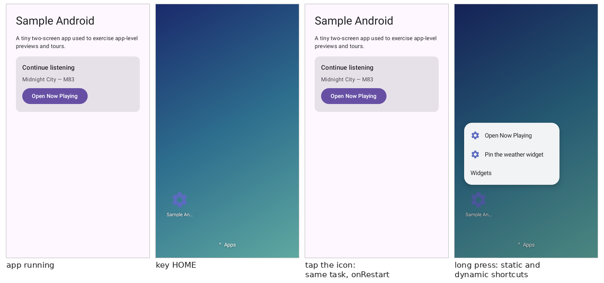

**The home screen** is an activity of the simulator's (`PhoneHome`), plain `android.view` with no
Compose, since the app's Compose is the only one on the sandbox's class path. It sits at the
bottom of the default display's back stack, and `Navigator` moves between it and the app as the
system does:

- `home` or `key HOME` stops the app's top activity (`onPause`, `onStop`) and shows the home
  screen; nothing is destroyed. Back from the app's root also lands there (`empty` follows).
- Tapping the app's icon (or `launch`) brings its task forward (`onRestart`, `onResume`) when it
  runs that activity at its root, else starts it. Any activity started while the home screen
  shows (a widget's click, a shortcut) goes into the app's task, over the home screen.
- `forceStop` and `CLEAR_TASK` leave the home screen alone. `am start -c
  android.intent.category.HOME` and `input keyevent HOME` go home too.

The grid follows the display: cells of 72dp, 8dp apart (the preview runtime's launcher grid, so a
4×2 widget is 312×152dp in a `@Preview` and here), as many as fit — 4×6 on the default 360×640dp
phone, 5×9 on the `phone` preset, 7×3 turned to landscape — centred. The app's launchable
activities (`<activity-alias>`es included) are icons on the bottom row and in the drawer (`drawer`,
the Apps handle, or a swipe up). A resize, rotation or fold re-flows it (`home` `reflowed` event):
what no longer fits moves, and a widget that has to shrink is told its new size.

**Shortcuts.** A long press on an icon (or `shortcuts` `open`) shows the activity's static
shortcuts (`android.app.shortcuts` metadata, parsed through the app's resources) and its dynamic
ones (`ShortcutManager`), then Widgets when the app has any. Opening one starts its intents with
`NEW_TASK | CLEAR_TASK` on the first. A shortcut the app pins with `requestPinShortcut` becomes an
icon on the home screen (`shortcut` `pinned` event); Robolectric's `ShortcutManager` pins it
without a confirm sheet.

**Widgets.** The app's providers come from its manifest: receivers handling `APPWIDGET_UPDATE`
with `android.appwidget.provider` metadata, the `<appwidget-provider>` XML parsed through the
app's resources into an `AppWidgetProviderInfo` (sizes, target cells, resize limits and mode,
category, features, configure activity, preview, description, update period). `:simulator-host`
replaces Robolectric's `AppWidgetManager` shadow, so `getAppWidgetIds`, `getAppWidgetInfo`,
`getAppWidgetOptions`, `updateAppWidget`, `partiallyUpdateAppWidget`,
`notifyAppWidgetViewDataChanged`, `requestPinAppWidget` and `setWidgetPreview` answer from the
home screen's widgets, as `AppWidgetService` does on a device. Adding one does what the system and
a launcher do between them:

1. **Bind** a new id (`widget` `bound` event), with the size options it will get.
2. **Broadcast** `APPWIDGET_ENABLED` for a provider's first widget, then `APPWIDGET_UPDATE`,
   through `Navigator` to the app's own receiver; Glance's `GlanceAppWidgetReceiver` takes the
   same path.
3. **Configure**, if the provider has a configure activity: it starts over the home screen for a
   result with `EXTRA_APPWIDGET_ID`. `RESULT_OK` places the widget, anything else removes it
   (`APPWIDGET_DELETED`, then `APPWIDGET_DISABLED` for the last). `WIDGET_FEATURE_CONFIGURATION_OPTIONAL`
   skips it unless `"configure":true`; `reconfigure` (or Settings on the resize frame) re-runs it
   for a `WIDGET_FEATURE_RECONFIGURABLE` widget.
4. **Size** it: `APPWIDGET_OPTIONS_CHANGED` with `OPTION_APPWIDGET_MIN_WIDTH` / `MAX_WIDTH` /
   `MIN_HEIGHT` / `MAX_HEIGHT` and `OPTION_APPWIDGET_SIZES`, the size it is drawn at, so a
   responsive `RemoteViews(Map<SizeF, RemoteViews>)` picks its layout.
5. **Draw** what the app passes to `updateAppWidget` in an `AppWidgetHostView` on the grid —
   the framework's own, not Robolectric's shadow of it, so layouts are picked by size, partial
   updates merge, and errors show the error view — and redraw on every update (`widget`
   `updated` event with the layout, whether it was partial, the update count and a `reason`).

The span is `targetCellWidth` × `targetCellHeight` when set, else the fewest cells that hold
`minWidth` / `minHeight` (a launcher never gives a widget less than its minimum); `resize` stays
within `minResize*` (rounded up the same way) and `maxResize*` (the cells that fit in it) along
the axes `resizeMode` allows. `widget
update` sends `APPWIDGET_UPDATE`, as a launcher refresh does; `updatePeriodMillis` ticks follow the
simulated clock (at least 30 minutes, as the system clamps it). An update's `reason` is the home
screen's last prompt to that widget within ten simulated seconds (`bind`, `update`, `options`,
`click`, `configure`), else `app`: the app updating on its own, from a worker, a broadcast or its
UI. It is a best guess; the system does not say.

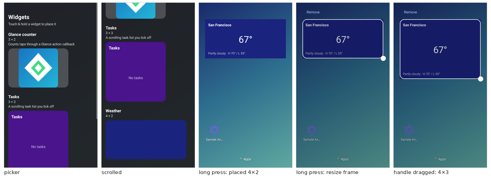

**Taps.** The home screen installs the interaction handler a launcher does, so a view's
`setOnClickPendingIntent`, a compound button's `setOnCheckedChangeResponse` (with
`EXTRA_CHECKED`), and a collection row's fill-in intent under the list's
`setPendingIntentTemplate` are sent as the system sends them, through `Navigator`: an activity
onto the app's task, a broadcast to runtime and manifest receivers, a service started (`widget`
`clicked` event, with the intent). Glance's actions are this underneath: `actionRunCallback`
reaches Glance's `ActionCallbackBroadcastReceiver`, the callback runs, and the `update()` it calls
recomposes the widget in a Glance session worker (WorkManager) and arrives as an `updated` event
with reason `click`.

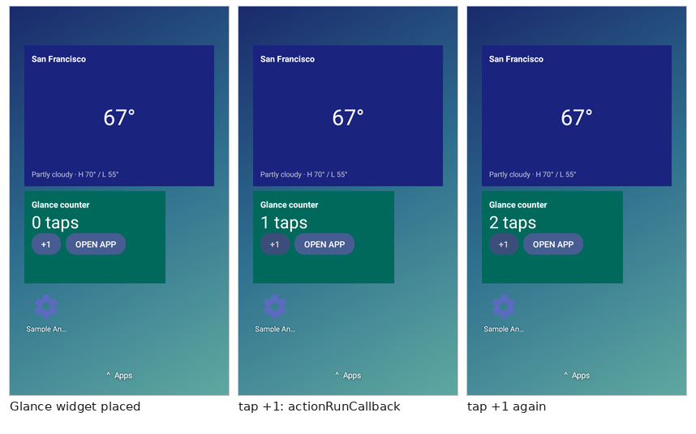

**Collections.** For `setRemoteAdapter` with a `RemoteViewsService`, the service is bound through
`Navigator` (a `service` `bound` event) and its `RemoteViewsFactory` driven in-process:
`onDataSetChanged`, `getCount`, `getViewAt`, each row flagged as a collection child and wrapped as
the device's adapter wraps it, so the template click finds the row's fill-in intent.
`notifyAppWidgetViewDataChanged` reloads it (`dataChanged` event). `RemoteCollectionItems` (and
Glance's lazy lists, which use them) need no service and just inflate.

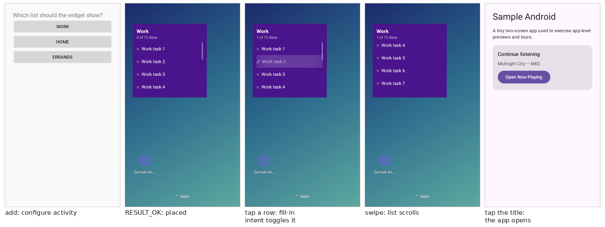

**The picker and pinning.** `picker` (or Widgets in the wallpaper's or an icon's long-press menu)
lists the providers with label, span, description and preview: the generated preview the app set
with `setWidgetPreview` (API 35), else its `previewLayout` inflated, else its `previewImage`, else
the app's icon, as Launcher3 picks. A long press on a preview places the widget. The app's
`requestPinAppWidget` brings the home screen forward with a confirm sheet (`widget`
`pinRequested` event); `widget` `pin` with `"answer":"accept"` (or tapping Add) places the widget
and sends the success callback with `EXTRA_APPWIDGET_ID` filled in, `"reject"` drops it.

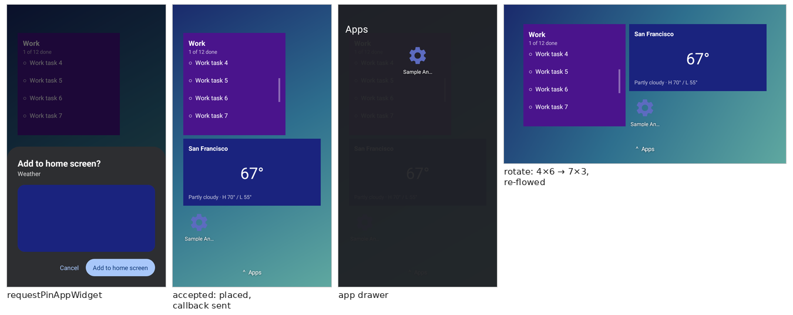

`hierarchy`, `find` and `tap` see the home screen's views, each with a `sim:id/…` resource id:
`icon`, `shortcut_icon`, `drawer_handle`, `drawer`, `drawer_icon`, `shortcuts`, `shortcut`,
`shortcut_widgets`, `home_menu`, `home_widgets`, `widget` (its description names the widget, id
and span), `widget_resize`, `widget_resize_handle`, `widget_remove`, `widget_reconfigure`,
`picker`, `picker_preview`, `pin_sheet`, `pin_accept`, `pin_reject`. A widget's own views appear
under its `widget`, with their text, so `{"cmd":"tap","text":"+1"}` taps a widget's button.

```
→ {"cmd":"home"}
→ {"cmd":"widget","action":"add","provider":"TaskListWidgetReceiver"}
← {"event":"widget","state":"configuring","widgetId":1,"configure":"…TaskListConfigureActivity"}
→ {"cmd":"tap","textContains":"work"}
← {"event":"widget","state":"configured","widgetId":1,"spanX":3,"spanY":3,…}
→ {"cmd":"tap","textContains":"Work task 2"}
← {"event":"widget","state":"clicked","widgetId":1,"sent":{"kind":"broadcast",…}}
← {"event":"widget","state":"updated","widgetId":1,"partial":true,"reason":"click",…}
→ {"cmd":"widget","action":"resize","widgetId":1,"spanX":4,"spanY":4}
```

`id` is the command's own, so a widget is `widgetId` and a shortcut `shortcutId`. The home screen
belongs to the default display: a secondary display gets no launcher.

### Wear system UI

On a Wear app, `--launcher` (or a `--tile`) puts a Wear OS system UI under it instead of the phone
home screen: a demo watch face at the
bottom of the back stack, with the launcher, notification stream, tiles and widgets carousel and
quick settings around it. It is plain Android views in the simulator's own `WearHome` activity
(Compose there would put a second Compose on the app's class path), so the app's lifecycle runs as
on a watch: leaving the app stops it, coming back restarts it, and back from its root lands on the
watch face. `info` and `activities` report the `surface`: `watchface`, `launcher`,
`notifications`, `tiles`, `quickSettings` or `app`.

| On a watch | Goes to | Command |
| --- | --- | --- |
| back from the app's root, Home | the watch face | `home`, `key HOME` |
| the side button | the launcher (again: the face) | `key STEM_PRIMARY`, `launcher` |
| swipe up on the face | the notification stream | `notifications op:open` |
| swipe left / right on the face | the carousel | `tiles op:next / prev / show` |
| swipe down on the face | quick settings | `quickSettings` |
| swipe right on a list, or back | the face | `home` |

The crown (`rotary`) scrolls the launcher, stream and quick settings. Every system view carries a
`sim:id/...` resource id and its item's identity as its description, so `find` and `tap` reach
them as they do the app's: `tap {"resourceId":"notification_card","desc":"3"}` opens a
notification, `notification_action` / `notification_reply` (`<key>/<action>[/<choice>]`),
`notification_open`, `notification_dismiss`, `launcher_item` and `ongoing_row` (by component or
key), `ongoing_chip`, `tile`, `widget`, `tile_add`, `qs_airplane`, `qs_wifi`.

**Notifications** are the shadow notification manager's, drawn as Wear does from their extras, not
`RemoteViews`: title, text, big text, `MessagingStyle` messages, big picture, the actions (a
`WearableExtender`'s replace the phone's) and the inline-reply choices. Long text expands on tap;
a group summary collapses its children; a high-importance post peeks over the watch face for four
seconds. Every app gets the stream as `notification` events (`posted` / `updated` / `removed`),
launcher or not, and the `notification` command acts on one by `key` (its id, or `tag:id`).

**Ongoing activities** (`androidx.wear.ongoing`) are read back from their notification with the
app's own library and shown as the face's chip and the launcher's first rows, their `Status` timers
on the simulator clock.

**The carousel** holds what the agent adds (`tiles op:add`, `--tile`, or the carousel's own add
page): each tile is a whole page, and the Wear Widgets share one page, a scrolling list whose items
shrink and fade toward the round screen's edges as a `TransformingLazyColumn`'s do. Tiles are
bound by `BIND_TILE_PROVIDER` and spoken to over their AIDL (request, resources, add / enter /
leave / remove), and drawn by the protolayout tile renderer the CLI stages in `lib-simulator/`
(apps do not ship it); a `LoadAction` requests the tile again with the clicked state and a
`LaunchAction` starts its activity. Widgets are bound by Glance Wear's `BIND_WIDGET_PROVIDER`,
asked for a document of their container's size and played with the View-based Remote Compose
player. A widget is shown as a watch shows it: just its container, the provider's
`preferredType` (small, 2x1, or large, 2x2), with no card or label around it. The document
paints its own background and the host only masks it to the container's shape: on a round
watch a stadium (large 160x136dp, small 200x60dp), on a square one a 26dp-cornered squircle
(200x108dp, 200x60dp), the sizes Glance Wear's own previews use. Both get the watch's system data: `health` sets the Wear Health Services values tiles read
through `PlatformHealthSources` and widgets through Glance Wear's `HealthData`.

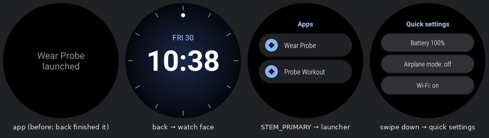
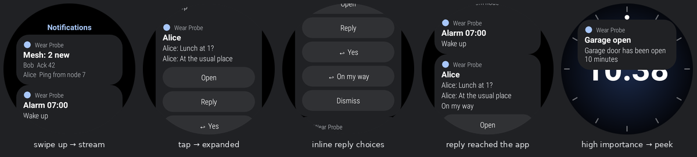
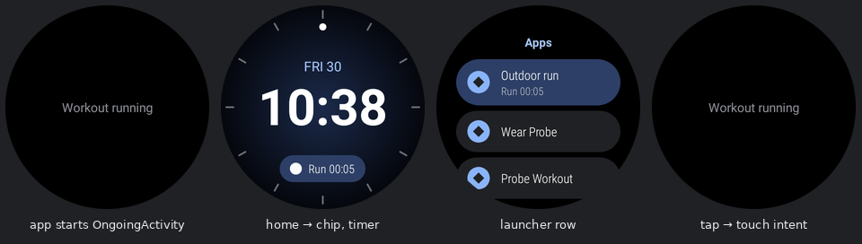
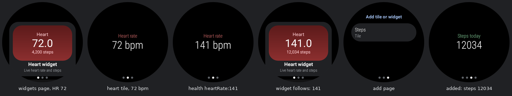
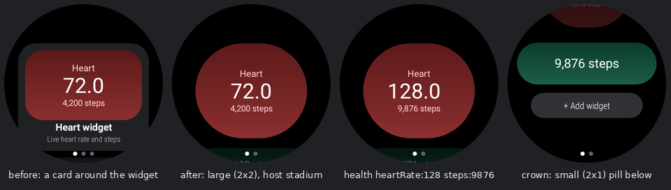

| Command | Arguments | Does |
| --- | --- | --- |
| `home` | | the watch face |
| `launcher` | `index`? / `component`? / `label`? | without one, opens the launcher and lists its apps and ongoing activities; with one, launches it (bringing the app's task back when it is that task's root) |
| `notifications` | `op`? (`open` / `close` / `clear`) | without `op`, every active notification with its key, channel, category, extras, actions, `ongoingActivity`, and `shown: false` plus `hiddenBecause` for one a watch would drop (blocked channel, `POST_NOTIFICATIONS` denied) |
| `notification` | `key`, `op` (`tap` / `action` / `reply` / `dismiss` / `snooze`), `index`?, `text`?, `ms`? | sends its content intent (auto-cancel honored), presses action `index`, fills the action's `RemoteInput` with `text` (the first reply action without `index`), sends the delete intent and cancels (not when ongoing), or snoozes for `ms`. Activities land on the back stack, broadcasts reach manifest receivers, services start; an immutable `PendingIntent` drops a reply as on a device (`fillInDropped`) |
| `ongoing` | `op`? (`list` / `tap`), `index`? | the ongoing activities, or sends one's touch intent |
| `tiles` | `op` (`list` / `add` / `remove` / `show` / `next` / `prev` / `refresh`), `component`?, `index`? | the carousel: its pages, what the app offers (a widget with its `container`), each tile's and widget's render state; `show` takes a page index or a component |
| `health` | `heartRate`?, `heartRateAccuracy`? (`unknown` … `high`), `steps`?, `distanceMeters`?, `calories`?, `floors`? | sets the simulated health data, which tiles and widgets on screen redraw with |
| `quickSettings` | `airplane`?, `wifi`? | opens quick settings (battery, airplane mode, Wi-Fi), switching either first |

The face dims to its ambient outline while the screen dozes; see [Screen power and ambient
mode](#screen-power-and-ambient-mode) for `ambient`, `tilt` and `palm`, which work with or without
`--launcher`.

### Screen power and ambient mode

The screen is `on`, `ambient` (a watch's always-on doze) or `off`, and moves between them as a
device's does. Every change sets `PowerManager.isInteractive()` and the default display's
`Display.getState()` (`STATE_ON`, `STATE_DOZE`, `STATE_OFF`), broadcasts `ACTION_SCREEN_OFF` /
`ACTION_SCREEN_ON`, and is reported as a `screen` event. What happens to the app depends on
whether it opted into ambient:

- **An ambient app** stays resumed on screen and gets its callbacks: `onEnterAmbient` with the
  burn-in-protection and low-bit details (`burnIn`, `lowBit`), `onUpdateAmbient` once a minute of
  simulated time (or on `ambient op:update`), and `onExitAmbient` on wake. That covers androidx.wear's
  `AmbientLifecycleObserver`, the legacy `AmbientModeSupport` / `AmbientMode`, Horologist's
  `AmbientAware` (all through the Wear OS shared library's `WearableActivityController`) and Wear
  Compose's `rememberAmbientModeManager()` (through the Wear SDK's `AmbientManager`).
- **Any other app** is paused and stopped as it leaves the screen: for the watch face with
  `--launcher` (which dims to its ambient outline), in place without. On wake it restarts and
  resumes, as a watch returns to the last app.
- **Off**, every app is stopped, ambient or not, and screenshots are black. So is an ambient-mode
  screenshot with nothing that draws in ambient: no ambient app and no `--launcher` face.

The two libraries are system libraries on a watch (`<uses-library
android:name="com.google.android.wearable">`, `wear-sdk`), which apps compile against and do not
ship. `:simulator-host` provides both classes, and drops any copy an APK carries when it converts
it (some ship compile stubs of the Wear SDK), as a device's library class loader would come first.

Sleeping (`palm`, `sleep`, `KEYCODE_SLEEP`, the timeout) goes to ambient on a watch with always-on
on (the default) and off otherwise; waking (`tilt`, `wake`, `KEYCODE_WAKEUP`) goes back on. While
the screen sleeps, a `tap`, `longPress`, `swipe`, `rotary` or `key` wakes it and goes no further, as
a watch's first touch does; the reply says `consumed`. A watch also has a wrist-tilt gesture sensor
(`Sensor.TYPE_WRIST_TILT_GESTURE`, 26), and `tilt` delivers an event to its listeners before
waking.

| Command | Arguments | Does |
| --- | --- | --- |
| `screen` | `state`? (`on` / `ambient` / `off`), `timeoutMs`?, `alwaysOn`?, `burnIn`?, `lowBit`? | without arguments, the state: `interactive`, `displayState`, the settings, whether the app is in ambient or was stopped by the sleep, and each registered ambient activity (`api`, `ready`, `ambient`). `timeoutMs` sleeps the screen after that long without input (0, the default, never); `alwaysOn:false` makes a sleep go off; `burnIn` / `lowBit` are the details the next `onEnterAmbient` reports |
| `ambient` | `value`?, `op`? (`update`), `burnIn`?, `lowBit`? | Wear only: enters ambient (`true`) or wakes (`false`); toggles without `value`. `op:update` sends `onUpdateAmbient` now rather than at the next minute |
| `tilt` / `wake` | | the wrist-tilt gesture: `tilt` reports a `TYPE_WRIST_TILT_GESTURE` event to its listeners (`wristTiltListeners` counts them), then both wake the screen |
| `palm` / `sleep` | | a palm over the screen: ambient on an always-on watch, off otherwise |
| `key` | `POWER`, `SLEEP`, `WAKEUP` | `POWER` toggles sleep and wake; `adb shell input keyevent KEYCODE_POWER` maps to it |

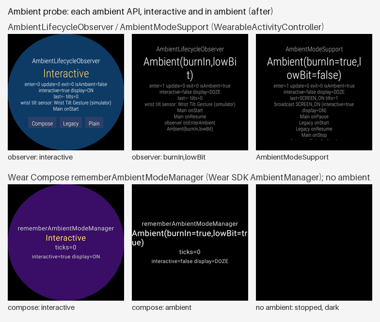
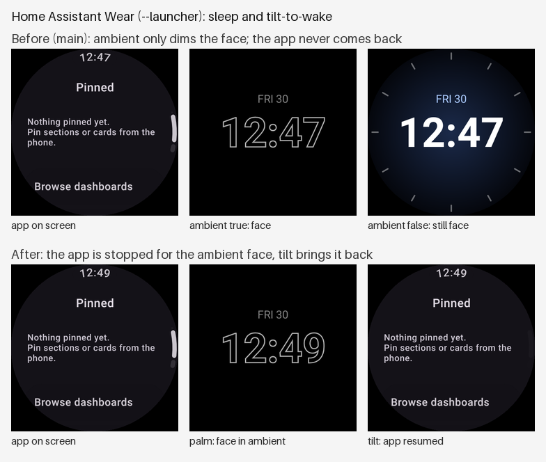

### adb equivalents

`{"cmd":"shell","command":"am start -a android.intent.action.VIEW -d https://…"}` takes an `adb
shell` line and runs the control command it means, so an agent can use the adb it already knows. A
leading `adb [-s serial] shell` is dropped, and `adb exec-out`, `adb logcat`, `adb pull` and `adb
push` are understood too. The line is split as `sh` would (quotes, backslashes); pipes, `;`, `&&`
and redirection are refused — one command per line — except a trailing `> file` on `screencap`,
`uiautomator dump` and `run-as … cat`. The reply is `{"command":{…},"result":{…}}`: the translated
command, then its usual JSON result, not adb's text (commands whose adb output is a value, such as
`settings get`, `getprop`, `wm size` and `pm path`, add it as `output`).

Paths: `screencap`, `uiautomator dump`, `run-as`, `pull` and `push` take device paths. A relative
path, `/data/data/<pkg>/…` and `/data/user/0/<pkg>/…` are the app's data directory; `/sdcard/…` and
`/storage/emulated/0/…` its simulated external storage; `/data/local/tmp/…` a scratch directory.
All are directories on the host (Robolectric's temporary ones), returned as `hostPath`. Any other
absolute path given to `screencap` is a host path. Other packages' paths are refused.

| adb | Simulator | Notes |
| --- | --- | --- |
| `am start` / `start-activity` | `startActivity` | `-a -d -t -c -n -p -f`, `--es --esn --ez --ei --el --ef --ed --eu --ecn --esa --eia`, `--activity-*` / `--grant-*` flags, a trailing URI (with `VIEW`), component or package; `-W` is implicit; `-S` force-stops first; `--display <id>` starts it on that display |
| `am start-service` / `start-foreground-service` / `stopservice` | `startService` / `stopService` | |
| `am broadcast` | `broadcast` | runtime and manifest receivers; `--receiver-*` flags; `--user` and `--receiver-permission` ignored |
| `am force-stop` / `kill` | `forceStop` | partly: see below |
| `am stack list` | `activities` | |
| `pm grant` / `revoke` | `permissions` `grant` / `deny` | short names (`CAMERA`) take `android.permission.`; the answer also applies to later requests; a grant lifts "don't ask again" |
| `pm reset-permissions` | `permissions` `reset` | runtime permissions revoked and never asked about, policy back to grant |
| `pm clear` | `clearData` | partly: see below |
| `pm list packages` / `pm path` / `pm dump` | `packages` / `package` | the one installed package |
| `pm list permissions` | `permissions` | the app's requested permissions and their state, not the device's |
| `input tap` / `swipe` / `text` / `keyevent` / `draganddrop` / `press` | `tap` / `swipe` / `text` / `key` / `swipe` with `holdMs` | a source word (`touchscreen`…) is accepted; `text` turns `%s` into a space; `keyevent --longpress` |
| `settings get` / `put` / `delete` (`--user` ignored) | `settings` | puts applied: `global airplane_mode_on`, `global wifi_on`, `global mobile_data`, `global bluetooth_on` (radios), `global animator_duration_scale` (`ValueAnimator`), `system font_scale` (configuration change), `system time_12_24` (`TIME_SET` broadcast); others are stored for the app to read |
| `input tap` / `swipe` / `text` / `keyevent` / `draganddrop` / `press` | `tap` / `swipe` / `text` / `key` / `swipe` with `holdMs` | a source word (`touchscreen`…) is accepted; `text` turns `%s` into a space; `keyevent --longpress`; `-d <id>` acts on that display |
| `settings get` / `put` / `delete` (`--user` ignored) | `settings` | puts applied: `global airplane_mode_on`, `global wifi_on` (network), `global animator_duration_scale` (`ValueAnimator`), `system font_scale` (configuration change), `system time_12_24` (`TIME_SET` broadcast); others are stored for the app to read |
| `content query` / `insert` / `update` / `delete` | `content` | `--uri --projection a:b --where --sort --bind name:type:value` (`s b i l f d n`) |
| `cmd uimode night yes` / `no` / `auto` | `qualifiers` `+night` / `+notnight` | |
| `wm size [WxH\|reset]` / `wm density [N\|reset]` | `display` | pixels, as on a device: a density change keeps the pixel size; `reset` restores the launch qualifiers (both) |
| `svc wifi` / `svc data enable` / `disable`, `cmd wifi set-wifi-enabled`, `cmd connectivity airplane-mode`, `cmd netpolicy set restrict-background` | `network` | the radios and data saver, as [above](#network-wi-fi-and-bluetooth) |
| `cmd wifi status` / `list-scan-results` / `start-scan` / `connect-network <ssid> …` | `wifi` | |
| `svc bluetooth enable` / `disable`, `cmd bluetooth_manager enable` / `disable` | `bluetooth` | |
| `dumpsys activity [activities\|top\|services]`, `dumpsys notification`, `dumpsys window`, `dumpsys package`, `dumpsys connectivity` / `wifi` / `bluetooth_manager` | `activities`, `services`, `notifications`, `info`, `package`, `network` / `wifi` / `bluetooth` | JSON, not dumpsys text |
| `logcat` `-d -c -s -t -e`, `TAG:LEVEL` / `*:LEVEL` | `logcat` | without `-d` / `-c` / `-t` it follows: `log` events until `{"cmd":"logcat","op":"stop"}`; `-v -b --pid` ignored; times are wall-clock, pid/tid are Robolectric's |
| `screencap -p [file]` | `screenshot` | PNG only; `-d <id>` captures that display (the simulator's display id, from `displays`) |
| `uiautomator dump [file]` | `hierarchy` `flat` | JSON nodes, not UI Automator XML |
| `run-as <pkg> ls [-R]` / `cat` / `rm [-r]` / `mkdir`; the same on `/data/data/<pkg>` paths | `files` | `cat … > file` pulls |
| `adb pull` / `adb push` | `files` `pull` / `push` | files or directories |
| `getprop [name]` | `getprop` | |
| `monkey -p <pkg> 1` | `launch` | only as a launcher; random events are refused |

**Partly:** a single-process simulator cannot kill the process. `am force-stop` destroys every
activity (top first) and service, and cancels the app's notifications; the `Application`, its
singletons, open databases and threads live on, so the next `launch` or `am start` starts
activities into a warm process rather than a cold one. `pm clear` does that, then deletes the data
and external-files directories and resets runtime permissions — but state already in memory
(a Room database's open connection, cached `SharedPreferences`, a DataStore) still holds the old
data. Robolectric's data directory is a fresh temporary one per launch, so for a truly clean start,
quit and launch again.

**Not supported**, with the reason:

| adb | Why |
| --- | --- |
| `install`, `uninstall`, `pm install` | the simulator runs the one APK it was launched with |
| `am instrument`, `am profile`, `am start -P/--start-profiler`, `am dumpheap` | no instrumentation runner, profiler or ART heap |
| `intent:` URIs, `--selector`, `--ela`/`--efa` array extras | not mapped; use `-a -d -n` and the scalar or `--esa`/`--eia` extras |
| `svc power`, `svc nfc`, `svc usb` | power is the `screen` command (`svc power stayon` is not mapped); no NFC or USB model |
| `settings list` | Robolectric's settings store cannot be enumerated |
| `dumpsys meminfo` / `gfxinfo` / `battery` / others | no such services: one JVM, Robolectric's graphics |
| `input roll` / `motionevent`, `monkey` with events | not mapped; use `tap`, `swipe` and `key` |
| `reboot`, `root`, `sh` scripts, pipes, `&&` | no device to reboot; one command per line |
| `pm disable` / `enable` components | not mapped |
| `logcat -b crash/events/radio`, `bugreport` | there is one buffer: the app's `android.util.Log` |

## Memory

Each simulator JVM gets `-Xmx` of an eighth of the machine, between 768 MB and 2 GB
(`--max-heap` overrides it), and a periodic collection every 5 seconds without one
(`-XX:G1PeriodicGCInterval=5000`). Apps' live heaps are small — about 120 MB for Now in Android and
Confetti once ready — but the framework's graphics objects own native memory that only a
collection frees, and an app idling on an animated screen makes too little garbage to trigger one:
Confetti grew from 850 MB to 2.3 GB in two idle minutes before, and stays near 1 GB with it. A pair
runs two JVMs; `--max-heap 1g` suits a phone app and `768m` a watch.

## Restart and update

`launch --control stdio` keeps the simulator JVM behind a supervisor in the CLI, so the app can be
replaced without ending the session or the client's connection:

- **`restart`** starts the app again in a fresh simulator JVM from the same converted classes. It is
  a new process, as after `am force-stop` on a device, but statics, singletons and in-memory state
  are really gone. Its data is kept: the old simulator copies its data directory and external
  storage (`snapshotData`), and the new one restores them before the `Application` and its
  providers are created. `"keepData":false` starts from a clean install.
- **`update`** `{"apk":…}` does the same with another APK, usually a rebuild of the running one,
  as `adb install -r` does. Its classes come from the conversion cache: a hit when that exact APK
  was converted before, and otherwise only the classes the rebuild changed are converted again.
  Keeping data needs the same package.

With `"device":"watch"` in a `--pair` session, each replaces the watch's simulator instead of the
phone's.

Each answers with the new simulator's `info` and where the time went: `snapshotMs`, `stopMs` and
`startMs`, `totalMs`, and `startup`, which every `ready` event also carries. `startup` has `jvmMs`
to `main`, `sandboxMs` for Robolectric's sandbox, `applicationMs` to `Application.onCreate()`
returning, and `firstActivityMs` to the first activity's first frame. `update` adds `conversion`.
Every launch also sends a `conversion` event before `ready`, saying whether the APK's classes came
from the cache (`cached`) and what it cost (`ms`).

**`--standby`** keeps a second simulator JVM prepared, which the next `restart` takes over. It is
started with the same APK and classes and waits at the last point before the app's own code: the
manifest is asked for the app's `AppComponentFactory`, just before the `Application` is created.
By then the JVM, Robolectric's sandbox and the framework's setup of the app's resources, display
and configuration are paid, which is more than half of a launch. The standby is told to go with the
data to restore; `startup` then reports `standby: true` and `preparedMs`. A new standby is prepared
after each restart. It costs a second JVM's memory while it waits: about 400 MB idle.

Measured on a shared 15 GB host with other simulators running, each from the conversion cache,
keeping the app's data:

| | Probe app (Views, 7,578 classes) | Sunflower (Compose, Hilt, Room; 19,540 classes, `--sdk 36`) |
| --- | --- | --- |
| Launch to `ready` | 7.9 s | 6.8 to 12.0 s |
| `restart` | 10.7 s | 7.1 to 7.5 s |
| `restart` with `--standby` | 4.9 to 5.7 s | 3.7 to 3.8 s |
| `update` to an APK in the cache | 12.6 s | 6.7 s |

A cold Sunflower restart's `startup` is 0.2 s of JVM, 1.2 s of sandbox, 3.7 s to
`Application.onCreate()` returning and 1.5 s to the first frame. From a standby it is 0.9 s and
2.3 s, with the rest paid ahead. Snapshotting and restoring the data takes about 30 ms, and
stopping the old JVM 0.4 s. A waiting standby holds about 390 MB.

Why a new JVM rather than a new class loader in this one: Robolectric's sandbox and the framework's
classes belong to a class loader, so a fresh sandbox costs almost what a fresh JVM does. Starting the
JVM itself is about 0.3 s of the total. The native graphics runtime also binds to one class loader
per process. A new JVM also gives the app a clean process, as a real reinstall does. UI state, such
as the back stack and scroll positions, is not kept: the app starts at its launcher activity, as
after `adb install -r`.

## Live reload

`launch --project <dir>` adds the app's Gradle build, so an edit reaches the simulator without an
APK. `--module` names the app module (default `app`), `--variant` the variant (default `debug`),
and with no APK given the CLI builds one first. The control channel's **`reload`** then:

1. runs `:<module>:compile<Variant>JavaWithJavac` through the Tooling API, which runs Kotlin's
   compile, KSP or kapt, and `process<Variant>Resources` (aapt2's link) before it. The connection
   stays open between reloads, so the daemon stays warm;
2. compares every project module's compiler output with what it was at launch:
   `build/tmp/kotlin-classes/<variant>`, AGP 9's built-in Kotlin output,
   `intermediates/javac/…/classes`, and JVM modules' `build/classes/*/main`. Included builds and
   `buildSrc` are build logic and are skipped;
3. copies each class that changed or is new into an overlay directory, renamed as the APK converter
   names classes. dex2jar turns every `-` in a name into `_`, so kotlinc's `constructor-impl` and
   `lambda-1` would otherwise call names the converted jar does not have;
4. restarts the app on the APK's converted classes with the overlay in front, keeping its data, as
   [`restart`](#restart-and-update) does. Nothing is dexed, packaged or converted. `--project`
   turns `--standby` on, so the restart takes over a prepared JVM.

When aapt2's linked resources changed, such as an edited layout, string or drawable, the simulator's
resource APK becomes the launched APK with the new `resources.arsc`, `res/` and manifest swapped
in. When resource ids moved, the module's R classes are overlaid too. Assets and native libraries
only reach an APK by packaging it, so a change there, or `{"cmd":"reload","full":true}`, runs
`assemble<Variant>` and `update`s to the result. A compile error is the command's error, with the
compiler's `e:` lines, and the running app is left alone.

`--live` reloads after every edit to a module's `src/`, once the edits have settled for 400 ms, and
reports each as a `reload` event. `--gradle-arg` (repeatable) passes arguments to the build, such
as `--max-workers=2`.

`reload` answers like `restart`, plus `mode` (`classes`, `resources`, `apk`, or `unchanged` when
the build changed nothing the app does not already run), `build` (`ok`, `ms`, `tasks`, `errors`),
`classesChanged` with the first few names, and `prepareMs` for the overlay and resource merge.

Sunflower (Compose, Hilt, Room; `--sdk 36`), its empty garden screen. A three-line edit to the
`EmptyGarden` composable's `Text` (its text, style and color), then a string resource:

| Before | Three-line Compose edit (6.3 s) | String resource edit (11.1 s) |
| --- | --- | --- |
| 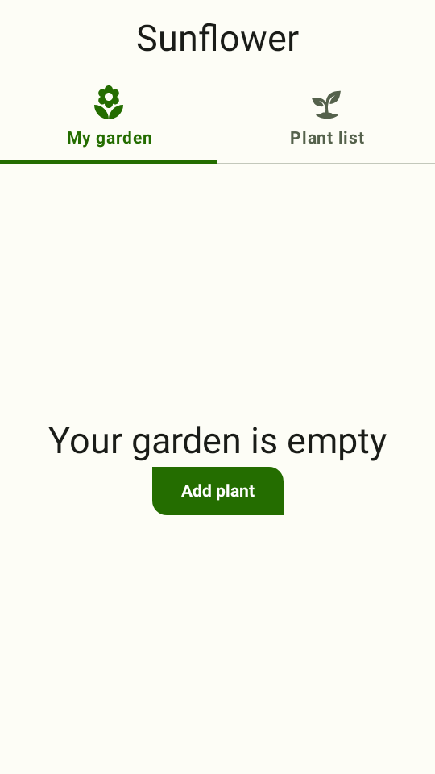 | 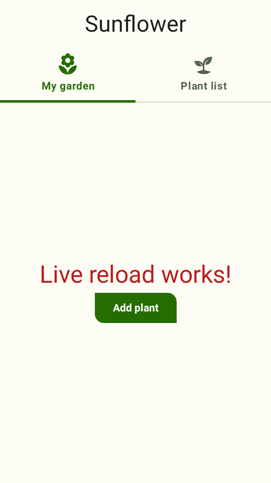 | 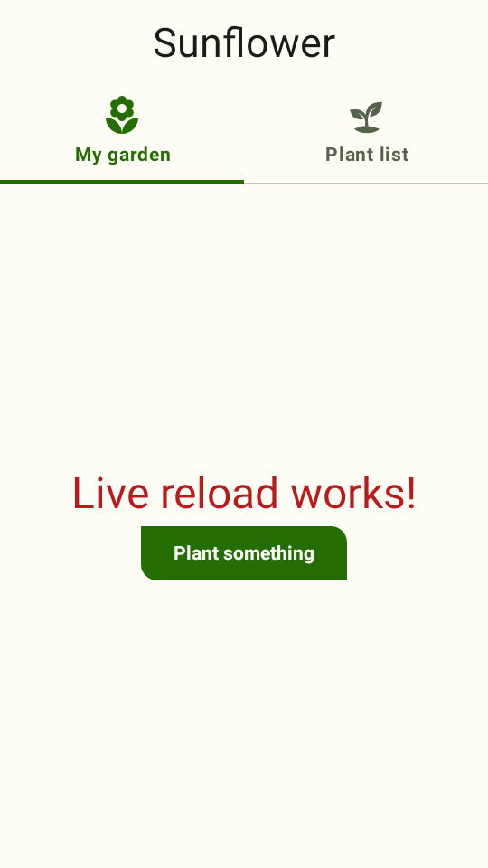 |

| Edit | Answered in | Where the time went |
| --- | --- | --- |
| Three lines of a composable | 6.3 s | compile 3.4 s, overlay 0.1 s (6 classes), restart from the standby 2.3 s |
| A string resource | 11.1 s | compile 2.3 s, resource merge 1.7 s, restart 6.7 s: the standby held the old resources, so a cold JVM |
| A type error | 3.3 s | compile only; the error is the `e:` line, and the app keeps running |

That session's launch from the project took 46 s to `ready`: an up-to-date `assembleDebug` (13 s),
and a conversion of the APK that reused its previous build's unchanged classes (12 s).

What a reload does not keep or cover:

- **UI state.** The back stack, scroll positions and anything not on disk are lost: the app starts
  at its launcher activity, as after `adb install -r`. Compose's own hot reload, which keeps
  state, redefines classes in place; that needs the JetBrains Runtime's enhanced class
  redefinition and is not attempted.
- **Desugared library APIs.** Overlaid classes are kotlinc's and javac's JVM output, not D8's. An
  app using core library desugaring passes `java.time` where the APK's classes expect `j$.time`,
  so a changed class must not exchange those types with one that did not change.
- **Release builds.** Shrunk (R8) APKs rename classes; reload against a debug variant.
- **Modules elsewhere.** A module outside the project directory, or in an included build, is not
  overlaid; edit those and reload with `full`.
- **Pairs.** In a `--pair` session, `reload` and `--live` are the phone's: `--project` builds the
  phone app.

## A paired phone and watch

`--pair <wear.apk>` runs a Wear OS APK in a second simulator (a round watch display,
`--pair-qualifiers` to change it) and joins the two with a simulated Wearable Data Layer:
`Wearable.getDataClient` / `MessageClient` / `NodeClient` / `CapabilityClient` answer from the
simulator instead of Play services, so messages, requests, data items and capabilities cross
between the apps and reach their listeners and manifest `WearableListenerService`s, and
`ChannelClient` channels stream bytes between them (`openChannel`, the streams, `sendFile` /
`receiveFile`, `ChannelCallback`s and `CHANNEL_EVENT` services). As with Play services, no task a
client returns is complete yet: each completes on a later turn of the main looper. Each peer
is also a `CompanionDeviceManager` association (the [`companion`](#the-control-channel) command),
and on the watch `RemoteActivityHelper.availabilityStatus` follows the peer's connects and
disconnects. With
`--control stdio`, `"device":"watch"` sends a command to the watch, every line carries its
`device`, and each crossing is a `datalayer` event. Every other line either simulator prints — the
app's logcat, Robolectric's logging and stack traces on stderr, and without the control channel its
stdout too — is prefixed with its device, `[phone] ` or `[watch] `. `RemoteActivityHelper` launches, Horologist's
`DataLayerAppHelper`, and on the watch `RemoteAuthClient`, `BridgingManager` and
`PhoneTypeHelper` work across the pair too. A prototype; the design, evidence and what is
missing are in [`design/SIMULATOR_DATALAYER.md`](design/SIMULATOR_DATALAYER.md).

### The agent as the peer

`--data-layer agent` (with `--control stdio`) simulates the Data Layer for one app with no second
simulator: the control channel plays every peer device. Each frame the app sends is a
`datalayer` event of kind `send`: `type` `hello` (its node and capabilities, answered on each
connect), `message` (with a `requestId` for a `sendRequest`), `response`, `data`, `capabilities`,
`activity` (a `startRemoteActivity`), `oauth`, or a channel's `channelOpen` (with its `token` and
`path`), `channelData`, `channelEof` and `channelClose`, with its payload as base64 `data`, a `text`
preview and, when the bytes are a `DataMap`, a `dataMap` JSON object; a data item's assets come
as `assets` (key → base64, up to 4 MiB of base64 each, larger ones named in `assetsOmitted`).
Both are in the form `put` takes, so a captured item can be put back as it was. A channel's life
on either side is also a `datalayer` event of kind `channel` (`state` `opened`, `data`,
`inputClosed`, `outputClosed`, `closed`, with the `channel` token). The agent answers with
`{"cmd":"dataLayer","action":…}`:

| `action` | Arguments | The peer… |
| --- | --- | --- |
| `connect` | `node?` (its id; `phone-agent` / `watch-agent`), `name?`, `package?`, `capabilities?`, `nearby?` | joins: `getConnectedNodes`, capability listeners, then receives the app's data items |
| `disconnect` | `node?` | leaves |
| `capabilities` | `node?`, `capabilities` | changes its capabilities |
| `put` / `delete` | `node?`, `path`, a payload, `assets?` | writes or deletes a data item, delivered to listeners and services |
| `message` / `request` | `node?`, `path`, a payload | sends a message, or a request the app answers (a `send` event of type `response`) |
| `reply` | `requestId`, a payload or `error`; `result` for a remote activity; `responseUrl` for OAuth | answers the app's request |
| `config` | `requestTimeoutMs` | sets how long the app's requests wait (default 30 s, then `TIMEOUT`) |
| `channelOpen` | `node?`, `path`, `channel?` (a token; one is made up) | opens a `ChannelClient` channel to the app (`onChannelOpened`, `CHANNEL_EVENT` services); answers its `channel` token |
| `channelWrite` | `channel`, a payload | writes bytes the app's input stream reads |
| `channelEof` | `channel` | closes its output: the app's input ends (`onInputClosed`) |
| `channelClose` | `channel`, `errorCode?` | closes the channel (`onChannelClosed`, `CLOSE_REASON_REMOTE_CLOSE`) |

A payload is `text`, `data` (base64) or `dataMap` (JSON: strings, booleans and ints bare, other
values `{"type":"long"|"float"|"double"|"bytes"|"string[]"|"stringList"|"intList"|"dataMapList"|…,
"value":…}`, nested objects as `DataMap`s; `"list"` picks the list type from its elements). `node` defaults to the only connected peer; with none, the app's
`sendMessage` / `sendRequest` fail with `TARGET_NODE_NOT_CONNECTED`.

`--fingerprint <f>` replaces Robolectric's `Build.FINGERPRINT` (`robolectric`), which some apps
compare against to skip real work in tests and previews: MeshCore's watch shows canned preview
data, and never touches the Data Layer, unless it is set.

## Constraints

What runs: apps whose UI is Compose or Views over the framework Robolectric shadows, with their
real `Application.onCreate()`. The sample app's Compose screens, `androidx.startup`, WorkManager
and its Room database start as they would on a device.

Two real apps, from their debug APKs: [Now in Android](https://github.com/android/nowinandroid)'s
demo flavor runs its Hilt graph, WorkManager sync and Room database, and every tab and Settings
work; [Confetti](https://github.com/joreilly/Confetti) starts with Firebase, Koin and Compose
Multiplatform resources on `--sdk 36` (its OkHttp needs API 36's classes) and runs its onboarding.
Home Assistant RemoteCompose (alias launchers), Cadence (Metro's `AppComponentFactory`) and
MeshCore run too. Renders are in
[`design/evidence/simulator-launch/`](design/evidence/simulator-launch/).

What does not, or not yet:

- **Native code.** `.so` files are built for Android; anything that needs its own JNI fails.
- **Google Play services APIs, Maps, billing, DRM** — Play services is reported installed
  ([above](#google-play-services)), but only the Wearable Data Layer is simulated (under `--pair`
  or `--data-layer agent`); every other API reports `API_UNAVAILABLE`. Firebase starts, and its backends answer as they would any
  unregistered client.
- **GPU content.** No `SurfaceView` / `TextureView` producer, video, camera or GL.
- **Bindings across processes.** An app's binding to its own service connects; one to another
  package's (Play services) does not.
- **Process and task model.** One process, one task (so `am force-stop` and `pm clear` are partial:
  see [adb equivalents](#adb-equivalents)). A `NEW_TASK` start of the running root activity with
  its launcher intent brings the task forward, as on a device, so `launch` (or another app's
  "open the app") does not stack a second instance; without `--launcher`, `HOME` does nothing,
  and there are no recents or task switching either way.
- **Content providers** start before `Application.onCreate()` as on a device; `--no-providers`
  skips them.
- **Runtime permissions** have no dialog on screen: the agent answers in its place ([above](#runtime-permissions)),
  and the requesting activity is not paused while a request waits. Groups are approximated (a
  dialog per permission, not per group), and Android 16's health permissions that replace
  `BODY_SENSORS` are plain runtime permissions.
- **System UI.** An intent only the system handles (the live-wallpaper picker Muzei opens, a
  share sheet, other settings screens) reaches no activity and is reported as an `error` event;
  the radio dialogs and settings panels are answered ([above](#network-wi-fi-and-bluetooth)).
- **Bluetooth.** On, with nothing in range until the agent puts peripherals there
  ([above](#network-wi-fi-and-bluetooth)). Robolectric's adapter reports LE off in airplane mode
  even when Bluetooth is turned back on. No classic sockets (RFCOMM), audio profiles, LE
  advertising by the app, or GATT server in the app. `CompanionDeviceManager.associate` is
  answered by the [`companion`](#the-control-channel) command's policy, from API 33.
- **Network.** Online, requests go out through the host JVM, its proxy and its trust store; the
  simulated network decides only whether they may, and how fast. A mode is one default network (a
  VPN adds the Wi-Fi beneath it): no Wi-Fi-to-cellular fallback when Wi-Fi drops, no roaming,
  no per-app blocked status under data saver.
- **Split APKs and App Bundles** need merging into one APK first; protected APKs are out.
- **Fidelity.** Robolectric's native graphics, not a device's GPU: close, not pixel-identical. The
  window draws one device pixel per screen pixel, hence the `w360dp-h640dp-hdpi` default, and
  resizes to the display after each display command; a tablet or desktop at hdpi may be larger
  than the screen.
- **Device controls.** Secondary displays are separate screens (above); there is no multi-window
  or freeform on one display, and no activity embedding. A `rear` display is a display only:
  Jetpack WindowManager's `WindowAreaController` (rear display mode, dual screen) needs the
  extensions' `WindowAreaComponent`, which `Foldables` does not provide, so it reports them
  unsupported. Activities on a removed display finish rather than move to the default display. A configuration change reaches the top activity; activities below it in the back
  stack keep the old configuration until they are next shown, and are not recreated then. The
  fold is always at the middle of the window. Location reaches the platform `LocationManager`
  only: Play services' fused provider is absent. Time zone changes reach `java.util.TimeZone` and
  the broadcast; the wall clock itself follows Robolectric's simulated clock and cannot be set.
- **Wear.** The [system UI](#wear-system-ui) is a demo face: no Watch Face Format or
  `WatchFaceService` faces and no complications. A tile's `TileUpdateRequester` is not wired to the
  carousel (`tiles op:refresh` requests it again), widgets are drawn as their large container only,
  and the paired phone's bridged notifications and launcher entries are not shown. Ambient mode
  reaches the app ([above](#screen-power-and-ambient-mode)), but nothing enforces it: the system
  does not dim, shift for burn-in or cap the frame rate of an ambient app's drawing, ambient
  offload (`setAmbientOffloadEnabled`) and auto-resume are accepted and ignored, and the Wear SDK's
  `AmbientTransitionListener` is not called. Only the wrist-tilt gesture sensor exists; tilt is a
  command, not derived from an accelerometer. Without `--pair` or `--data-layer agent` the Data Layer has no
  paired phone: `checkApiAvailability` reports the `Wearable` clients `API_UNAVAILABLE`, as
  Play services' other APIs.
- **Home screen.** Only with `--launcher` ([above](#home-screen-and-widgets)), and only the app's
  own widgets and shortcuts: there is one package. No notification shade, wallpaper picker,
  keyguard or search widgets, or widget drag between cells (`widget add` takes `cellX`/`cellY`).
  A pin request brings the home screen forward rather than showing its sheet over the app, and
  `requestPinShortcut` pins without one. Widgets render with Robolectric's graphics and the
  framework's `RemoteViews`; a widget whose content comes from the network shows its placeholder
  where this sandbox refuses the host.
- **XR.** No Full Space: nothing renders a `Subspace`, `SpatialPanel` or 3D content, and a request
  to enter Full Space is not acted on. An app that calls `Session.create` itself gets no session:
  Jetpack XR's `*-testing` runtime fakes, which the preview renderer adds for XR previews, are not
  on the simulator's classpath (`--jar` can add them).
- **Glimmer.** No touchpad and no input focus (above): focus-driven navigation does not work;
  the display is shown as is, not composited onto a scene as the preview environment backdrops
  do, and there is no projection from a phone app.
- **Stack traces say `Unknown Source`** for app frames (dex2jar keeps line numbers, not the source
  file attribute).
- **SDK level.** One of Robolectric's supported levels (`--sdk`, default 35), fetched as
  `android-all-instrumented` on first use like any Robolectric run.
