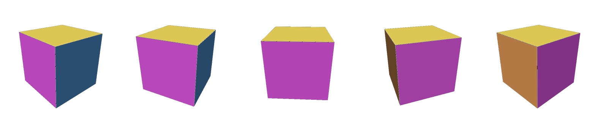
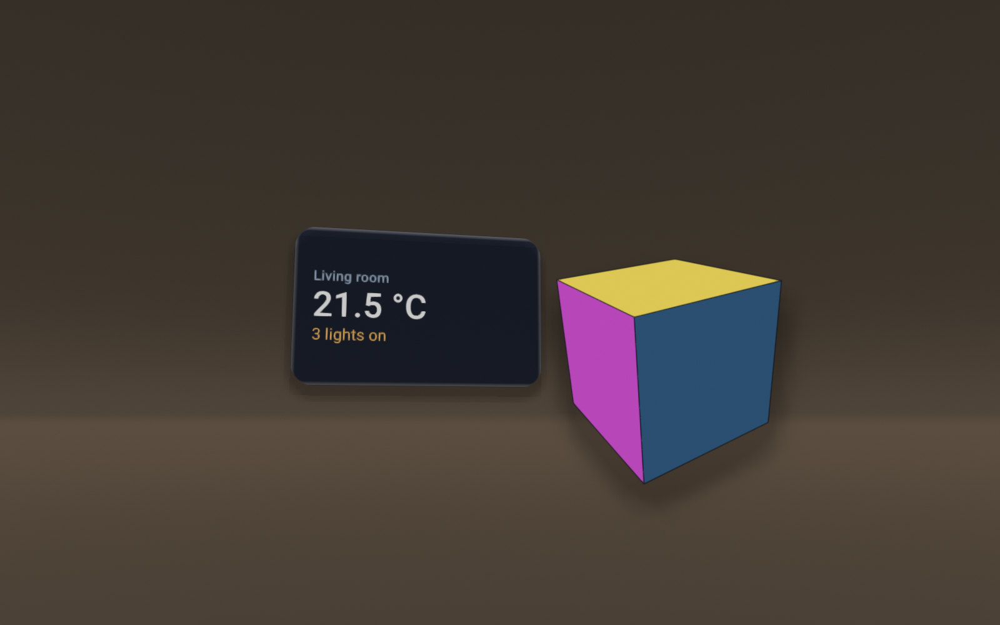
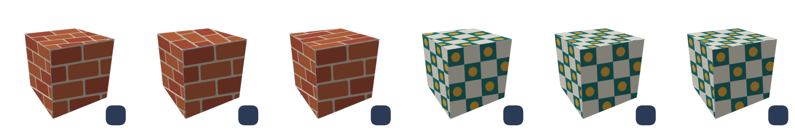

# Remote Compose in XR

**Status: exploratory.** Two working examples in `:samples:remotecompose` plus the API they argue
for. Nothing here is a contract yet. The wire format the offline 3D path uses is
[`SPATIAL_SCENE_CONTRACT.md`](SPATIAL_SCENE_CONTRACT.md), unchanged.

The question: can a Remote Compose (`.rc`) document, played by the CMP player
(`rc-player-compose`, yschimke/rc-players) or the AndroidX players, be useful inside a 3D/XR scene,
both as **3D content defined wholly in the document** and as **2D content projected onto a surface
in the room**? And what would hosts and players need to do it efficiently?

## What Remote Compose already has

Pinned at `remote-core:1.0.0-alpha20`:

| Need | Operation | Notes |
| --- | --- | --- |
| 4x4 matrices from live values | `MatrixExpression` (writer `matrixExpression(...)`) | RPN over `ROT_X/Y/Z`, `ROT_AXIS`, `TRANSLATE*`, `SCALE*`, `MUL`, `PROJECTION`; re-evaluated when an input variable changes |
| Transform a point | `MatrixVectorMath` (writer `addMatrixMultiply(m, type, in, out)`) | writes each output component to a new float id; type 0 is an affine multiply, type 1 also divides by `w` |
| Drag input | `TouchExpression` (writer `addTouch(...)`) | value relative to touch-down, with wrap, clamping and eased stop |
| Shapes from live points | `PathData` with float-id coordinates | the public `remotePath { moveTo(RemoteFloat, RemoteFloat) }` builds one |
| Per-frame visibility | `drawConditionally(RemoteBoolean)` | used here for back-face culling |
| Dynamic colour | `RemoteColor.hsv(..., value = RemoteFloat)` | used here for Lambert shading |

What it does **not** have: meshes, a depth buffer, textures mapped onto 3D geometry, or any notion
of a per-eye view. Everything is drawn as 2D on a canvas.

## Example 1: a rotatable cube defined wholly in the document

[`Spatial3dCube.kt`](../../samples/remotecompose/src/main/kotlin/com/example/sampleremotecompose/Spatial3dCube.kt),
previews `RemoteCube3dPreview`, `RemoteCube3dFromBelowPreview` and `RemoteCube3dSpinningPreview`.

- Two `TouchExpression`s turn horizontal drags into yaw (wrapping) and vertical drags into pitch
  (clamped to ±85°), both easing to a stop on release.
- One `MatrixExpression`, `pitch ROT_X yaw ROT_Y`, is the model rotation.
- Fourteen `MatrixVectorMath` ops rotate the 8 corners and 6 face normals.
- Perspective is plain float expressions, `centre + (x, -y) * s * d / (d - z)`.
- Each face is a four-point `remotePath` over the projected ids. It is drawn under
  `drawConditionally(screenWinding < 0)`, which is back-face culling (enough for a convex shape, so
  no depth sort is needed), and filled with an HSV colour whose value is the Lambert term of its
  rotated normal.
- Nothing paints a background. `SpatialRemoteComposeTest` checks that the capture's corners have
  alpha 0.

Per frame the player evaluates one matrix, 14 matrix-vector products, about 60 float expressions and
up to 6 path rebuilds, then fills at most 3 quads. That is trivial on any device. The host needs no
code at all: the document is the whole interactive object.

`RemoteCube3dSpinningPreview` adds a 90°/s spin on the document clock:



Findings from building it:

- **`MatrixVectorMath` wants 3-component inputs.** `Matrix.evalPerspective` only copies inputs
  shorter than 4 into its static scratch vector (the implicit `w = 1` lives there). A 4-component
  input is silently ignored and, on a cold JVM, dereferences a null scratch array. Pass `(x, y, z)`.
- **The `PROJECTION` op was avoided.** `Matrix.projection` fills its array with a "column-major"
  comment, while `Matrix.multiply` and `get` index row-major. That looks transposed (`-1` lands
  where the `w` row should take `-z`). It is unverified, so the sample divides by depth itself.
  Worth a check against a player before a document relies on `PROJECTION`.
- **A spin needs the right clock and the right player.** Animated captures do advance the
  document clock (the indeterminate-progress GIFs move on both AndroidX players). The first spinning
  cube froze for two player reasons, not a capture one:
  - The AndroidX View player schedules its next frame only for documents that listen to
    `CONTINUOUS_SEC` or the second/minute fields (`RemoteComposeState.getOpsToUpdate`, unchanged
    through remote-core alpha22). A document animated by `ANIMATION_TIME` alone draws once and
    stops, on a device as well as in a capture. The cube's spin reads `CONTINUOUS_SEC`.
  - The embedded player up to rc-players 2.19.0 keeps a `MatrixVectorMath` product at its first
    value, so a projected shape neither spins nor follows touch. rc-players 2.21.0 fixes it
    (pinned by `RcMatrixVectorMathTest`, yschimke/rc-players#769). This repository pins 2.17.5
    through the daemon, so `RemoteCube3dSpinningPreview` is pinned to the View player until the
    daemon and rc-players pins move together; `SpatialRemoteComposeTest` fails if the captured
    frames stop moving.

## Example 2: a 2D document projected onto a wall

[`SpatialWallCard.kt`](../../samples/remotecompose/src/main/kotlin/com/example/sampleremotecompose/SpatialWallCard.kt)
(preview `RemoteWallCardPreview`) and
[`spatial/wall/scene.json`](../../samples/remotecompose/spatial/wall/scene.json).

The wall card is an ordinary 2D document: a rounded card with a title and two **named** strings
(`temperature`, `lights`) that a host updates without re-sending the document. It paints only
inside the card. The scene places it on a wall angled 25° towards the viewer, with the transparent
cube floating in front. It uses the existing SpatialScene contract unchanged: each `.rc` capture is
a panel `texture`, posed in dp. So the offline compositor and the VS Code 3D viewer can show it
today, which makes this the cheap way to preview "this document on that surface" before any device
work.



Rendered by `xr-composite` built locally from yschimke/compose-preview-xr#102 (command below). The
card keeps its rounded-corner alpha and the cube composites over the room with no background. Each
panel's shadow is shaped by its content: the compositor blurs the texture's alpha inside the
panel's rounded rect, so the cube casts a cube's shadow. The released compositor (2.0.2) draws the
shadow from the whole quad instead, a square behind the cube that also darkens the card.

```sh
# from a compose-preview-xr checkout, after ./build.sh
xvfb-run -a -s "-screen 0 2000x1400x24" env LIBGL_ALWAYS_SOFTWARE=1 GALLIUM_DRIVER=llvmpipe \
  ./build/xr-composite --scene <compose-ai-tools>/samples/remotecompose/spatial/wall/scene.json \
  --out wall.png --materials build/materials --width 1600 --height 1000
```

`spatial/wall/*.png` are copies of the renders. Refresh them when the documents change;
`SpatialRemoteComposeTest` checks that they still match the panel aspect ratios and stay
transparent.

### Doing it efficiently on a device

On Android XR the host should give the player a surface rather than a panel full of views. A
SceneCore `SurfaceEntity` (a quad) parented to an `AnchorEntity` on an ARCore wall plane hands the
app an Android `Surface`. The player draws into it with `lockHardwareCanvas()`: all on the GPU, no
`Bitmap` readback, and the system compositor reprojects the last frame as the head moves. What
keeps it cheap:

1. **Draw only when something changed.** A retained document knows whether any expression is
   time-driven or a variable it reads just changed. A static card is drawn once. A clock redraws
   once a second, not 90 times. This is the biggest saving.
2. **Choose the buffer size from apparent size, not dp.** Pixels = angular size × display
   pixels-per-degree, capped. Re-render only when that changes by more than about 25%, so text
   doesn't flicker between sizes.
3. **One render for both eyes.** It is a texture on a flat surface. Stereo comes from the
   compositor.
4. **Cache static subtrees** as layers, so a ticking value redraws one layer instead of the card.
5. **Stop drawing** when the surface leaves the view or its anchor stops tracking.

`xr-composite --serve`'s `xr/updatePanels` (replace one panel's texture and re-render) is already
the offline shape of point 1: the host re-sends a texture only when the document's frame changed.

## Example 3: interacting with a document, and changing its texture

[`SpatialTexturedCube.kt`](../../samples/remotecompose/src/main/kotlin/com/example/sampleremotecompose/SpatialTexturedCube.kt),
previews `RemoteTexturedCubePreview` and `RemoteTexturedCubeInteractionPreview`.

A cube with a bitmap texture on every face. Tapping the cube turns it a quarter turn on a spring.
Tapping the swatch swaps bricks for tiles. `@InteractionPreview(targets = [0, 0, 1, 0])` records
four real taps: the cube twice, the swatch, then the cube again.



**Interaction is document state moved by document actions.** Each tap target is a `clickable`
whose action is a `valueChange` on a remote float (`turns`, `textureIndex`). The yaw is
`animateRemoteFloatAsState(turns * 90 + 30)`, and the texture is chosen with `drawConditionally`.
No host code runs, and the same document answers taps in any player. A host can also move such
values from outside: a named value (`rememberNamedRemoteFloat`, `rememberNamedRemoteColor`,
`rememberNamedRemoteImageBitmap`) can be changed without re-sending the document, which is how the
wall card's readings update.

**There are three ways to change a texture.**

1. **Inside the document.** Ship several bitmaps and select one with document state, as the
   swatch does. Or bind the fill to a named bitmap (`rememberNamedRemoteImageBitmap`) so the host
   supplies a new image without re-sending the document.
2. **What a face shows.** A 2D canvas can only map a bitmap onto a face affinely. Each face
   translates to one corner, then applies the 2×2 map from the texture square onto the face's two
   edges. That map is decomposed as rotate · scale · rotate, because `RemoteCanvas` has no skew.
   (A raw `document.skew(...)` bypasses the recording canvas and lands outside its
   save/restore.) The face is clipped to its true projected quad over a 2×2 block of the seamless
   texture, which covers the far corner where perspective outruns the parallelogram. Perspective-
   correct texturing would need the `DrawMesh` operation proposed below.
3. **In an XR scene.** A panel's `texture` is the document's rendered frame. The compositor's
   `xr/updatePanels` replaces one panel's texture and re-renders, so a host that re-renders the
   document after a tap or a named-value change pushes exactly that.

Findings:

- The rotation is plain `sin`/`cos` expressions rather than `MatrixExpression` +
  `MatrixVectorMath`, so it turns on every player, including the pinned embedded player.
- `@InteractionPreview` needs the **embedded** player. It resolves tap targets from Compose
  semantics, and the AndroidX View player exposes none ("the preview has 0 clickable node(s)").
- On the pinned embedded player (rc-players 2.17.5) each tap **snaps** the cube to its new pose:
  the animated yaw only feeds other expressions, and that player does not animate it. With
  rc-players 2.21.0 the same capture springs over about 20 frames. With the daemon built from
  `main` and rc-players 2.21.0 (an unreleased combination), the interaction capture also drew only
  one face per frame. The same document plays correctly frame after frame in rc-players' own
  harness on both 2.21.0 and `main`, so check the daemon's interaction capture with the new player
  before moving the pins.

## Integration API this argues for

None of this exists yet. The player side belongs in yschimke/rc-players, the host side in an XR
app.

**Player: `RcSurfaceRenderer`** (Android, beside the CMP Android backend):

| Call | Purpose |
| --- | --- |
| `RcSurfaceRenderer(document, surface)` | owns the hardware canvas |
| `setTargetSize(px)` | re-lays out at a new pixel density, keeping the dp layout |
| `isDirty(timeNanos)`, `nextWakeNanos()` | the document's own answer to "do I need a frame" |
| `render(timeNanos)` | draws one frame |
| `dispatchPointer(u, v, action)` | a hand or gaze ray hit, as surface UV, mapped to the document's existing touch handling |
| `hitTest(u, v)` | whether that point is opaque or interactive, so taps on transparent pixels pass through |
| `setVariable(name, value)` | host-supplied values (below) |

**Host to document**, as named variables set per frame. A document ignores those it doesn't read:

| Variable | Use |
| --- | --- |
| `xr.view`, `xr.proj` (per eye), `xr.eye` | lets 3D content like the cube project correctly per eye |
| `xr.headPose`, `xr.distance` | billboarding, or less detail when far away |
| `xr.pointer.{x,y,z,active}` | a ray hit in document coordinates |
| `xr.panelSizeMeters` | physical size of the host surface |

**Document to host**, as header hints in a versioned capability profile (`RcProfiles` already
exists): a transparent-background flag, a preferred physical size and depth extent, a minimum
legible pixels-per-dp (caps the buffer), and elevation layers (subtrees a host may lift into
separate panels, which map directly onto `SpatialScene.panels`).

## A GPU path for real 3D

The cube at the top is drawn by Skia from paths, with the vertex maths on the CPU. That is fine
for small shapes, and it runs on every player. The real-3D route has three tiers, each falling back
to the one before:

1. **Paths with CPU vertex maths** (today, Example 1). Every player can run it.
2. **A `DrawMesh` operation**: vertex and index arrays (existing float and int array data), a
   matrix id, and an optional bitmap or `ShaderData` material. On Android it maps to
   `android.graphics.Mesh` (API 34+): the buffers are uploaded once, the matrix is a uniform, and
   the transform runs in the vertex shader. Skiko players would use `drawVertices`, and players
   without it would fall back to tier 1.
3. **Hand off to the XR runtime.** Inside an XR session the player turns a mesh subtree into a
   SceneCore entity once, then only updates its pose from the document's `MatrixExpression` each
   frame. The system renderer then provides true stereo, depth, occlusion against the room and
   lighting. Elsewhere it falls back to tier 2.

## Next steps

- Check `PROJECTION` and the 4-component `MatrixVectorMath` behaviour against the CMP and JS
  players via the `rc-compare` lanes, and report upstream if they are bugs.
- Move `RemoteCube3dSpinningPreview` to the default embedded player once the daemon pin carries
  rc-players 2.21.0 or later.
- Before that pin bump, check `RemoteTexturedCubeInteractionPreview` springs and draws all faces
  (see Example 3's findings).
- Bump the `xr-composite` pin once compose-preview-xr releases content-shaped shadows (#102).
- Prototype `RcSurfaceRenderer` in rc-players. Its dirty tracking and pixel-budget logic are
  unit-testable without a headset.
