# A paired phone and watch in the simulator: the Wearable Data Layer

Status: **prototype, behind `--pair`.** `compose-preview launch phone.apk --pair wear.apk` runs
both apps, each in its own simulator, joined by a simulated Wearable Data Layer. Home Assistant
RemoteCompose's real phone and Wear APKs exchange data items and messages through it unmodified
(evidence below).

## The problem

`compose-preview launch` ([`SIMULATOR.md`](../SIMULATOR.md)) runs one APK in one Robolectric
sandbox in one JVM. Google Play services is not there, so the Wearable API
(`com.google.android.gms.wearable`: `DataClient`, `MessageClient`, `NodeClient`,
`CapabilityClient`, and the manifest `WearableListenerService`s) reports `SERVICE_INVALID`. A
phone app and its Wear OS companion cannot see each other, so nothing that depends on the pair
(sync, a watch sending taps to the phone, a phone pushing settings to the watch) can be driven or
watched.

## Approaches considered

**(a) Substitute the Wearable clients inside each sandbox.** `Wearable.getDataClient(context)`
and its siblings are the one door every app (and Horologist's datalayer library, which takes
those clients as constructor arguments) goes through. Hand back our own subclass of the app's
`DataClient` and the binder to `com.google.android.gms` is never reached. **Chosen.**

**(b) A fake `com.google.android.gms` service speaking the wearable AIDL.** The client side
would be the app's own, unmodified, but the AIDL is unpublished and obfuscated, differs between
play-services-wearable releases, and sits behind `GoogleApiManager`'s connection, availability
and signature checks (`GoogleApiAvailability`, the CN companion check Home Assistant guards
against). Weeks of reverse engineering per version, for no behavior an app can observe that (a)
lacks. Rejected.

**(c) How the two apps meet.** Two sandboxes in one JVM share Robolectric's static state
(`RuntimeEnvironment`, the main looper, native graphics, the simulator's window loop), which is
built for one app per process. Two `launch` JVMs, unchanged, joined by a small relay, keep
everything that already works. The CLI hosts the relay. **Chosen**, combined with (a).

## Design

```
compose-preview launch phone.apk --pair wear.apk --control stdio
 ├─ DataLayerHub (CLI)            localhost socket; relays frames, says "bye" for a node that leaves
 ├─ PairedLaunch (CLI)            stdin → the "device" a command names; stdout lines tagged "device"
 ├─ simulator JVM: phone.apk      -Dcomposeai.simulator.datalayer.{hub,node=phone-sim,name}
 │    Wearable.getXClient ─► ShadowWearable ─► DataLayer ─► DataLayerLink ─┐
 └─ simulator JVM: wear.apk       qualifiers w227dp-h227dp-round-watch-xhdpi       │
      Wearable.getXClient ─► ShadowWearable ─► DataLayer ─► DataLayerLink ─┘ (hub)
```

**The seam.** `ShadowWearable` is a Robolectric shadow of
`com.google.android.gms.wearable.Wearable`, an app class (the APK's own copy), instrumented only
for a paired launch. Its static `getDataClient` / `getMessageClient` / `getNodeClient` /
`getCapabilityClient` (all overloads) return `DataLayerClients.Data` / `Messages` / `Nodes` /
`Capabilities`: subclasses of the app's own abstract clients, so `GoogleApi`'s constructor runs
as it always did, and every `Task` they return is the app's own `Tasks.forResult` or a
`TaskCompletionSource`. The shadow names no Play services type (it is also loaded outside the
sandbox, where the app's classes are not): it returns `Object`, which the instrumented caller
casts, and names `Wearable$WearableOptions` through `@ClassName`.

**Compiling against an app's library.** `:simulator-host` compiles the clients against a
`gmsStubs` source set: hand-written signatures of the slice of play-services-wearable, -base,
-basement and -tasks used, checked against 20.0.1 with `javap`. The stubs are never packaged; at
run time those classes come from the APK. Constants are copied exactly, since javac inlines them.

**The node.** `DataLayer` is what Play services' wearable service does for one app:

| API | Simulated as |
| --- | --- |
| `NodeClient.getConnectedNodes` / `getLocalNode` | the peers that said `hello` / this node (`phone-sim`, `watch-sim`, "Simulated Phone") |
| `CapabilityClient` | the app's `android_wear_capabilities` resource plus `addLocalCapability`, announced in `hello`; `getCapability` lists the peers that have it |
| `MessageClient.sendMessage` | a `message` frame; to an unknown node, `TARGET_NODE_NOT_CONNECTED` (4000) |
| `MessageClient.sendRequest` | a `message` frame with a `requestId`; the peer's `RpcService` or `REQUEST_RECEIVED` service answers with a `response` |
| `DataClient.putDataItem` | stored as `wear://<local>/<path>`, synced to the peers, and synced again to a node that connects later; a put of the same bytes and assets changes nothing, as in Play services (reported `unchanged`); an item with no payload stays empty on the peer |
| `getDataItems` / `getDataItem` / `deleteDataItems` | over every node's items, with `*` / node hosts and literal / prefix filters |
| assets | `Asset.createFromBytes` bytes travel with the item; `getFdForAsset` streams them |
| `NodeClient.getCompanionPackageForNode` | on the phone `com.google.android.apps.wear.companion`, the Pixel Watch app, which the phone has installed with a launcher activity (`PhoneCompanion`); on the watch `com.google.android.wearable.app`, the Wear OS app; never the peer app's package |
| `GoogleApiAvailability.checkApiAvailability` | available, when every API is a simulated Wearable client (`ShadowGoogleApiAvailability`; every overload); Horologist's `isAvailable()` asks it. Play services itself is reported installed in every launch ([`SIMULATOR.md`](../SIMULATOR.md#google-play-services)) |
| `RemoteActivityHelper.startRemoteActivity` | its `REMOTE_INTENT` broadcast to the Wear OS app is taken here and sent as an `activity` frame; the other node starts the intent (or, for `http(s)` / `market:` with no app activity, answers OK as its browser or Play Store would) and its `activityResult` answers the app's `ResultReceiver` |
| `RemoteAuthClient.sendAuthorizationRequest` (watch) | the bind to the Wear OS app's OAuth service connects (`WearCompanion`); the request reaches the phone as an `oauth` event, and `{"cmd":"dataLayer","oauthResponse":"<redirect URL>"}` on the phone stands in for the browser's redirect, which reaches the app's callback |
| `BridgingManager.setConfig` (watch) | the bind connects; the config is reported as a `bridging` event |
| `PhoneTypeHelper.getPhoneDeviceType` (watch) | `DEVICE_TYPE_ANDROID`, from `Settings.Global` `paired_device_os_type` |
| `PackageManager.hasSystemFeature("android.hardware.type.watch")` | true on a watch display, paired or not |
| `com.google.wear.Sdk` (watch, API 34+) | the simulator's stand-in for the Wear OS system library, `WEAR_SDK_INT` 0, so androidx.wear takes its pre-Wear-SDK paths |
| `ChannelClient` | `openChannel` sends a `channelOpen` frame; the peer's `ChannelCallback`s and `CHANNEL_EVENT` services get `onChannelOpened`; each write to the output stream is a `channelData` frame (64 KiB at most) that the peer's input stream reads in order; closing the output is `channelEof` (the peer's `onInputClosed`, this side's `onOutputClosed`); `close` is `channelClose` (`CLOSE_REASON_LOCAL_CLOSE` here, `REMOTE_CLOSE` there); a peer that leaves closes its channels with `DISCONNECTED`. `sendFile` / `receiveFile` stream a file (`file:` or a content URI) through the same pipe ([`ChannelPipes`](../../simulator/host/src/main/java/ee/schimke/composeai/simulator/ChannelPipes.java), [`DataLayerChannels`](../../simulator/host/src/main/java/ee/schimke/composeai/simulator/DataLayerChannels.java)) |
| every client's `Task` | never complete when the app gets it: completed by a post to the main looper, as Play services' binder answer is ([`DeferredTasks`](../../simulator/host/src/main/java/ee/schimke/composeai/simulator/DeferredTasks.java)); a `sendRequest`'s answer or timeout, which arrives on the hub's reader or a timer thread, is posted to the main looper too |
| `RemoteInteractionsManager` (watch, API 34+) | the Wear SDK service `RemoteActivityHelper` 1.2 builds on: `availabilityStatus` `STATUS_AVAILABLE` while a peer is connected (paired, or an agent's `connect`) and `STATUS_UNAVAILABLE` otherwise, each registered listener told again on every connect and disconnect ([`PeerPresence`](../../simulator/host/src/main/java/ee/schimke/composeai/simulator/PeerPresence.java)); its `startRemoteActivity` (API 36) sends the same `REMOTE_INTENT` |
| `CompanionDeviceManager` | each peer is an association of the app (a stable locally administered MAC from its node id, its display name, `DEVICE_PROFILE_WATCH` on the phone); `associate()` is answered by the `companion` command's policy, from the peers and the Bluetooth devices in range ([`CompanionDevices`](../../simulator/host/src/main/java/ee/schimke/composeai/simulator/CompanionDevices.java)) |
| `ACTION_TIME_TICK` | sent each time the wall clock enters a new minute, so Wear Compose's `TimeText` moves (either form factor) |

**Delivery** runs on the receiving app's main looper: the live listeners the app added (with
their URI filters), then each manifest service whose intent filter matches the action
(`MESSAGE_RECEIVED`, `REQUEST_RECEIVED`, `DATA_CHANGED`, `CAPABILITY_CHANGED`) and the
`wear://<node>/<path>` URI, as resolved by the package manager from the APK's manifest. The
service is created through `Navigator` (reported as a `service` event) and called directly:
`onMessageReceived`, `onRequest`, `onDataChanged`, `onCapabilityChanged`. `DataEventBuffer` and
`DataItemBuffer` are the app's own classes over a `DataHolder` built with the columns Play
services sends (`path`, `data`, `event_type`, `asset_key`, `asset_id`), so `DataMapItem` and
every other reader work unchanged.

**The control channel.** With `--pair`, a command with `"device":"watch"` goes to the watch;
without, to the phone. Every output line carries its `"device"`. Each crossing is a `datalayer`
event:

```json
{"device":"watch","event":"datalayer","kind":"data","direction":"in","node":"phone-sim",
 "path":"/wear/settings","bytes":43,"state":"changed",
 "deliveredTo":["…WearSyncRepository$$ExternalSyntheticLambda0","…WearDataDeletionListenerService"]}
```

and `{"cmd":"dataLayer"}` reports the node, its peers and their capabilities, every data item, and
the listener counts.

## Evidence: Home Assistant RemoteCompose

`homeassistant-debug.apk` (`:app`) with `homeassistant-wear-debug.apk` (`:wear`), both
unmodified debug builds, `--sdk 36`:

- **Peers.** Each node announced its manifest capability: the phone
  `data_layer_app_helper_device_phone`, the watch `data_layer_app_helper_device_watch`.
- **Phone → watch data item.** The phone's `MobileWearSyncManager` wrote `/wear/settings` (a
  43-byte `DataMap` with the inline proto) from `Application.onCreate()`. The watch received it
  as `wear://phone-sim/wear/settings` and delivered it both to `WearSyncRepository`'s live
  `OnDataChangedListener` and to the manifest `WearDataDeletionListenerService`, which
  `Navigator` created for it.
- **Watch → phone messages.** The watch's `WearLeaseController` sent its `/wear/lease`
  heartbeat (`nodeClient.connectedNodes` → `sendMessage`) every few seconds while
  `WearMainActivity` was in front; each reached the phone's `MobileWearSyncManager` lease
  listener.

- **The watch follows the phone.** Tapping "Offline demo · sample data on this phone" on the
  phone (`{"cmd":"tap","textContains":"Offline demo"}`) made the phone write 13 data items —
  `/wear/settings` now carrying `demo://terrazzo`, `/wear/pinned`, `/wear/sections`,
  `/wear/slot-designs`, `/wear/widget-cards`, a card design and seven `/wear/dashboard/*` items of
  3–24 KB — and send `/wear/stream` messages (one of 30 KB). All reached the watch, whose
  `WearSyncRepository` and `WearDataDeletionListenerService` took them, and its UI switched to
  the phone's demo mode:

| | Before the tap | After |
| --- | --- | --- |
| Phone | 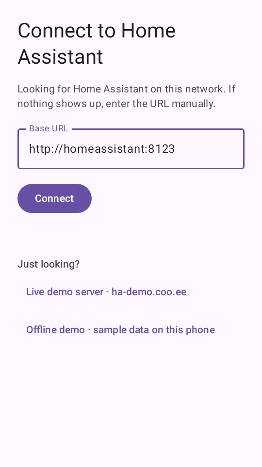 | 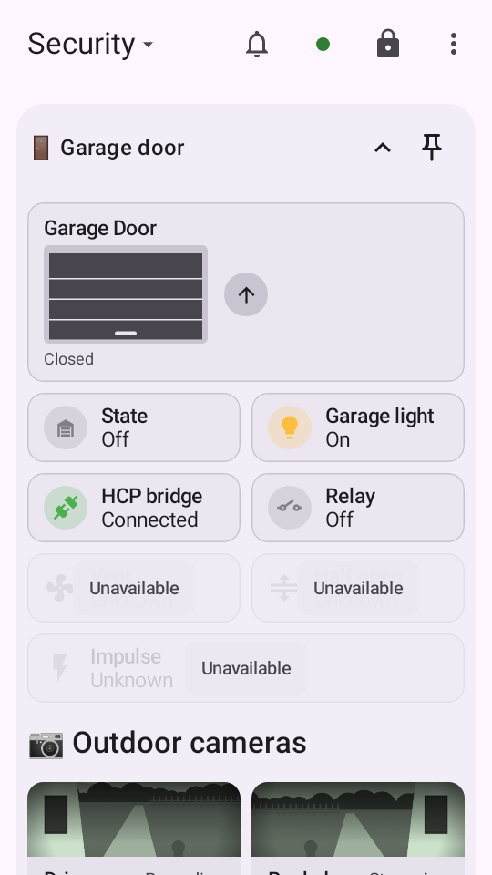 |
| Watch | 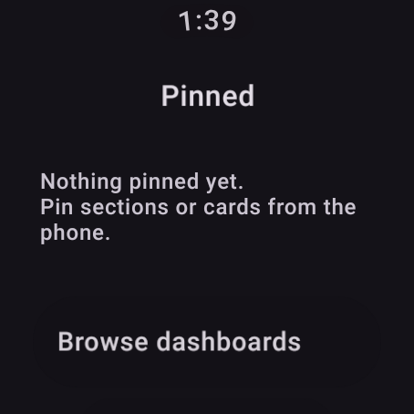 | 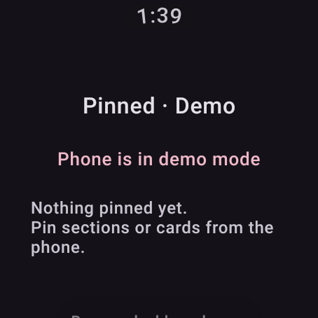 |

One bug the pair found in the simulator rather than the app: the first version called manifest
services on the main thread, and `WearDataDeletionListenerService.onDataChanged` — written, as
its comment says, for Play services' background thread — `runBlocking`s on work that needs the
main thread, so the watch froze on the first large item. Services' callbacks now run on a
`WearableListenerService` handler thread, in order, as on a device.

## Evidence: every Wear interaction API, from two probe apps

Two throwaway probe apps (not committed): a phone and a Wear app with one package, Horologist
0.8.3-alpha's `PhoneDataLayerAppHelper` / `WearDataLayerAppHelper`, androidx.wear
`wear-remote-interactions` 1.1.0 and `wear-phone-interactions` 1.1.1, one button per API, run
paired on `--sdk 35`. Each API in both directions where it has two:

| API | Result |
| --- | --- |
| `NodeClient` `getLocalNode` / `getConnectedNodes` | works |
| `CapabilityClient` `getAllCapabilities` (`FILTER_ALL`, `FILTER_REACHABLE`), `addLocalCapability`, `onCapabilityChanged` | works |
| `GoogleApiAvailability.checkApiAvailability`, Horologist `isAvailable()` | works (was `SERVICE_INVALID`) |
| Horologist `connectedNodes()`, `connectedAndInstalledNodes` | works: the peer, `Installed` |
| Horologist `startRemoteOwnApp`, `startRemoteActivity(ActivityConfig)` | works, `APP_HELPER_RESULT_SUCCESS`; the activity starts on the other device |
| Horologist `installOnNode` | `SUCCESS`: the Play Store link is answered as the store would |
| Horologist `startCompanion` | works both ways: the phone's Pixel Watch app opens (it was `NO_COMPANION_FOUND`) |
| `MessageClient` `sendMessage` (`/request-network`), `sendRequest` / `onRequest` | works |
| `DataClient` `putDataItem`, `getDataItems(wear://*/…, FILTER_PREFIX)`, listeners and services | works |
| `RemoteActivityHelper.startRemoteActivity` (`VIEW` + `BROWSABLE`, data, package) | works both ways (the future never completed before: see below) |
| `RemoteActivityHelper.availabilityStatus` | `STATUS_AVAILABLE` on the watch, `STATUS_UNKNOWN` on the phone |
| `PhoneTypeHelper.getPhoneDeviceType` | `DEVICE_TYPE_ANDROID` |
| `RemoteAuthClient.sendAuthorizationRequest` | works, with `oauthResponse` as the redirect |
| `BridgingManager.setConfig` | works, reported (it looped forever before: see below) |
| `ConfirmationActivity` `OPEN_ON_PHONE_ANIMATION` | works, an ordinary activity of the app |
| `WatchFaceConfigIntentHelper` | works (pure intent extras) |
| `ChannelClient.openChannel` | fails, `API_UNAVAILABLE` (not simulated then; see [Channels and tasks](#evidence-channels-and-tasks)) |

| Phone → watch | Watch → phone |
| --- | --- |
|  |  |

| Phone probe | Watch probe |
| --- | --- |
|  |  |

The probes found five simulator bugs, all fixed:

- **`ResultReceiver` through a `Parcel`.** Robolectric's shadow makes `send` call the receiver's
  own `onReceiveResult`. `RemoteActivityHelper` parcels its receiver before handing it over, and
  the copy is a plain `ResultReceiver` that forwards over its binder, so the result was dropped
  and the launch's future never completed. `SimulatorShadowResultReceiver` runs the framework's
  `send`.
- **A shadow parameter typed `Object[]`.** Robolectric matches a `@ClassName` parameter only when
  it is declared `Object`, so `ShadowGoogleApiAvailability` never applied.
- **`com.google.wear.Sdk`.** With `android.hardware.type.watch` reported, androidx.wear reads the
  Wear OS system library on API 34+, which a device has and Robolectric does not.
- **`unbindService` calling `onServiceDisconnected`.** Robolectric's default; `BridgingManager`
  unbinds in `onServiceDisconnected`, so the two called each other until the log filled the disk.
  The simulator now behaves as a device.
- **A bind reported as a failed start.** Robolectric logs a bind as a start too; the binds to the
  simulator's own Wear OS app services are now recognized as binds.

## Evidence: Horologist's Data Layer sample

Horologist's `datalayer/sample/phone` and `datalayer/sample/wear` debug APKs, unmodified, `--sdk
35`: every screen on both sides and every `DataLayerAppHelper` call.

| Feature | Phone | Watch |
| --- | --- | --- |
| `connectedNodes` (Nodes) / `connectedAndInstalledNodes` (Nodes Listener, Data Layer Nodes) | works | works |
| `startCompanion` | works: opens the Pixel Watch app | works: the phone opens it |
| `installOnNode` | works (`market://` answered as the Play Store would) | works (it threw `NoClassDefFoundError`) |
| `startRemoteOwnApp` / `startRemoteActivity` | works; a running app comes forward rather than stacking | works (it threw `NoClassDefFoundError`) |
| Install app / Re-Engage / Sign-in prompts, stock and custom | works (install app shown with the watch's capability dropped) | — |
| Install Tile prompt, stock and custom | works: the sheet, then the companion's tile editor (it found no watch) | — |
| `markActivityLaunchedOnce` / `markSetupComplete` (Tracking) | read from `surface_info` | works |
| Counter (`ProtoDataStore` over gRPC `sendRequest`) | works | works |
| Tile tracking (`/tile_tracking_enabled`, no payload) | 0 bytes (it arrived as 3) | — |

Six simulator gaps, all fixed:

- **An item with no payload arrived with three bytes.** A frame's absent `data` travelled as JSON
  `null`, and `optString(key, null)` reads that as the text `"null"`, whose Base64 decoding is
  three bytes. Frames are now read through `DataLayerFrames`, where only a string is a value.
- **The watch's clock stood still.** Robolectric sends no `TIME_TICK`, and Wear Compose's
  `TimeText` redraws on it; the simulator now sends one each wall-clock minute (`TimeTick`).
- **No companion app on the phone.** `startCompanion` launches the package
  `getCompanionPackageForNode` names, and the install-tile prompt needs the Pixel Watch app
  (`com.google.android.apps.wear.companion`, version 2.1.0.576785526 or later). The paired phone
  now has it (`PhoneCompanion`), with its launcher activity and its tile-editor deep link.
- **`RemoteActivityHelper` on an API 34+ watch.** wear-remote-interactions 1.2 asks the Wear SDK
  for `RemoteInteractionsManager`; the class did not exist, so every Horologist call that builds
  a `RemoteActivityHelper` on the watch threw. The simulator's Wear SDK now has it.
- **A relaunch stacked another activity.** A `NEW_TASK` start of the task's root with its
  launcher intent brings the task forward on a device (`TaskReuse`); each remote "start own app"
  had added a `MainActivity`.
- **A put of the same contents synced again.** Play services syncs and delivers a data item only
  when it changes; the simulator now reports such a put as `unchanged` and sends nothing.

In a paired launch `Build.DEVICE` and `Build.MODEL` are the node's (`watch-sim`, "Simulated
Watch") rather than `robolectric`, which the sample writes into its proto data.

| | Before | After |
| --- | --- | --- |
| Phone, `startCompanion` | 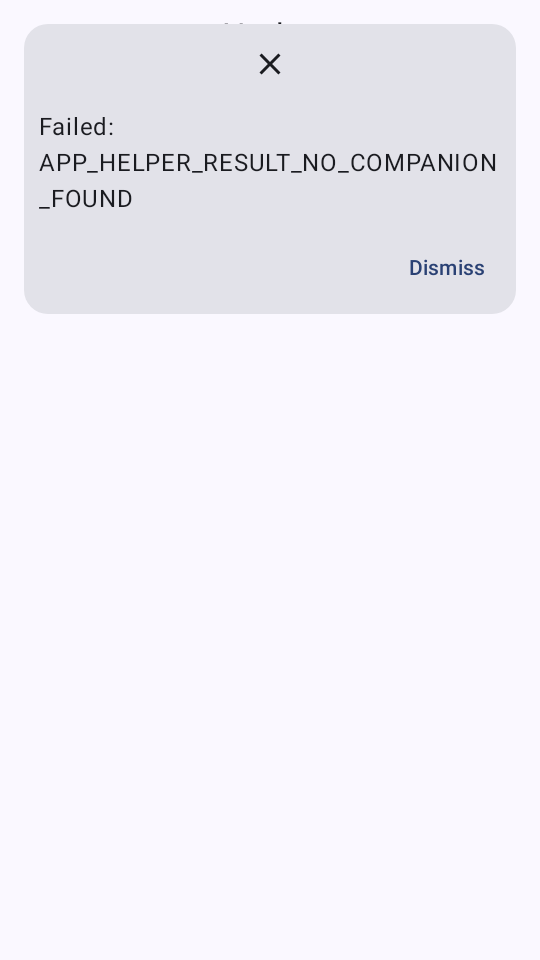 | 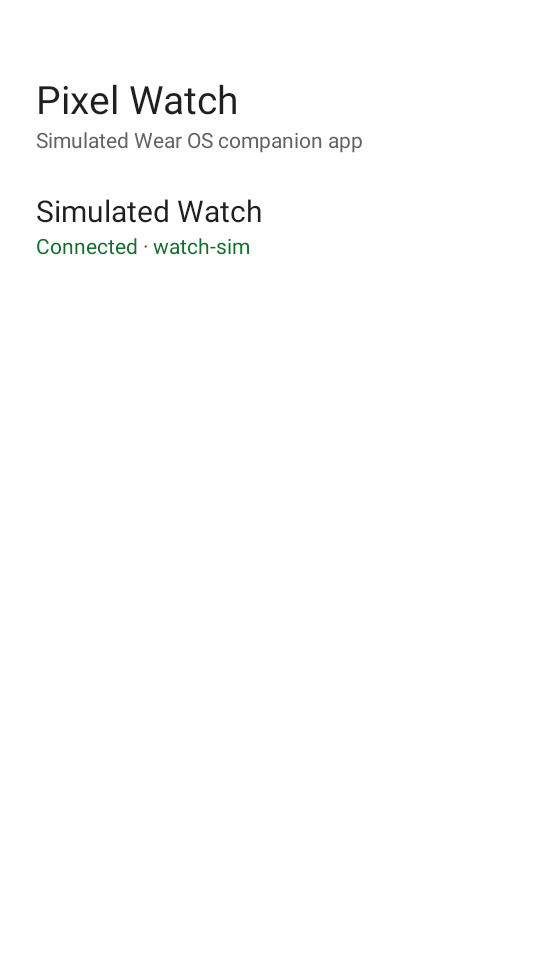 |
| Phone, Install Tile prompt | 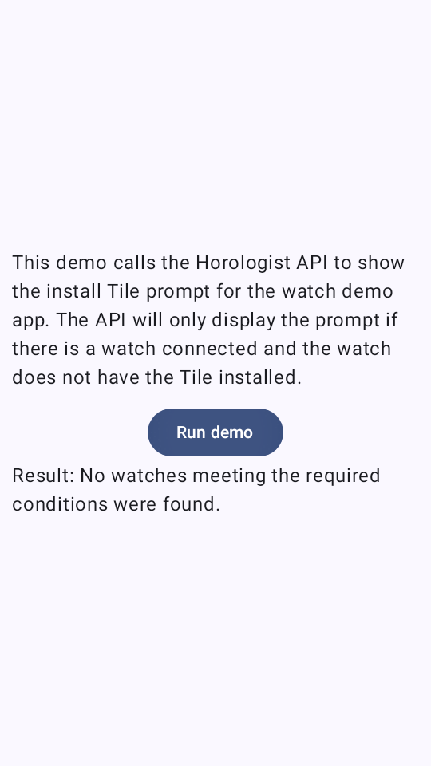 | 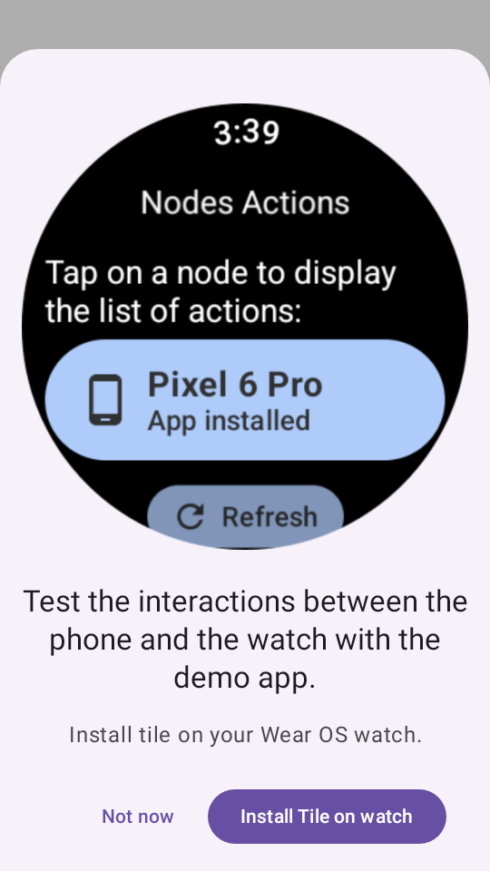 |
| Watch, launch and 8 minutes later | 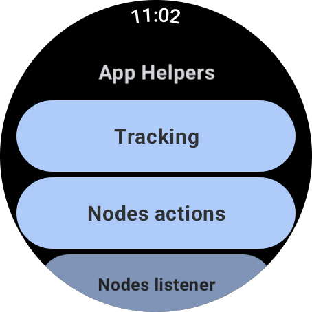 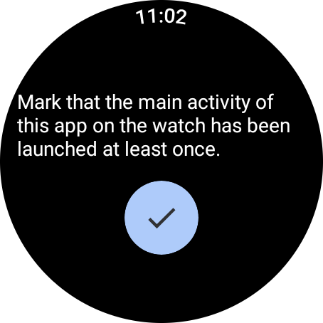 | 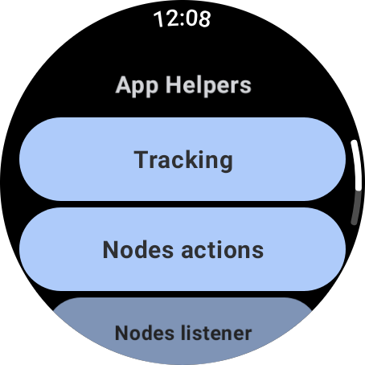 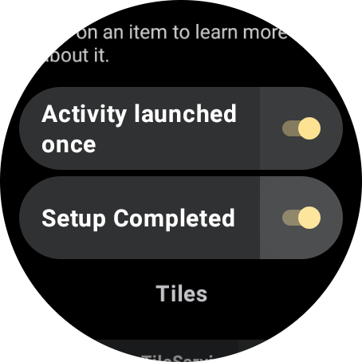 |

## Evidence: channels and tasks

A throwaway probe pair (not committed): a phone and a Wear app, play-services-wearable 19.0.0, a
global `ChannelCallback`, and a `WearableListenerService` with a `CHANNEL_EVENT` filter, run paired
on `--sdk 35`. The peer echoes what it reads on `/probe/echo` and `receiveFile`s `/probe/file`.

| Probe | Before | After |
| --- | --- | --- |
| `tasks`: 24 calls on the main thread across `DataClient`, `MessageClient`, `NodeClient`, `CapabilityClient`, `ChannelClient` and `checkApiAvailability`; is each task complete when it returns? | the `ChannelClient` call failed the run (`API_UNAVAILABLE`, 17) | 23 incomplete on return, all 24 completed later; the one complete on return is `checkApiAvailability` (`ShadowGoogleApiAvailability`'s `Tasks.forResult`, not a client) |
| `chopen`: `openChannel`, write, close the output, read the reply | `API_UNAVAILABLE` | `reply=echo:ping from phone` (and from the watch) |
| `chfile`: `sendFile` 200,000 bytes, `receiveFile` on the peer | `API_UNAVAILABLE` | received 200,000 bytes, same SHA-256 prefix (`8f9d1bf4`) |
| `openChannel` to an unknown node | `API_UNAVAILABLE` | `TARGET_NODE_NOT_CONNECTED` (4000) |
| callbacks | none | `onChannelOpened` on the main thread and in the service; `onInputClosed` / `onOutputClosed` `NORMAL` as each stream ends; `onChannelClosed` `LOCAL_CLOSE` on the closer, `REMOTE_CLOSE` on the peer |

With `--data-layer agent` (the watch alone): `channelOpen` / `channelWrite` "hi from the agent" /
`channelEof` reached the probe's callback and service, which read 17 bytes and echoed them back as
`channelData` / `channelEof` send events; the app's own `openChannel` to the agent showed as a
`channelOpen` send event, and the agent's `disconnect` closed it with `CLOSE_REASON_DISCONNECTED`,
failing the app's blocked read.

| Before (phone) | After (phone) | After (watch) |
| --- | --- | --- |
| 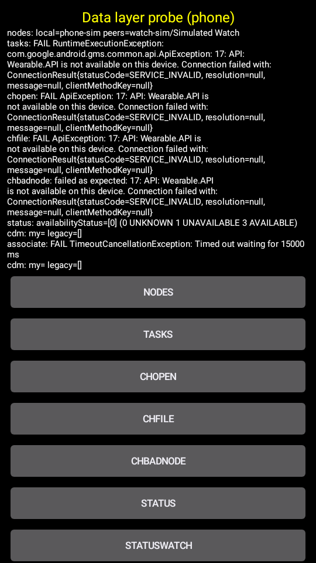 | 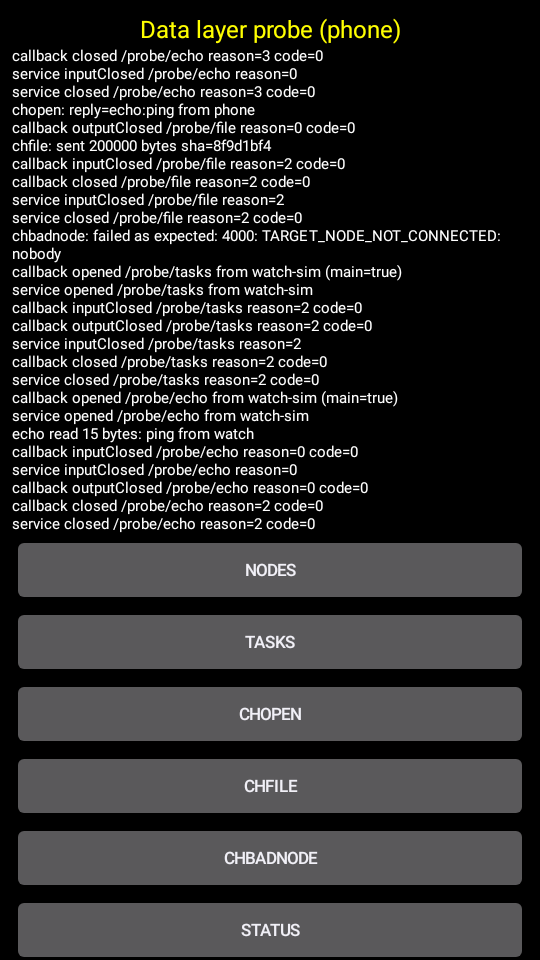 | 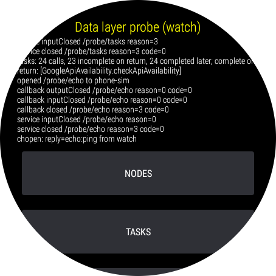 |

No app in the test set uses channels: `dexdump` of Home Assistant, MeshCore, Confetti and the
Horologist datalayer, media and sample APKs finds `getChannelClient` only in Play services' own
`Wearable`, and Horologist 0.8.3's `datalayer`, `datalayer-grpc`, `-phone` and `-watch` libraries
do not call it.

## Evidence: companion devices and remote-interaction status

The same probe pair as for channels (wear-remote-interactions 1.2.0), `--sdk 35`:

| Probe | Before | After |
| --- | --- | --- |
| phone `getMyAssociations()` / `getAssociations()` | empty | `#1 36:3E:D6:01:31:76 'Simulated Watch'`, `DEVICE_PROFILE_WATCH` |
| phone `associate(DEVICE_PROFILE_WATCH)` | never answered (timed out after 15 s) | `onAssociationCreated` with the watch's association (the same one, not a second) |
| watch `getMyAssociations()` | empty | `#1 4A:A7:45:8A:A4:EC 'Simulated Phone'`, no profile |
| watch `RemoteActivityHelper.availabilityStatus` | `STATUS_AVAILABLE` (3) while paired, from the launch flag; nothing on a change | 3 while a peer is connected, and listeners hear each change |

The watch alone with `--data-layer agent`: `availabilityStatus` went 1 (no peer) → 3 on `connect` →
1 on `disconnect`, each heard by one collecting listener. The agent's phone became association #1.
With `{"cmd":"companion","policy":"ask"}`, each `associate()` was a `companion` event with
`state: chooser`. Answering `accept` with an address the chooser did not list created `#2
C0:FF:EE:00:00:42` and answered `onAssociationCreated`; answering `reject` answered `onFailure`.

| Before (phone) | After (phone) | Watch, agent mode |
| --- | --- | --- |
|  | 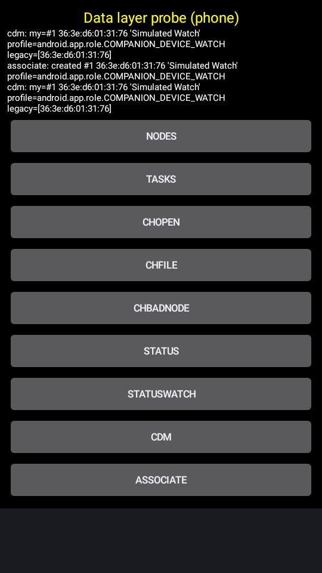 | 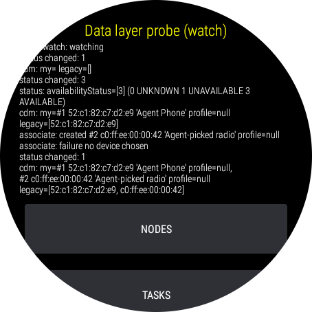 |

No app in the test set calls `associate()`. MeshCore's phone reads `getMyAssociations()` to observe
its saved BLE radio's presence, and matches by MAC, so the seeded watch association does not
change what it does.

## Evidence: MeshCore

`meshcore-debug.apk` with `meshcore-wear-debug.apk`, `--sdk 36`. Three causes, in order, kept the
watch from ever reaching its phone:

1. **The watch skips the Data Layer under Robolectric.** `WearAppGraph` checks `Build.FINGERPRINT
   == "robolectric"` (its preview renderer's test) and then uses `PreviewWearClient`, canned
   data, instead of Horologist's `WearDataLayerRegistry`. That is what the earlier "Radio not
   connected" was. `launch --fingerprint <device fingerprint>` makes it take the real client.
2. **No `horologist_phone` capability (a MeshCore bug).** The watch's gRPC channel targets
   `TargetNodeId.PairedPhone`, which Horologist resolves as
   `getCapability("horologist_phone", FILTER_ALL).nodes.singleOrNull()`. The phone APK has no
   `android_wear_capabilities` resource at all, so on a device too the watch finds no phone:
   "Phone not reachable". MeshCore uses neither `PhoneDataLayerAppHelper` nor
   `WearDataLayerAppHelper`; only the registry and `datalayer-grpc`. The fix belongs in the
   phone app's `res/values/wear.xml`. In the simulator `{"cmd":"dataLayer","addCapability":
   "horologist_phone"}` on the phone stands in for it.
3. **A request to a `MESSAGE_RECEIVED` service (a simulator gap, fixed).** The phone's
   `MeshcoreWearDataService` (`BaseGrpcDataService`) declares `MESSAGE_RECEIVED` for
   `/WearGrpcService/…`, as Horologist's samples do, and Play services delivers `sendRequest`s
   there too; the simulator only looked for `REQUEST_RECEIVED`.

With all three addressed, the watch's `GetConnectionStatus` crosses as a `sendRequest`, the
phone's service answers (6 bytes), and the watch shows the phone's real state: its radio is not
connected, since the simulator has no BLE device in range.

| No `horologist_phone` | Answered by the phone |
| --- | --- |
|  |  |

## Evidence: the agent as the peer

`--data-layer agent`, one app at a time, the agent playing the other device:

- **Home Assistant's phone app alone.** `connect` a watch (`data_layer_app_helper_device_watch`),
  then tap "Offline demo": every data item the phone writes arrives as a `send` event, its
  `DataMap` decoded (`{"proto":{"type":"bytes",…},"ts":{"type":"long",…}}`), 15 paths from
  `/wear/settings` to `/wear/values`, plus its `/wear/stream` messages.
- **Home Assistant's watch app alone.** `connect` a phone, then `put` the phone's items captured
  above: the watch switches to the phone's demo mode, as when paired. Its `/wear/lease`
  heartbeats arrive as `send` events. On `disconnect` the phone leaves `getConnectedNodes` and
  its capability is reported gone to the watch's listeners; the UI keeps the synced data and
  shows no disconnected state, so the run cannot show more than that.
- **MeshCore, the Horologist handshake.** The watch alone (with `--fingerprint`): a phone that
  connects without `horologist_phone` gets no request; once its `capabilities` add it, the
  watch's gRPC `GetConnectionStatus` arrives as a `send` with a `requestId`. A `reply` with an
  `error` leaves the watch at "Phone not reachable". The phone alone answered the same request
  bytes, sent with `request`, with 6 bytes; `reply`ing those to the watch, it shows the phone's
  radio state, as in the paired run.

| Watch: agent phone connected | After `put /wear/settings` (and the rest) |
| --- | --- |
|  |  |

| MeshCore watch: `reply` with an error | `reply` with the phone's answer |
| --- | --- |
|  |  |

## Evidence: Play services availability

A probe app (phone and watch) calling every availability API, paired, before and after
`ShadowGooglePlayServicesUtilLight` and the reworked `ShadowGoogleApiAvailability`: Play services
reported `SERVICE_INVALID` everywhere, so an app gating its Wear code on
`isGooglePlayServicesAvailable == SUCCESS` never reached the Data Layer, and the `HasApiKey`
overload of `checkApiAvailability` (a Kotlin caller holding a `HasApiKey<*>`) fell through to Play
services' own. Now Play services is installed (25.42.34) and every overload agrees. With
`--play-services none`, `makeGooglePlayServicesAvailable` shows Play services' own dialog.

| Before (paired phone) | After (paired phone) | `--play-services none` (watch) |
| --- | --- | --- |
| 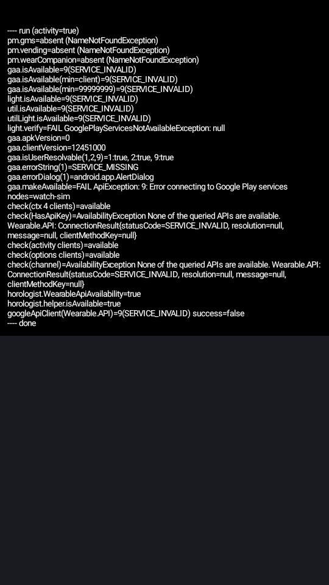 | 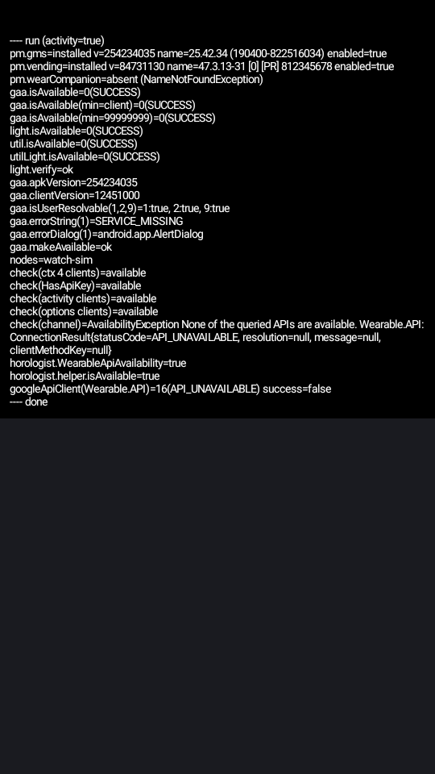 | 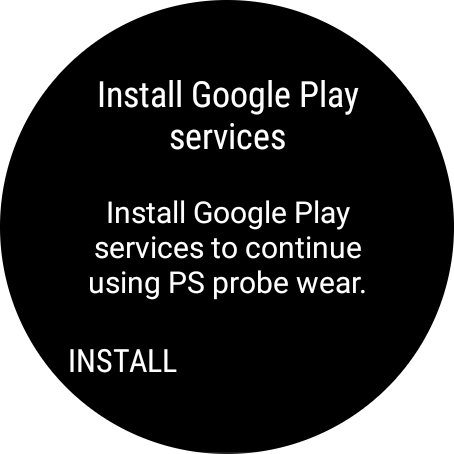 |

## What is missing

- **Fidelity gaps, all in `DataLayer`.** `getCapability` leaves out the local node (Play
  services includes it when the local app has the capability); filters on `getCapability` /
  `getAllCapabilities` (`FILTER_REACHABLE` vs `FILTER_ALL`) are ignored, since every peer is
  reachable; `onPeerConnected` / `onConnectedNodes` are not delivered; `getNodeId` answers
  null.
- **`ChannelClient`** has no flow control (a writer never blocks on a slow reader; the bytes
  queue in the reader's memory) and the deprecated `ChannelApi` / `Channel` (`GoogleApiClient`)
  and its `WearableListenerService` overloads are not simulated, as with the other `*Api`s.
- **Wear SDK services.** Only `RemoteInteractionsManager` is simulated; `Sdk.getWearManager`
  answers null for any other.
- **Things only the system does.** No browser or Play Store opens a remote `https:` / `market:`
  intent (reported, answered OK); the phone's Pixel Watch app is a single screen naming the
  paired watch, with none of the real app's setup or settings.
- **The deprecated `GoogleApiClient` APIs** (`Wearable.DataApi`, `MessageApi`, …) are not
  shadowed.
- **R8-minified APKs.** A minified app renames or removes `Wearable` and the abstract client
  methods, and the shadow, which matches by name, no longer applies. Debug builds work;
  release builds would need the shadow keyed by a mapping file or a keep rule.
- **Threading.** Manifest services are called on one background thread, live listeners on the
  main thread (Play services' default without a `Looper` argument); a listener added with its own
  looper or executor is still called on the main thread.
- **Starting the other app.** Real Play services would start a stopped app to deliver to its
  manifest service; here both apps are always running, so that path is not exercised.
- **One phone, one watch.** The hub relays to every node, so more watches would work, but the
  CLI starts exactly two.
- **Driving it from the control channel** is `--data-layer agent` ([`../SIMULATOR.md`](../SIMULATOR.md)):
  one simulator, with the agent playing its peers through the same frames the hub relays
  (`DataLayerAgent`), channels included (`channelOpen`, `channelWrite`, `channelEof`,
  `channelClose`).
- **MeshCore's own handshake** (above) needs `horologist_phone`, which its phone does not
  declare; the simulator surfaces that rather than papering over it.

## Estimate

The prototype covers what both apps use. To make it the default for `launch --pair`:

| Work | Estimate |
| --- | --- |
| Fidelity gaps above, with unit tests over a fake link | 1–2 days |
| Minified APKs (mapping-file lookup of `Wearable` and the clients) | 2–3 days |
| MCP server / `docs/SIMULATOR.md` integration of the paired session | 1 day |
