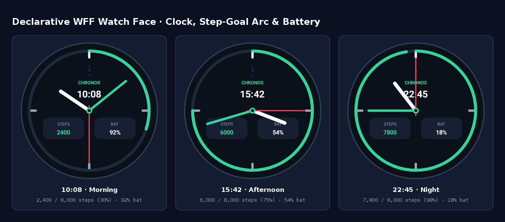
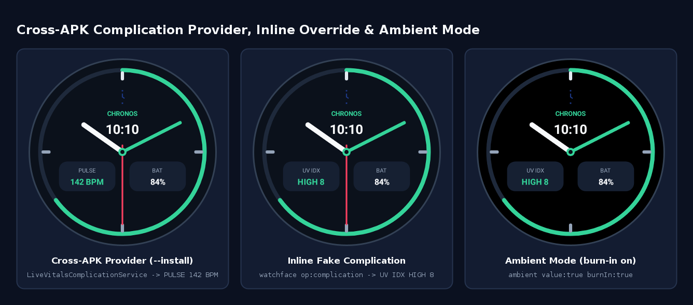
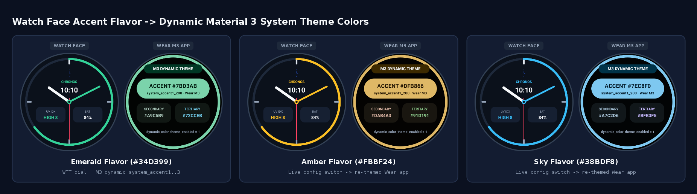
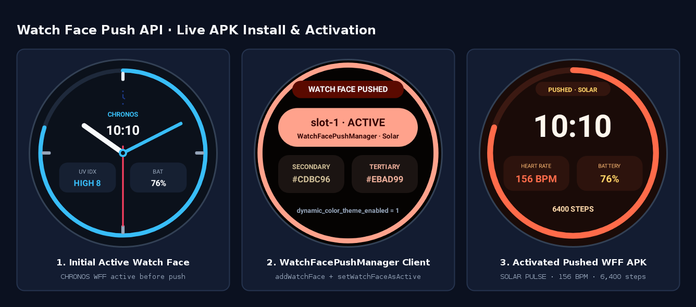

# Wear Watch Face, Watch Face Push & Complication Scenarios in `compose-preview launch`

## Overview

`compose-preview launch` and `compose-preview-mcp` host and scenario-test the three Wear OS watch
face surfaces in any combination — standalone or together on one simulated watch:

1. **Declarative / Watch Face Format (DWF / WFF) watch faces** (`watch_face_info.xml`):
   - **Real runtime path (`--dwf-runtime <apk|auto>`)**: runs Google's
     `com.google.wear.watchface.runtime` (`DeclarativeWatchFaceRuntime.apk`) in the simulator and
     side-loads resource-only WFF APKs via `WffWatchFaces` (`SimulatorShadowPackageManager` +
     `createPackageContext`). `compose-preview dwf-runtime pull --from-adb | install <apk> | status`
     provisions the runtime APK into `${XDG_CACHE_HOME:-~/.cache}/composeai/dwf-runtime/` without
     redistributing Google's binary.
   - **Built-in Remote Compose path (automatic fallback)**: when no runtime APK is present,
     `ApkDwfExtractor` compiles WFF XML into `.rc` documents and `DwfWatchFaceClient` plays them
     in-process via `RemoteComposePlayer`, injecting simulated clock, health, battery, weather,
     accelerometer, user configurations and complication variables on every frame.
2. **Watch Face Push apps** (`androidx.wear.watchfacepush.WatchFacePushManager`):
   - `:simulator-host` implements `com.google.wear.services.watchfaces.watchfacepush.*`
     (`WatchFacePushManager`, `WatchFaceSlot`, `ListWatchFaceSlotsResponse`), returned by
     `com.google.wear.Sdk.getWearManager(context, WatchFacePushManager.class)` and backed by
     `WatchFacePushStore`.
   - Apps calling `addWatchFace`, `updateWatchFace`, `listWatchFaces`, `removeWatchFace`,
     `isWatchFaceActive` and `setWatchFaceAsActive` (or agents sending `watchface op:push | pushed |
     removePush`) dynamically register the pushed WFF APK with `WffWatchFaces` (or compile it on
     the fly via `ApkDwfCompilerMain`) and activate it in `WatchFaceHost`.
3. **Wear apps providing complications** (`ComplicationDataSourceService`):
   - Same-APK and `--install <comp.apk>` cross-APK providers bind over `IComplicationProvider`
     (`DeviceBus` carries parcelled `ComplicationData` across simulator JVMs).
   - `ComplicationParcels` builds, decodes and summarizes wire `ComplicationData` (`SHORT_TEXT`,
     `LONG_TEXT`, `RANGED_VALUE`, `MONOCHROMATIC_IMAGE`, `SMALL_IMAGE`, `GOAL_PROGRESS`), selects
     active timeline entries against `WatchState`, fires `tapAction` `PendingIntent`s on
     `watchface op:tap`, and supports inline fake complications when `component` is omitted.

## Platform Inputs (`WatchState`) & Dynamic Material 3 Theme Colors

All Wear surfaces share one `WatchState` per simulated watch:

- **`clock`**: pins or scales wall-clock time (`time`, `timeMillis`, `timeZone`, `is24Hour`,
  `frozen`, `rate`, `dstMode`, `reset`), broadcasting `ACTION_TIME_CHANGED` /
  `ACTION_TIMEZONE_CHANGED` and driving both `WatchFaceClient` and `DwfWatchFaceClient.MutableClock`.
- **`health`**: updates `heartRate`, `heartRateAccuracy`, `steps`, `stepGoal`, `distanceMeters`,
  `calories` and `floors`, pushing `SensorEvent`s to `SensorManager` listeners (`TYPE_HEART_RATE`,
  `TYPE_STEP_COUNTER`), tiles, Glance Wear widgets and WFF `[STEP_PERCENT]` / `[HEART_RATE]`
  expressions.
- **`battery`**, **`weather`** (current + hourly + daily forecasts), **`accel`** (`x`, `y`, `z`),
  and **`ambient`** (`burnIn`, `lowBit`) feed WFF expressions and system listeners alike.
- **Dynamic Material 3 colors (`WatchFaceDynamicColors` + `SimulatorShadowResources`)**: enabled by
  default on Wear (`--theme-from-watchface`, toggled via `--no-theme-from-watchface` or
  `watchface op:theme`). Extracts `{primary, secondary, tertiary, source}` from the active watch
  face's `ColorConfiguration` / `UserStyle` option or rendered frame, emits `watchfaceColors`
  events, exposes `status.colors`, sets `Settings.Global.dynamic_color_theme_enabled = 1`, and
  overrides `android.R.color.system_accent1..3_*`, `system_neutral1..2_*`, `system_error_*`,
  `system_primary_dark` and `system_surface_container_*` in `Resources` so Wear Compose Material 3
  `dynamicColorScheme(context)` re-themes automatically.

## Scenario Runner & MCP Surface

- **Headless scenario runner**: `compose-preview launch ... --scenario <file.jsonl|json|yaml>
  [--report-dir <dir>]` replays steps — control commands or their shorthands — each optionally
  carrying `snapshot` (a named PNG) and `expect` (dotted paths into `last`, `status` and `events`;
  values, `#RRGGBB±tol`, numeric comparisons, `contains`, `exists`, and `frame.*` pixel checks)
  across single-app and `--install` multi-app sessions, writing `report.json` and exiting non-zero
  on any failed step.
- **`compose-preview-mcp`**: exposes `install`, `watchface`, `dwfRuntime` and `themeFromWatchface`
  on `simulator_launch`, all Wear scenario commands (`clock`, `weather`, `accel`, `battery`,
  `health`, `watchface`) on `simulator_command`, and `simulator_watchface_snapshot` to inspect
  `watchface {op: status}` alongside the display PNG in one call.

## Visual Verification

Captured end to end through `compose-preview launch ... --scenario ...` on a 454x454 round Wear
display:

