# `compose-preview launch` — an APK in Robolectric's simulator

Evidence for [`docs/SIMULATOR.md`](../../../SIMULATOR.md): `samples/android`'s debug APK
(`:samples:android:assembleDebug`), converted from dex by `ApkClassConverter` and run in
Robolectric 4.17's simulator on JDK 25, in this repository's cloud sandbox.

| The window (Xvfb) | After `tap` → the app's `startActivity` | After `qualifiers` `+land` |
| --- | --- | --- |
| 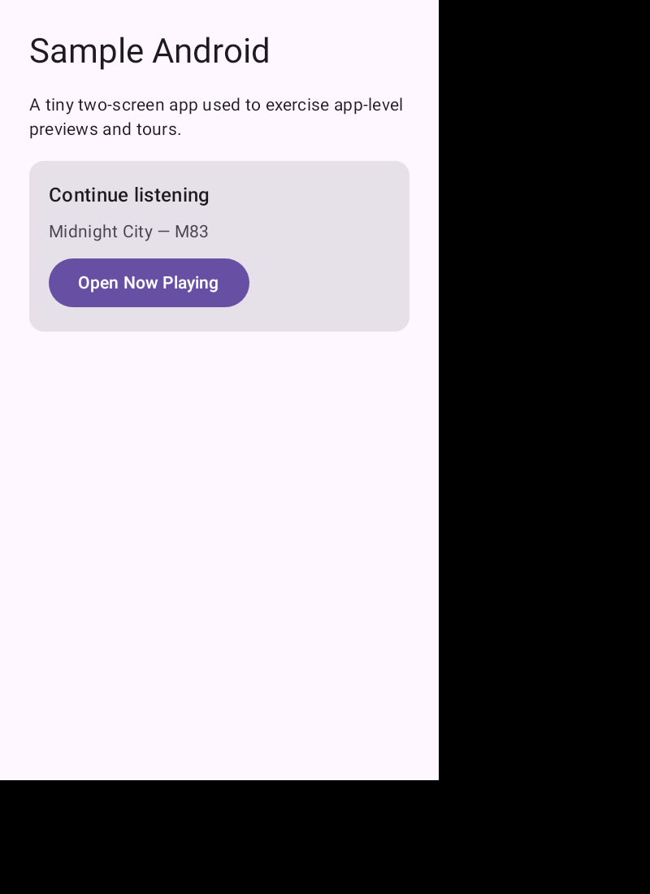 | 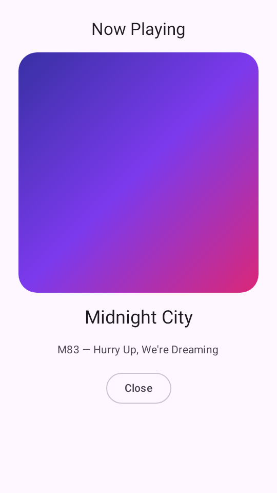 | 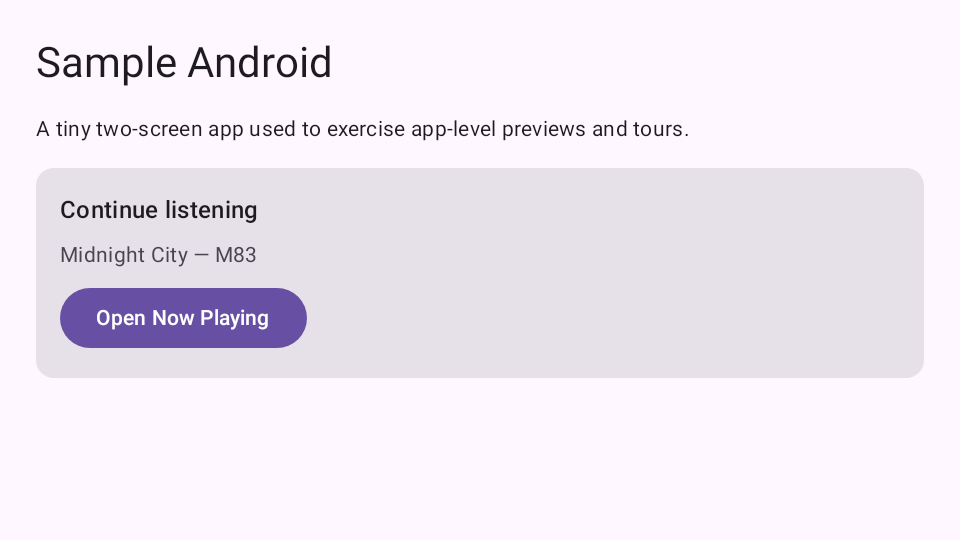 |

- **window** — `compose-preview launch app.apk` under `xvfb-run`, captured with `import -window
  root` after 25 s. The Swing window draws the 540×960 display (the `w360dp-h640dp-hdpi`
  default) one pixel to one pixel; there is no window manager, hence no frame.
- **now playing** — `--control stdio`: `{"cmd":"tap","text":"Open Now Playing"}` taps the Compose
  button found through the semantics hierarchy; the app's own `startActivity` is drained by
  `Navigator` and `NowPlayingActivity` launched onto the back stack; then `screenshot`.
- **landscape** — `{"cmd":"qualifiers","value":"+land"}` recreates `MainActivity` at 960×540.

## Watching the agent

With `--control stdio` and a display, the window stays up and draws what the agent sends —
captured from the Xvfb screen (not the agent's screenshots, which never contain the overlay):

| `tap "Open Now Playing"` (ring at the tap, on the screen it opened) | `swipe` |
| --- | --- |
| 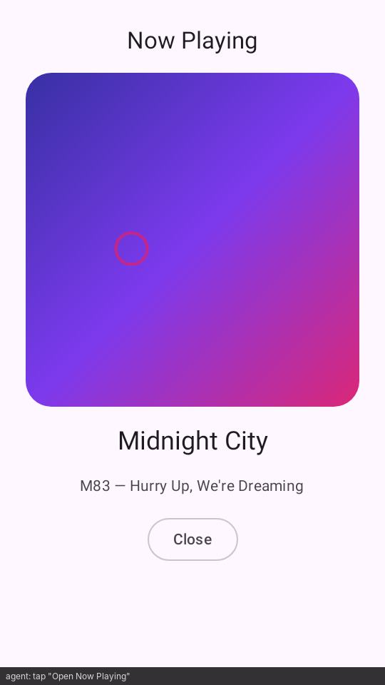 | 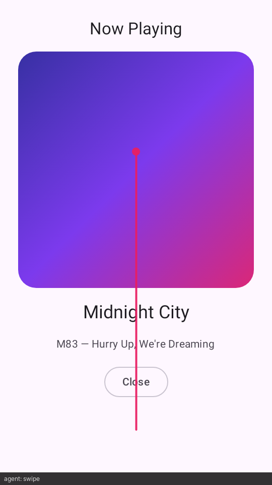 |

Re-collect: build the APK, `./gradlew :cli:installDist`, then drive
`cli/build/install/compose-preview/bin/compose-preview launch <apk> --java <jdk21+> --control
stdio` with the commands above.

## Real apps

Debug APKs built from each project's `main`, run headless (`--control stdio --headless`) on JDK 21;
screenshots are the control channel's `screenshot`.

**Now in Android** (`app-demo-debug.apk`), after a 10 s wait, then `tap "Interests"`, `tap
"Saved"`, `tap` the Settings action. The topics come from the demo flavor's sync, run by
WorkManager once the network reads as connected:

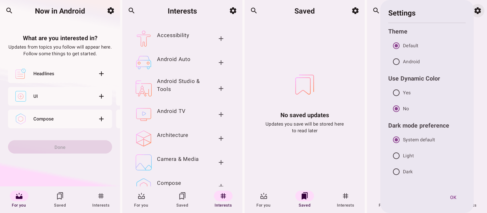

**Confetti** (`androidApp-debug.apk`, `--sdk 36`), its onboarding after startup. Past `Skip` the
conference list stays empty here: this sandbox's network refuses `confetti-app.dev`.

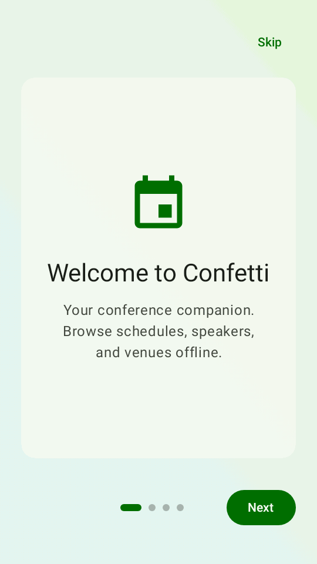

**Home Assistant RemoteCompose, Cadence, MeshCore** (debug APKs, `--sdk 36`): Home Assistant's
connect screen, then its offline demo after `tap "Offline demo · sample data on this phone"`;
Cadence's library, its activity built by Metro's `AppComponentFactory`; MeshCore's device list.

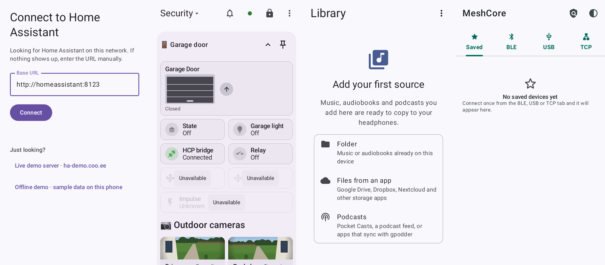

**Sunflower, Muzei, MeshCore's Bluetooth flow** (debug APKs): Sunflower's plant list from the
Room data its seed worker loads (the photos come from upload.wikimedia.org, which this sandbox's
network refuses); Muzei's intro, its nine content providers installed; MeshCore's BLE tab asking
for the permission, then scanning after `tap "Grant permission"` is granted.

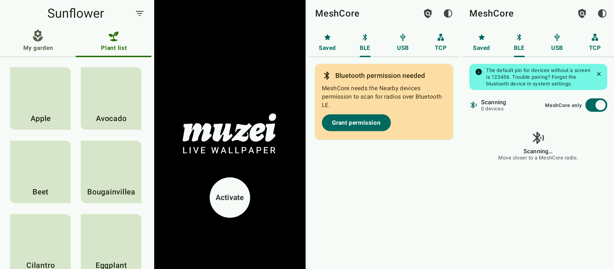

## Network, Wi-Fi and Bluetooth

`network`, `wifi` and `bluetooth` ([`docs/SIMULATOR.md`](../../../SIMULATOR.md#network-wi-fi-and-bluetooth)),
headless on JDK 21, screenshots from the control channel.

**Now in Android** (`app-demo-debug.apk`): `network` `mode` `offline` brings up its "You aren't
connected to the internet" snackbar (its `NetworkMonitor` listens with an `INTERNET` request and
hears `onLost`); `cellular` clears it; `cmd connectivity airplane-mode enable` brings it back;
`settings put global airplane_mode_on 0` and `wifi` clear it. The Firebase connections open at
the time were cut (`traffic.cut` 1, then 2).

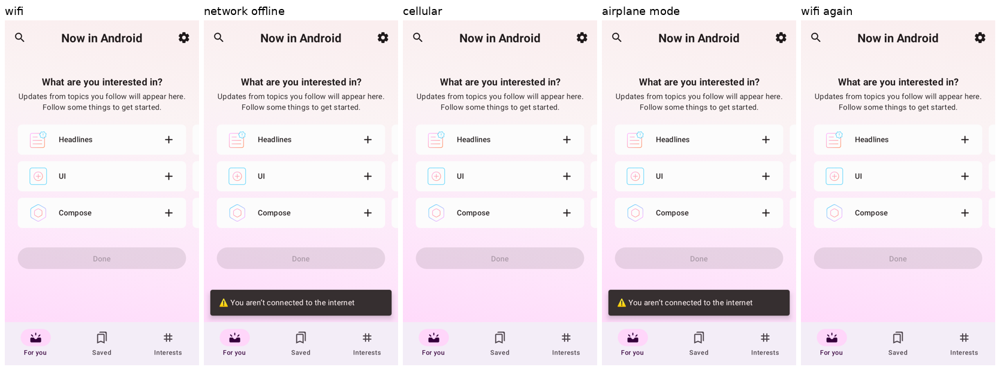

**A probe app** (kept out of the repo: one activity that logs every callback and broadcast it
gets). Cellular 5G reads `MOBILE/NR`, metered, 150/30 Mbps, `TelephonyManager` type 20 and data
connected; offline its `HttpURLConnection` fetch fails with `UnknownHostException: Unable to resolve
host "www.google.com": No address associated with hostname` (online, this sandbox's proxy refuses
the host: the 403); its `WifiNetworkSpecifier` request for `Printer-Setup` is held (`wifi request`
`policy` `ask`), reported as a `wifiRequest` event, then `answer` `accept` gives it `peer
onAvailable`; `addNetworkSuggestions` then `wifi connect Cafe` sends
`WIFI_NETWORK_SUGGESTION_POST_CONNECTION`; the internet panel comes back `RESULT_CANCELED` (7 → 0).
With Bluetooth off, `ACTION_REQUEST_ENABLE` waits for `bluetooth request answer accept`, then
`STATE_CHANGED` 11 → 12 and `RESULT_OK` (8 → -1); `bluetooth advertise` puts `MeshRadio` (Nordic
UART service, with a GATT spec) on air, the filtered scan finds it, `connectGatt` connects,
discovery finds the service, the write reaches the agent as a `gatt` event (`68656c6c6f`,
"hello"), and `bluetooth notify` delivers "hi from the radio".

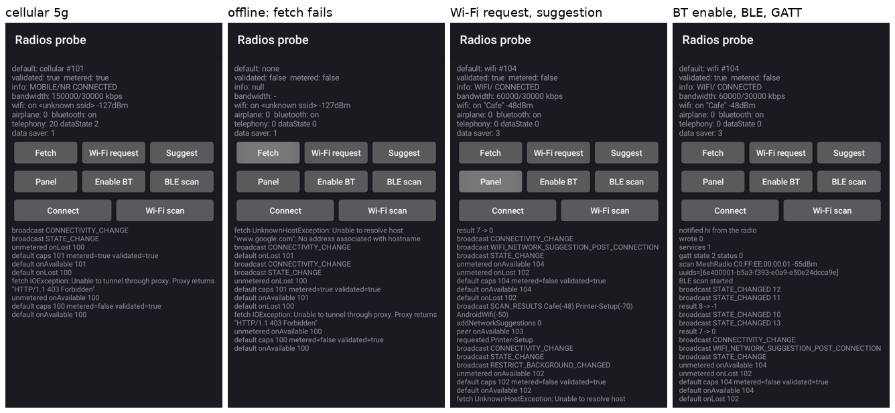

**Sunflower** offline: its plant photos fail with `UnknownHostException: Unable to resolve host
"upload.wikimedia.org"` (13 connections refused). **MeshCore** (`--sdk 36`): after the Bluetooth
permission grant its Kable scanner runs, and the radio `bluetooth advertise` puts in range appears
with its name, address and RSSI. Its Connect stops in Kable's own precheck ("Connection failed:
Bluetooth not supported") before `connectGatt`, so its GATT session is not reached yet.

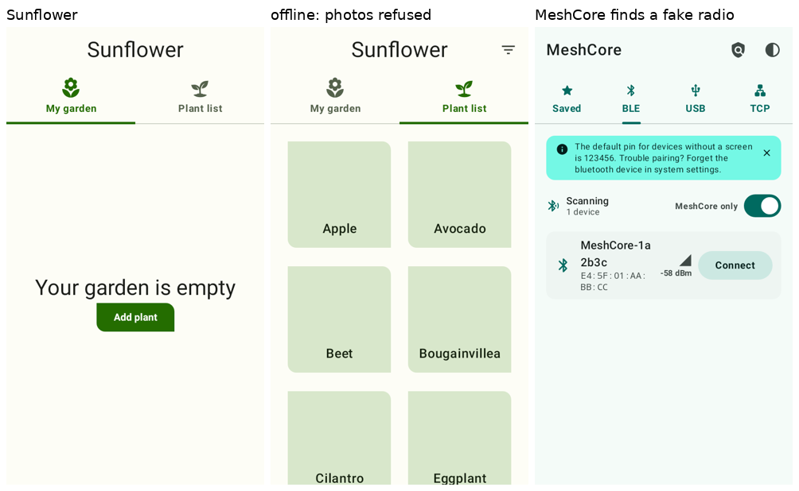

## Display, fold and device controls

Now in Android's demo debug APK, headless and under Xvfb, driven over `--control stdio` with the
display commands (`device`, `rotate`, `posture`, `resize`, `qualifiers`, `fontScale`); screenshots
are the control channel's `screenshot` unless noted.

**Fold postures** — `device foldable`, `tap "Interests"`, `rotate landscape` (841×673dp), then
`posture`. Flat is what `main` shows at that size, since no fold reached the app before: a
navigation rail and the list-detail pair. In `tabletop` (a horizontal half-opened fold)
`NavigationSuiteScaffold` moves to a bottom bar, as Material's adaptive library does for
`isTabletop`; in `book` (vertical, half-opened, so separating) the detail pane starts at the
hinge; with `hingeDp: 40` it starts past the hinge band.

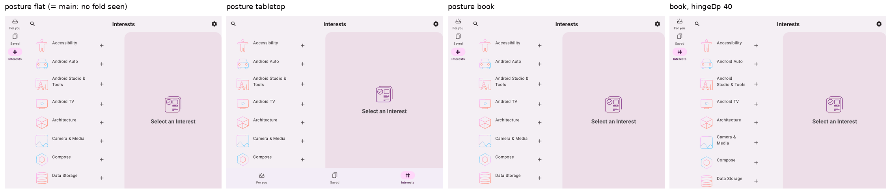

**Device presets and rotation** — `device phone` (411×891dp: bottom bar), `device foldable` (673×841dp
open: a rail, one pane), the phone after `rotate` (891×411dp), `device tablet` (1280×800dp) and
`device desktop` (1920×1080dp at mdpi): list-detail with a rail.

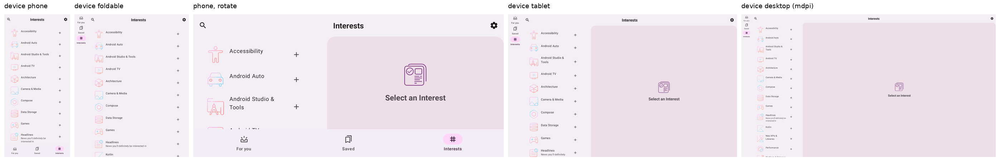

**Configuration at run time** — `qualifiers +night` and `fontScale 1.5`, each recreating the
activity as a device does.

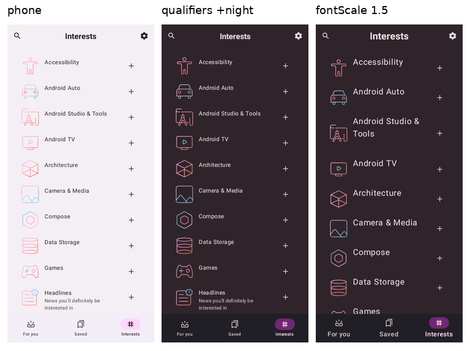

**The window follows** — the Xvfb screen (`import -window root`, scaled), after launch, after the
foldable in landscape, and after `device desktop`: the Swing window is resized to the display each
time.

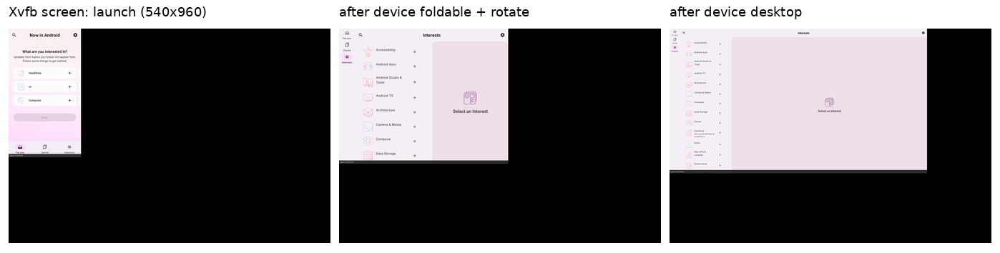

## Wear OS, Glimmer and Android XR

`launch` detects the form factor from the APK (`docs/SIMULATOR.md` → Form factors). All headless
(`--control stdio --headless`) on JDK 21; screenshots are the control channel's `screenshot`.

**Home Assistant's Wear app** (`:wear:assembleDebug` of homeassistant-remotecompose), before and
after: the same APK on the phone default (`--form-factor phone`, what `launch` used for every APK
before), then detected as Wear on the round 454×454 watch display, cropped round as a round
`@Preview` is; then after `{"cmd":"rotary","delta":-1,"count":6}` and a 2 s `wait`, the crown has
scrolled its `ScalingLazyColumn` to Settings.

| Before: phone default | After: round watch | After `rotary` |
| --- | --- | --- |
| 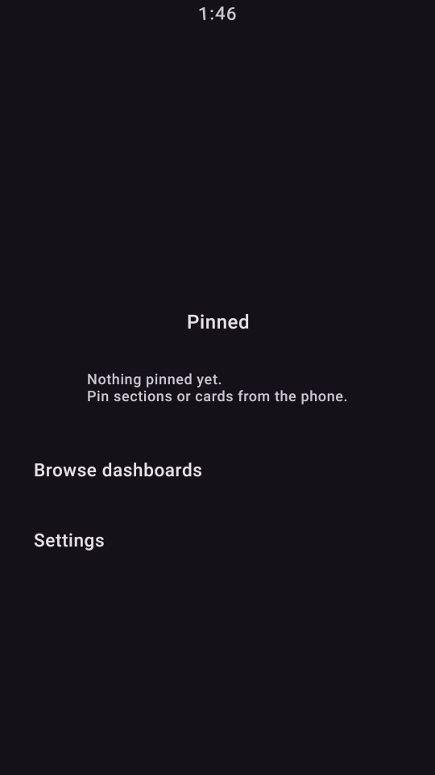 | 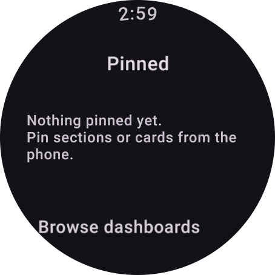 | 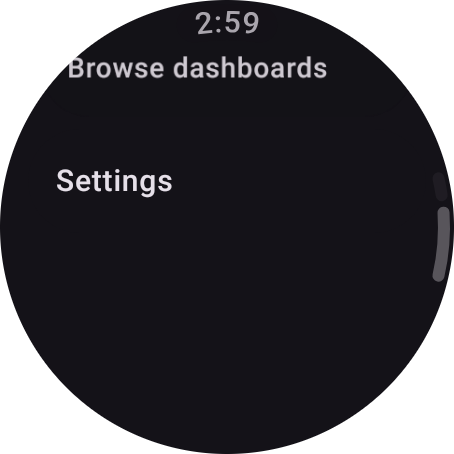 |

**`samples/wear`** (`:samples:wear:assembleDebug`), then `{"cmd":"rotary","delta":-1,"count":6}`:
the crown scrolls its `TransformingLazyColumn` to the `EdgeButton`. **MeshCore's Wear app** starts
with no radio, as it would with no phone paired.

| `samples/wear` | after `rotary` | MeshCore Wear |
| --- | --- | --- |
| 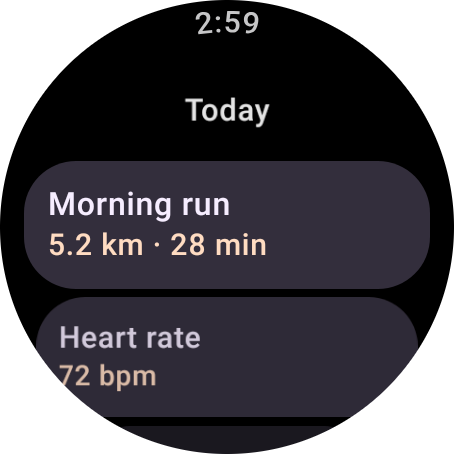 | 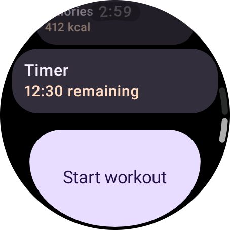 | 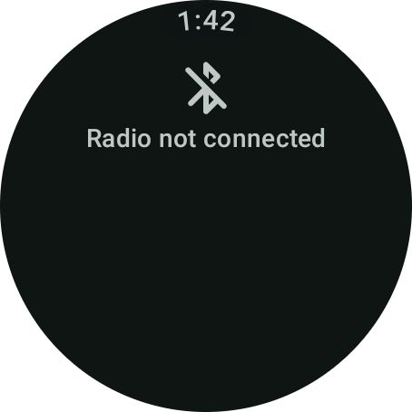 |

**Glimmer and XR.** No Glimmer or XR app lives in this repository (`samples/xr-glimmer` is a
library), so these come from two throwaway probe apps, not committed: a Glimmer activity
(`TitleChip`, `Card`, two `ListItem`s) declared `requiredDisplayCategory="xr_projected"`, on the
960×720 glasses display; and an `androidx.xr.compose` 1.0.0-beta02 app in Home Space, its `Orbiter`
rendered inline, after one `tap "Click"`. The Glimmer probe sets no theme, hence the action bar.

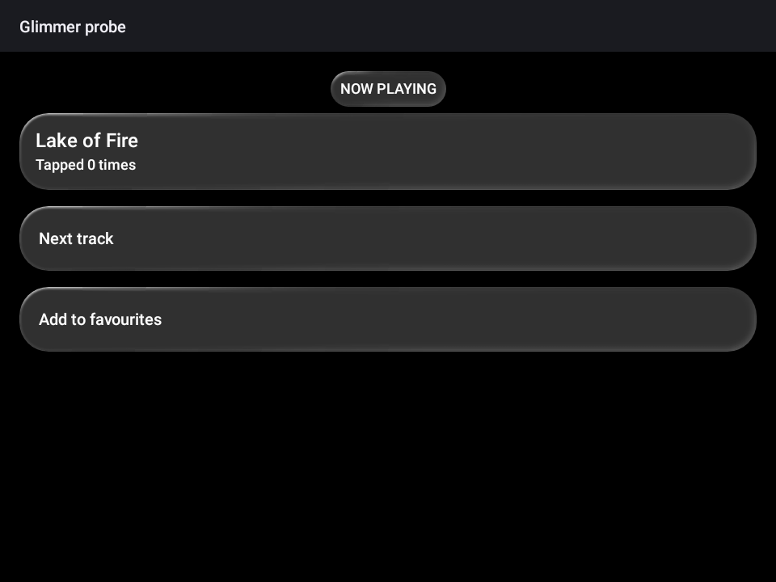

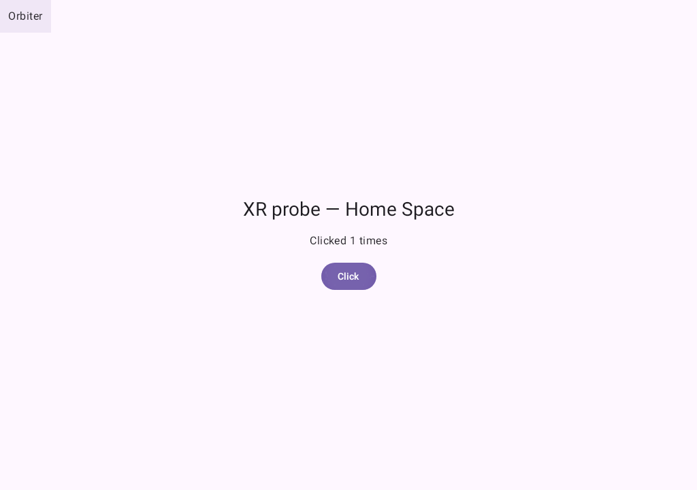

## More than one display

A probe APK (plain Views, built outside the repository) that listens for displays, shows an
`android.app.Presentation` on each presentation display, and launches a second activity onto one
with `ActivityOptions.setLaunchDisplayId`. Headless, with `launch --display 960x540,name=TV`,
driven over `--control stdio`; each image is the control channel's `screenshot` with `display` (or `"all"`), unless noted.

**A presentation on the TV** — the app's `DisplayListener` and `getDisplays(
DISPLAY_CATEGORY_PRESENTATION)` find the display, and its `Presentation` draws there at the
display's 960×540. Two `tap {"display":1}` reached the presentation's button; the phone's picture
does not contain it (before this change, Robolectric drew every window into the one screen).

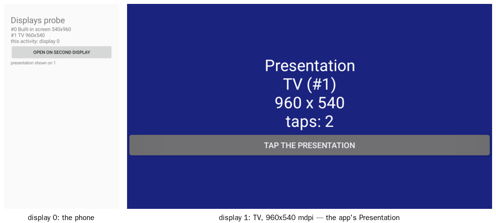

**Activities on a display** — the app's own `setLaunchDisplayId` puts `SecondActivity` on the TV
while `MainActivity` stays resumed on the phone; `SecondActivity` reports the TV's 960×540dp. After
`displays change` to 640×360dp at xhdpi it is re-created there at 1280×720 pixels. (Its "Open
another here" starts a third activity with no options, which stays on the TV.)

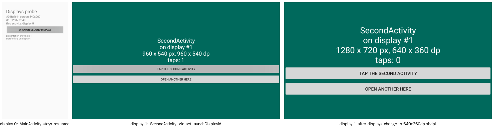

**The windows** — under Xvfb (`import -window root`, cropped and scaled): the phone, then a window
per secondary display (titled `<name> — display <id>`; no window manager, hence no frames): the TV
with `SecondActivity`, and a 480×360 virtual "Projector" added with `displays add`, showing its
presentation.

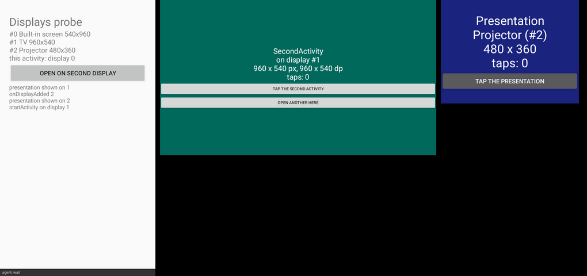

## Home screen and widgets

`launch --launcher` (`docs/SIMULATOR.md` → Home screen and widgets), on `samples/android`'s debug
APK, headless on JDK 21; screenshots are the control channel's `screenshot`, scaled to half. The
sample carries one widget of each kind for this: `WeatherAppWidgetReceiver` (classic
`RemoteViews`, its whole body a click into the app), `CounterWidgetReceiver` (Glance, a `+1`
button with an `actionRunCallback`) and `TaskListWidgetReceiver` (a `RemoteViewsService`
collection with a configure activity and per-row fill-in intents); `MainActivity` declares a static
shortcut and publishes a dynamic one that asks `requestPinAppWidget` for the weather widget.

Real apps follow the sample's runs below: Home Assistant RemoteCompose and Cadence, built from
their repositories.

**Home and navigation** — the app; `key HOME` (the app stopped, the home screen resumed); a tap on
its icon brings the same task back (`onRestart`, no new instance); a long press shows the manifest
shortcut, the dynamic one, and Widgets.

**Placing and resizing** — the picker from the icon's Widgets entry, scrolled; a long press on the
weather preview places it at 4×2 (bound, `APPWIDGET_UPDATE`, then `APPWIDGET_OPTIONS_CHANGED` with
312×152dp); a long press on it shows the resize frame; dragging the handle down a cell resizes it
to 4×3 (`resized`, new options).

**A Glance action callback** — `tap "+1"` twice: Glance's action receiver runs `IncrementAction`,
which updates the widget's state and calls `update()`; each redraw arrives as a `widget` `updated`
event with reason `click`.

**Configure, a collection, and a tap that reaches the app** — `widget add` for the task list starts
its configure activity over the home screen; `tap "work"` returns `RESULT_OK` and the widget is
placed with the Work list, its rows from the `RemoteViewsFactory`; tapping a row sends the list's
template with the row's fill-in intent to the app's receiver, which toggles it
(`notifyAppWidgetViewDataChanged`, then a partial update of "1 of 12 done"); a swipe scrolls the
list; tapping the title opens the app.

**Pinning, the drawer, re-flow** — the "Pin the weather widget" shortcut runs the app's
`requestPinAppWidget`, and the home screen comes forward with the sheet; Add places it and sends
the app's success callback (its receiver logs `pinned as widget <id>`, which `logcat` `follow`
showed in a separate run); the app
drawer; `rotate landscape` re-flows the 4×6 grid to 7×3.

### Real apps

Debug APKs built from each repository's `main` (`:app:assembleDebug`, `:composeApp:assembleDebug`),
run with `--launcher --sdk 36 --form-factor phone` (Home Assistant's dependencies read as XR to
the detection), headless.

**Home Assistant RemoteCompose** pins its widgets from a dashboard card rather than the picker: in
the offline demo, a long press on the Garage Door card, its "Add to home screen", then the app's
own install sheet's "Add widget" call `requestPinAppWidget` with the card's preview in
`EXTRA_APPWIDGET_PREVIEW`. The sheet shows that preview; Add binds the widget and sends the app's
callback, whose receiver stores the card and broadcasts `APPWIDGET_UPDATE` to the provider. The
widget is an API 36 `RemoteViews.DrawInstructions` (Remote Compose) document, drawn by the
framework, and re-laid out when resized to 2×2.

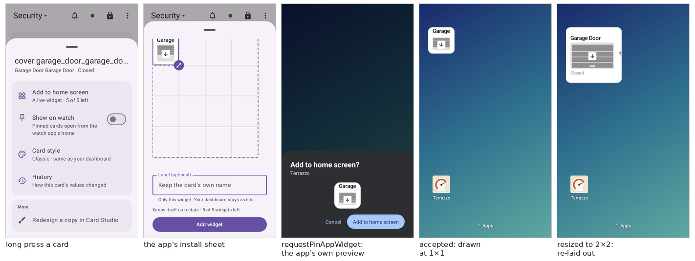

Running the two apps found three faults, fixed with them: the app's install sheet (a Compose
bottom-sheet dialog) stayed drawn and touchable over the home screen once the app stopped, since
only an activity's own window was hidden; the pinned widget stayed on its initial layout until
resized, since the app's explicit broadcast to its own manifest provider never arrived (Robolectric
delivers an app's broadcasts to runtime receivers only); and Cadence's podcast widget, 250×80dp at
the least, got 3×1 cells (232×72dp) and was clipped, since spans rounded to the nearest cell rather
than up to one that holds the minimum.

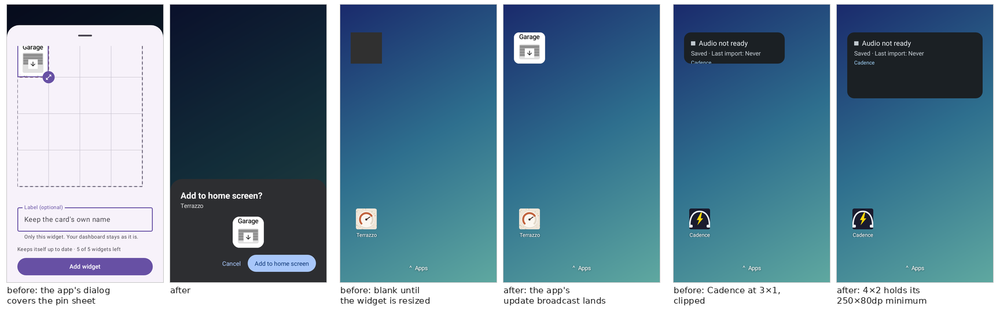

**MeshCore**'s battery widget is a Remote Compose widget enabled only from API 37
(`android:enabled="@bool/widget_enabled"`, true in `values-v37`); Robolectric 4.17 runs up to 36, so
`widgets` lists none for it, as a device on 36 would. Muzei's repository is not available to this
sandbox.

Re-collect: `./gradlew :samples:android:assembleDebug :cli:installDist`, then drive
`cli/build/install/compose-preview/bin/compose-preview launch android-debug.apk --launcher
--control stdio --headless` with `home`, `widget` `add` / `resize`, `tap`, `longPress`, `swipe`,
`picker`, `drawer`, `rotate` and `screenshot`.

**A paired phone and watch** (`launch phone.apk --pair wear.apk`). Two throwaway probe apps, one
button per Wear interaction API (the full table is in
[`../../SIMULATOR_DATALAYER.md`](../../SIMULATOR_DATALAYER.md)): `RemoteActivityHelper` opening a
`VIEW` intent on the other device, each way, and the probes' results.

| Phone → watch | Watch → phone |
| --- | --- |
| 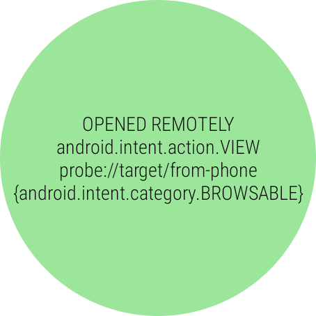 | 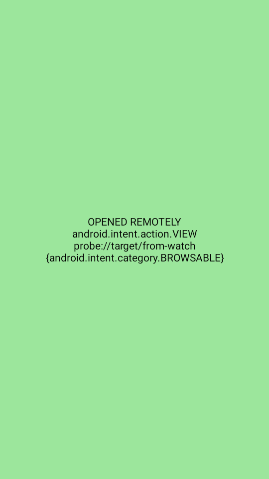 |

| Phone probe | Watch probe |
| --- | --- |
| 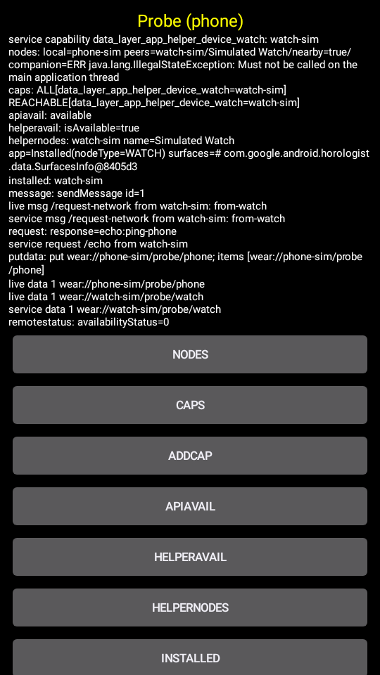 | 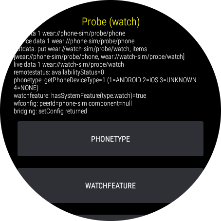 |

Home Assistant's real phone and Wear apps, paired: the watch before, and after the phone's
"Offline demo" tap synced 14 data items to it.

| Watch before | Watch after the phone's demo tap |
| --- | --- |
| 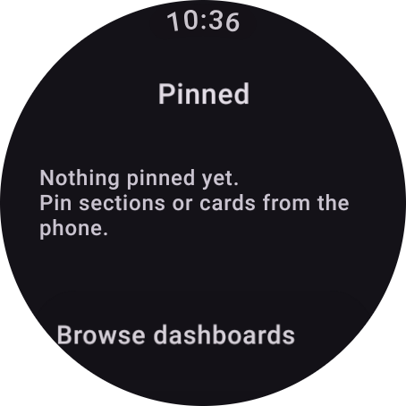 | 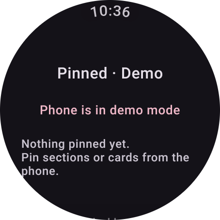 |

MeshCore's Wear app paired with its phone (`--fingerprint` set, `horologist_phone` added on the
phone with `dataLayer addCapability`): before, the watch finds no phone; after, its gRPC
`GetConnectionStatus` request is answered by the phone, whose radio is not connected.

| No `horologist_phone` | Answered by the phone |
| --- | --- |
|  | 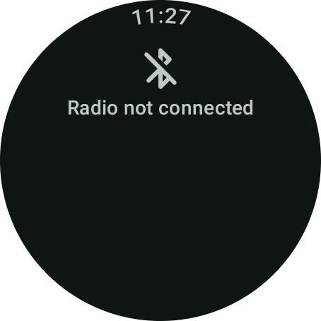 |

**The agent as the peer** (`--data-layer agent`, one simulator): Home Assistant's watch with an
agent-played phone, before and after the agent `put`s the phone's data items; MeshCore's watch
after the agent `reply`s to its gRPC request with an error, then with the bytes MeshCore's phone
answered the same request with.

| HA watch, agent phone connected | After `put` |
| --- | --- |
|  | 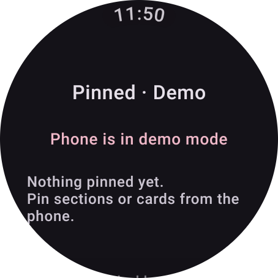 |

| MeshCore watch, error `reply` | The phone's answer `reply`ed |
| --- | --- |
| 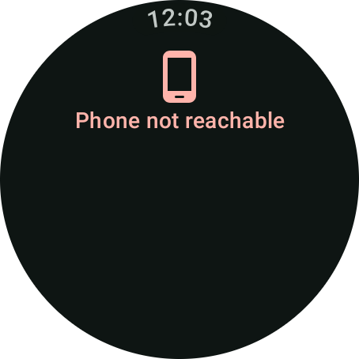 | 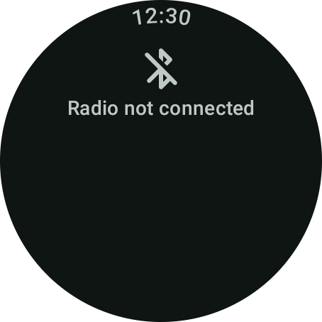 |
