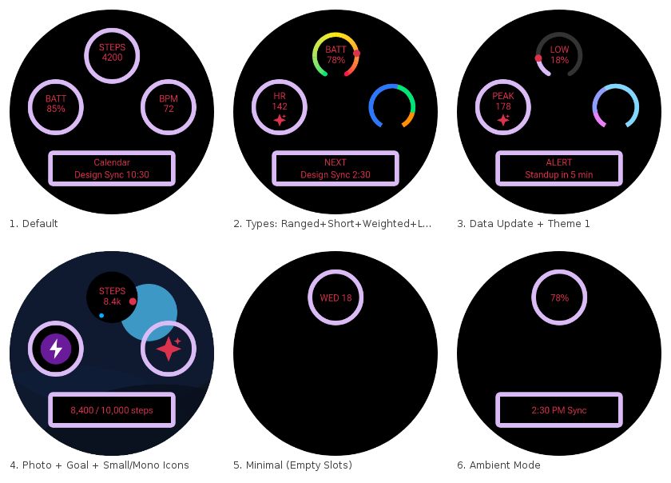
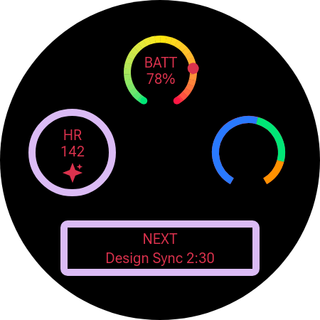
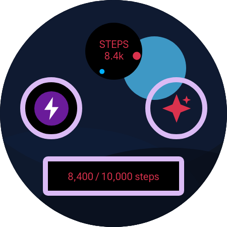
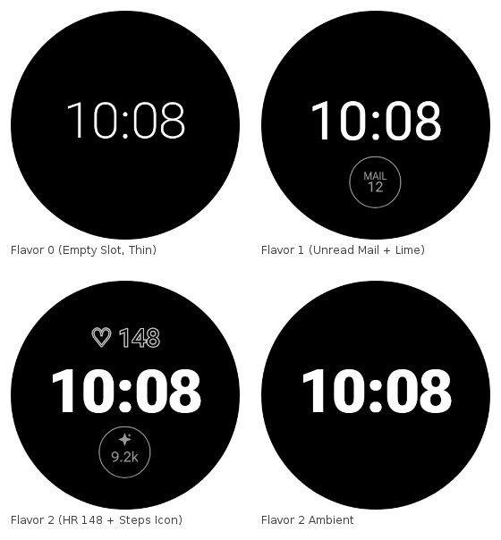

# DWF watch face complication overrides

These renders show complication overrides working on the Declarative Watch Face samples in
[android/wear-os-samples](https://github.com/android/wear-os-samples). They were produced by
`DwfDaemonMain` and driven through `compose-preview-mcp`, using
`render_preview.overrides.complications` / `overrides.watchFace` and
`render_preview_matrix.scenarios`.

## `WatchFaceFormat/Complications` scenario matrix

There are six scenarios. Each one changes the complication type installed in a slot and/or the data it shows: a ranged value with a color ramp, short text with a monochrome icon, weighted elements, long text, a photo background with goal progress, and empty slots in ambient mode.

## Full-size renders

| Showcase (ranged + short text + weighted + long text) | Photo background + goal progress + images |
| --- | --- |
|  |  |

## `WatchFaceFormat/Flavors`

This matrix varies the clock appearance and theme color configurations, the heart rate setting (on or off) and ambient mode.

